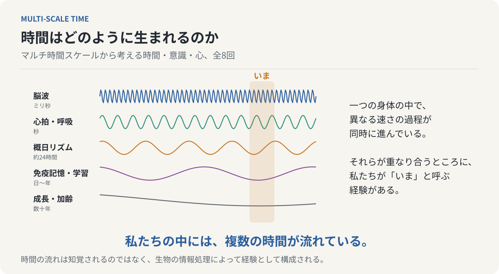

# 時間はどのように生まれるのか

## MULTI-SCALE TIME ── マルチ時間スケールから考える時間・意識・心、全8回



**私たちの中には、複数の時間が流れている。**

時計の針は一定の速さで進む。それにもかかわらず、退屈な30分は長く、友人と過ごす30分は一瞬で終わる。時計が測っているものと、私たちが経験しているものは異なるのではないか。この連載は、その違いを出発点に、時間知覚の限界、脳による世界の再構成、刺激と反応の間の「遅延」、記憶、現在の厚み、身体と環境の相互作用を順にたどり、**異なる時間スケールで進む複数の過程が統合され続けることで一つの「いま」が経験される**という「マルチ時間スケール」の見方へ至る。各回は独立した読み物であり、末尾の一段落が次回へつながる。

[第1回から読む](chapters/01-does-time-flow.md) ／ [最終回を読む](chapters/08-multiple-times-within-us.md) ／ [読み方](guides/READING.md)

## 全8回の目次

| 回 | 文章 | 主題 |
| --- | --- | --- |
| 01 | [時間は、本当に流れているのか？](chapters/01-does-time-flow.md) | 時計が測る時間と、私たちが経験する時間 |
| 02 | [私たちには見えない時間がある](chapters/02-limits-of-time-perception.md) | 瞬間と持続、そして時間知覚の限界 |
| 03 | [脳は現実を見ているのではなく、再構成している](chapters/03-brain-reconstructs-reality.md) | 時間的粗視化、生成モデル、そしてクオリアの成立 |
| 04 | [意識は、反応の「遅延」から生まれたのか？](chapters/04-consciousness-and-delay.md) | 生命が獲得した時間的余白と、心の誕生 |
| 05 | [心は過去でできている](chapters/05-mind-is-made-of-memory.md) | 記憶は保存庫ではなく、現在の世界を構築する仕組みである |
| 06 | [「現在」は、なぜ一瞬ではないのか？](chapters/06-the-thickness-of-now.md) | ベルクソンの持続、フッサールの時間意識、そして未完了の現在 |
| 07 | [脳だけでは、心も時間も生まれない](chapters/07-embodied-time.md) | 身体と世界の相互作用が構築する、もう一つの時間 |
| 08 | [私たちの中には、複数の時間が流れている](chapters/08-multiple-times-within-us.md) | マルチ時間スケールから考える、時間・意識・心の成立 |

## 連載の構成

第I部（1〜3回）は時間を「測る」ことから「経験する」ことへ問いを移す。客観的時間と主観的時間を区別し、時間分解能の限界と時間スケールギャップを導入し、脳が生成モデルで世界を再構成していることを見る。第II部（4〜6回）は心の時間的構造を扱う。刺激と反応の間の時間的余白（意識の遅延テーゼ）、現在を構成する記憶、そして保持と予感を含む厚みのある現在。第III部（7〜8回）は主体を身体と環境へ開き、神経系・内分泌系・免疫系の異なる時間尺度を経て、全体をマルチ時間スケールという一つの枠組みで束ねる。

<!-- SITE-INDEX-END: 以下はリポジトリ利用者向け。HTML閲覧版のトップページには含めない。 -->

## GitHubで読む

このREADMEと各回の `.md` をGitHubの **Preview** で開く。本文中の図は相対リンク先のSVGとして表示される。外部の画像やフォントは参照しない。挿絵は表紙を含めて24点で、各回に2〜4点を本文の該当段落の直後に置いている。すべて編集可能な独立SVGであり、`scripts/draw_figures.py` から決定論的に再生成できる。数式は使っていない。

## ブラウザで読む（GitHub Pages）

`main` ブランチへのpushで `.github/workflows/pages.yml` が `_site/` を生成し、GitHub Pagesへ配置する。有効にするにはリポジトリの Settings → Pages → Build and deployment で Source を **GitHub Actions** にする。手順の詳細は[公開手順](guides/PUBLISHING.md)にある。

ローカルで再生成するにはPython 3.11以降とPandoc 3.xを使う。依存パッケージの追加インストールは不要である。

```sh
python scripts/validate.py
python scripts/build.py
python -m unittest discover -s tests -v
```

`_site/index.html` が目次付きの閲覧ページ、`_site/complete.html` が全8回とSVGを一つにまとめた単独ファイルである。GitHub管理対象はMarkdownとSVGなどの原本であり、`_site/` は生成物として `.gitignore` で除外する。

## 連載の成り立ちと編集

本文は、時間・意識・心についての長い覚え書きを8回の連載として書き直したものである。各回は「冒頭の日常的な場面 → 概念の導入 → 核となる主張 → 前回までの議論との接続 → 次回への橋」という型で書かれ、「瞬間と持続」「時間スケールギャップ」「意識の遅延テーゼ」「未完了相としての現在」「マルチ時間スケール」という概念が回をまたいで反復し、最終回で統合される。設計の意図と各回の核となる主張は[連載構成案](guides/SERIES-DESIGN.md)に残してある。

[編集ガイド](guides/EDITING.md)に原本と生成物の責務をまとめた。[読み方](guides/READING.md)に表示環境の注意をまとめた。

## 出典へ戻る

[参考文献と確認範囲](references/bibliography.md)から各回の脚注の出典を参照できる。本文の脚注はその理論や研究の参照先であり、原文の引用ではない。確認範囲は資料ごとに明記し、全文未確認のものを確認済みとは表示していない。

本連載の主張のうち、感覚ごとの時間分解能、予測処理、内受容感覚、腸脳相関、自由エネルギー原理、概日リズムの分子機構については研究の裏づけがある。「意識の遅延テーゼ」「凝縮説」「拡張記憶」「多重時計原理」「未完了相としての現在」といった名称と、それらを一つに束ねるマルチ時間スケールの見方は、本連載が置いた整理と仮説である。

## ライセンス

本文と挿絵（`chapters/`、`assets/illustrations/`、表紙を含む）は [クリエイティブ・コモンズ 表示 4.0 国際（CC BY 4.0）](https://creativecommons.org/licenses/by/4.0/deed.ja) の下で提供する。出典として「yamaguchiyoshito『時間はどのように生まれるのか ── MULTI-SCALE TIME』」と、このリポジトリまたは公開ページのURLを示せば、複製・再配布・翻案・商用利用ができる。条文の全文は [LICENSE](LICENSE) にある。ビルド用のスクリプトと設定ファイルも同じライセンスの下で提供する。

各回末尾の脚注で参照する文献は、それぞれの著作権者に帰属する。
