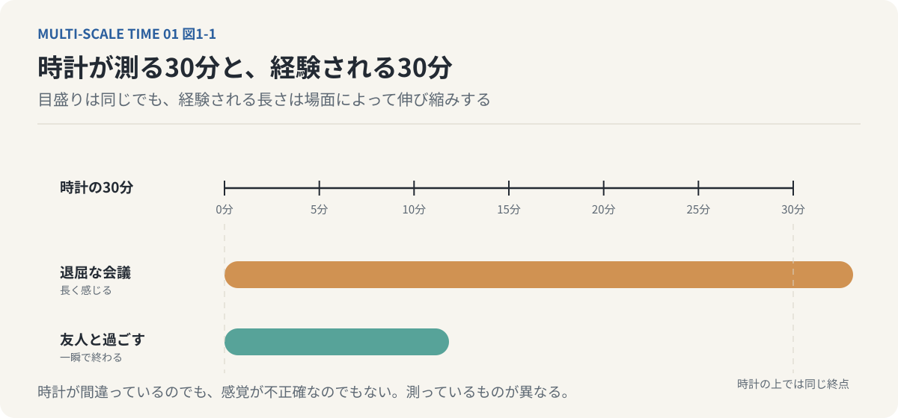
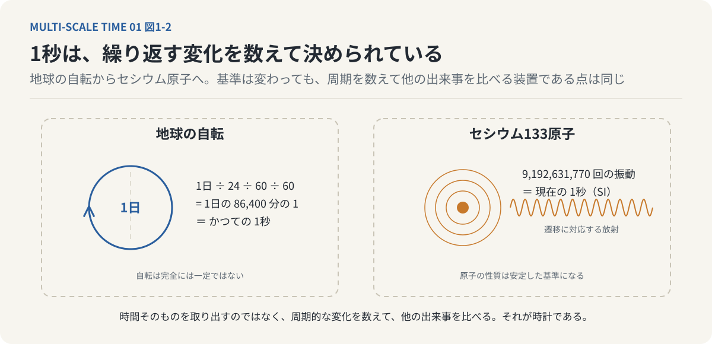
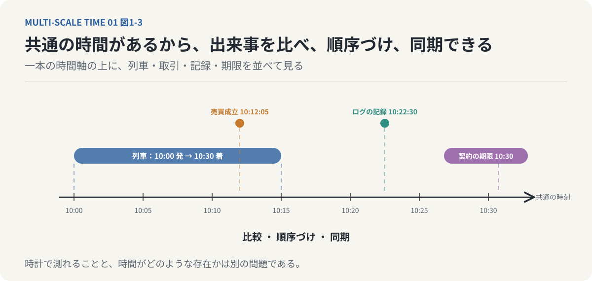
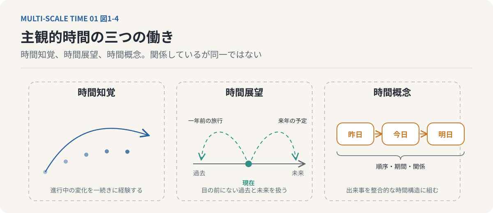
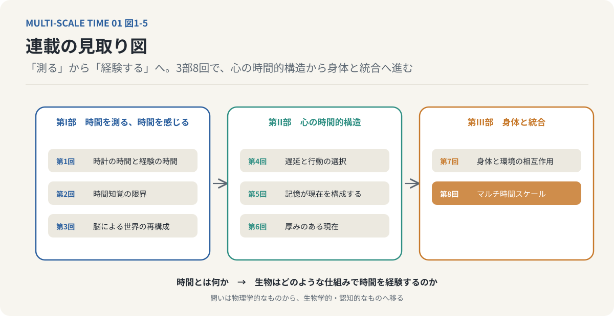

# 第1回　時間は、本当に流れているのか？

## 時計が測る時間と、私たちが経験する時間

<!-- NAV:TOP -->
[連載目次](../README.md) | [第2回 →](02-limits-of-time-perception.md)
<!-- /NAV -->

### 1. 時間について、ずっと気になっていることがある

時間のことが気になり始めて、もう10年ほどになる。

何が気になっているのかと問われると、実はうまく答えられない。

時間は本当に存在するのか。時間は一方向にしか進まないのか。楽しい時間があっという間に過ぎるのはなぜか。過去を思い出しているとき、私たちはどの時間を生きているのか。

こうした疑問は、どれも「時間」に関するものだ。しかし、同じ時間について考えているようで、実際には異なる問題を扱っている。

物理学が扱う時間と、私たちが日常的に経験する時間は、必ずしも同じものではない。

時計の針は一定の速さで進む。それにもかかわらず、退屈な会議の30分は長く感じられ、友人と過ごす30分は一瞬で終わる。

時計が間違っているわけではない。人間の感覚が単に不正確だという話でもない。

そもそも、時計が測っているものと、人間が経験しているものは異なるのではないか。

この違いを考えることが、今回の連載の出発点である。

*図1-1：上の時計は30分を同じ長さの目盛りで刻む。下の二本の帯は同じ30分の経験で、退屈な会議では引き延ばされ、友人と過ごす時間では縮む。時計が間違っているのではなく、測っているものが異なる。*

### 2. 「1秒」はどのように決められたのか

私たちは時間を数字で表すことに慣れている。

1秒、1分、1時間、1日。

しかし、これらの単位は自然界のどこかに刻まれているわけではない。人間が自然現象を基準として定義したものである。

かつて、1秒は1日の86,400分の1として定義されていた。

1日を24時間に分け、1時間を60分に分け、1分を60秒に分ける。つまり、地球の自転に由来する周期的な現象を基準として時間を計測していたのである。

ところが、地球の自転は完全には一定ではない。

精密な科学技術や社会システムを運用するには、より安定した基準が必要となった。

そこで、原子の性質を利用した時間の定義が導入された。

現在、国際単位系（SI）における1秒は、セシウム133原子の特定のエネルギー準位間の遷移に対応する放射の周波数を、9,192,631,770Hzと定めることで定義されている。[^bipm-si]

重要なのは、この数字自体ではない。

**私たちは時間そのものを直接取り出して測っているのではなく、ある物理現象の周期を基準に、別の現象の変化を測定している**という点である。

時計とは、一定の規則で繰り返される物理的変化を利用し、他の出来事を比較するための装置なのである。

*図1-2：1秒の決め方。かつては地球の自転（1日）を86,400等分し、現在はセシウム133原子の遷移周波数を9,192,631,770Hzと定めて得る。どちらも時間そのものを取り出すのではなく、繰り返す物理変化を数えて他の出来事を比べる装置である。*

### 3. なぜ社会には共通の時間が必要なのか

客観的な時間の定義は、社会にとって極めて重要である。

鉄道を例に考えてみよう。

ある列車が10時00分に発車し、10時30分に到着する。この情報が成立するためには、駅、列車、運行管理システム、乗客が共通の時間尺度を利用している必要がある。

株式市場でも同じである。

売買の成立時刻を正確に記録できなければ、取引の順序を確定できない。

契約の有効期限、システムのログ、歴史的な出来事の記録も同様である。

共通の時間があるからこそ、異なる場所で発生する出来事を同じ尺度で比較し、順序づけ、同期できる。

つまり、客観的時間には、社会における調整と同期のための基盤という役割がある。

*図1-3：共通の時間軸があるから、鉄道の運行、市場の取引、契約の期限、記録の時刻を同じ尺度で比べ、順序づけ、同期できる。客観的時間の役割は、社会の調整と同期の基盤にある。*

ただし、ここで一つ区別しておきたい。

時計によって時間を測定できることと、時間そのものがどのような存在なのかということは、別の問題である。

1秒を極めて精密に定義できたとしても、それだけでは「時間が流れるとはどういうことか」という問いには答えられない。

時間を正確に測る能力が向上しても、時間を経験する仕組みが明らかになるわけではないのである。

### 4. 私たちは、時計とは異なる時間を生きている

ここで、時計から少し離れてみよう。

好きな映画を見ているとき、2時間が驚くほど短く感じられることがある。

一方、病院の待合室で順番を待つ20分は、なかなか終わらない。

どちらの場合も、時計が刻む秒の長さは変わらない。

変わっているのは、私たちの時間経験である。

こうした個人が経験する時間を「主観的時間」と呼ぶ。

主観的時間は、感情、注意、記憶、期待などの影響を受ける。

ここで注意したいのは、主観的時間を客観的時間の不正確なコピーとして扱わないことである。

時計が測る時間と、私たちが経験する時間は、そもそも異なる機能を持っている。

時計は出来事の間隔を共通の尺度で表す。

それに対して、人間の時間経験は、出来事の変化を捉え、意味を与え、行動につなげることに関係している。

たとえば、迫ってくる自動車を見たとき、私たちに必要なのは現在時刻を正確に知ることではない。

自動車がどのくらいの速さで接近しているのか、自分に衝突する可能性があるのか、いつ行動すればよいのかを判断することである。

ここで扱われている時間は、時計の時刻ではなく、出来事の変化と行動の可能性に結びついた時間である。

**生物にとって時間とは、単なる計測対象ではなく、環境の変化に適応するための条件でもある。**

### 5. 主観的時間には、異なる三つの働きがある

主観的時間をもう少し丁寧に分けると、少なくとも三つの側面を区別できる。

第一は「時間知覚」である。

鳥が飛んでいく様子を眺める。音楽が流れているのを聴く。目の前の人が手を振る。

こうした現在進行中の変化を、一続きの出来事として経験する働きである。

ここで興味深いのは、私たちは一つひとつの静止した瞬間を見ているわけではないということである。

飛ぶ鳥を、独立した位置の集合として経験しているわけではない。私たちは「鳥が飛んでいる」という連続した運動を見ている。

第二は「時間展望」である。

昨日の出来事を思い返したり、来年の予定を考えたりする働きである。

目の前に存在しない過去や未来を、私たちは意識の中で扱うことができる。

一年前の旅行を思い出すとき、その旅行は現在の感覚入力として存在するわけではない。

それでも、当時の風景や感情を再び経験することができる。

未来についても同様である。

まだ存在しない出来事を想像し、それに向けて現在の行動を変えることができる。

第三は「時間概念」である。

出来事の順序や期間、相互の関係を理解する働きである。

昨日、今日、明日という区別。ある出来事が別の出来事より先に起きたという判断。複数の出来事を一つの歴史として整理する能力。

こうした働きによって、私たちは個々の経験を整合的な時間の構造へと組み立てる。

*図1-4：主観的時間の三つの働き。左は現在進行中の変化を一続きに経験する時間知覚、中央は目の前にない過去と未来を扱う時間展望、右は出来事の順序と期間を整える時間概念。三つは関係しているが同一ではない。*

この三つは互いに関係しているが、同一ではない。

特に重要なのは、現在進行中の変化を捉える時間知覚と、過去や未来を扱う時間展望の違いである。

この違いが、後に意識と記憶の関係を考えるための重要な手掛かりとなる。

### 6. 「現在」とは、どれくらいの長さなのか

ここまで考えると、新しい疑問が生まれる。

私たちが経験する「現在」とは、どれくらいの長さなのだろうか。

時計の上では、時間をいくらでも細かく分割できる。

1秒を1,000分割すれば1ミリ秒。さらに分割すればマイクロ秒、ナノ秒となる。

しかし、人間の感覚がそのすべてを区別できるわけではない。

蛍光灯の光は高速に変動しているが、私たちには連続して点灯しているように見える。

逆に、夜空の星は地球の自転によって見かけ上移動しているが、短時間眺めていても動いているとは感じにくい。

速すぎる変化も、遅すぎる変化も、私たちはその流れを直接経験できない。

つまり、人間が時間的変化として捉えられる範囲には限界がある。

そして、その限界は感覚器官や生物種によって異なる。

ここから、今回の連載における重要な仮説が導かれる。

**ある現象が「一瞬の出来事」なのか、それとも「時間の中で変化する出来事」なのかは、それを経験する個体の時間スケールに依存する。**[^hirai-2022]

これは単に、動体視力が優れているかどうかという話ではない。

同じ物理的な世界に存在していても、異なる時間スケールで世界を捉える生物は、異なる変化の流れを経験し得るということである。

客観的に同じ時間が経過していても、その時間に何が生じていると経験されるかは同じではない。

### 7. 時間を「測る」ことから「経験する」ことへ

ここまでの議論を整理しよう。

客観的時間は、物理現象を共通の尺度で比較するために必要である。

しかし、私たちが日常的に経験している時間は、それだけでは説明できない。

人間は外界の変化を無制限に知覚できるわけではない。特定の時間スケールの中で変化を捉え、記憶し、予測し、行動している。

ここで時間の問いは、物理学的な問いから、生物学的・認知的な問いへと移り始める。

「時間とは何か」と問うだけではなく、「生物はどのような仕組みで時間を経験するのか」と問う必要がある。[^bergson-essai]

その先には、さらに大きな問題が待っている。

時間の経験が生物の構造に依存するのだとすれば、意識はどのように時間の流れを作り出しているのか。

そして、過去の記憶を持たない生物は、そもそも時間の流れを経験できるのだろうか。

この連載では、こうした問いを一つずつ考えていく。

*図1-5：連載の見取り図。第I部（1〜3回）は時計の時間と経験の時間を分け、知覚の限界と脳の再構成を見る。第II部（4〜6回）は刺激と反応の間の余白、記憶、現在の厚みという心の時間的構造を扱う。第III部（7〜8回）は身体と環境へ主体を開き、最終回で複数の時間スケールの統合として時間経験を捉え直す。*

次回は、まず時間知覚の限界を取り上げる。

私たちには見えないほど速い時間がある。

同時に、私たちには見えないほど遅い時間もある。

では、その二つの間にある「私たちが経験できる時間」とは、どのようなものなのだろうか。

---

**次回｜第2回「私たちには見えない時間がある」**

瞬間、持続、時間分解能、時間スケールギャップを手掛かりに、私たちが経験する時間の境界を考える。

## 参考文献・注記

[^bipm-si]: 国際度量衡局（BIPM）（2019）. [The International System of Units (SI), 9th edition](https://www.bipm.org/en/publications/si-brochure)。秒の現行定義。かつての「1日の86,400分の1」から原子時への移行の経緯も同文書と関連資料にある。
[^bergson-essai]: アンリ・ベルクソン（1889）. [Essai sur les données immédiates de la conscience（『時間と自由』）](https://plato.stanford.edu/entries/bergson/)。時計で分割できる均質な時間と、内的に経験される持続を区別した。本連載の客観的時間と主観的時間の区別は、この区別を認知科学の言葉で言い換えたものである。リンク先はスタンフォード哲学百科事典の項目。
[^hirai-2022]: 平井靖史（2022）. [世界は時間でできている ── ベルクソン時間哲学入門](https://www.seidosha.co.jp/book/index.php?id=3708)。青土社。ベルクソンの時間哲学を「マルチ時間スケール（MTS）解釈」として再構成した入門書。本連載の骨格 ── 複数の時間スケールの積層、階層0〜3、時間的粗視化（凝縮）、幅のある現在、未完了相、意識の遅延テーゼ ── はこの本に由来する。

<!-- NAV:BOTTOM -->
---

[連載目次](../README.md) | [第2回 →](02-limits-of-time-perception.md)
<!-- /NAV -->
