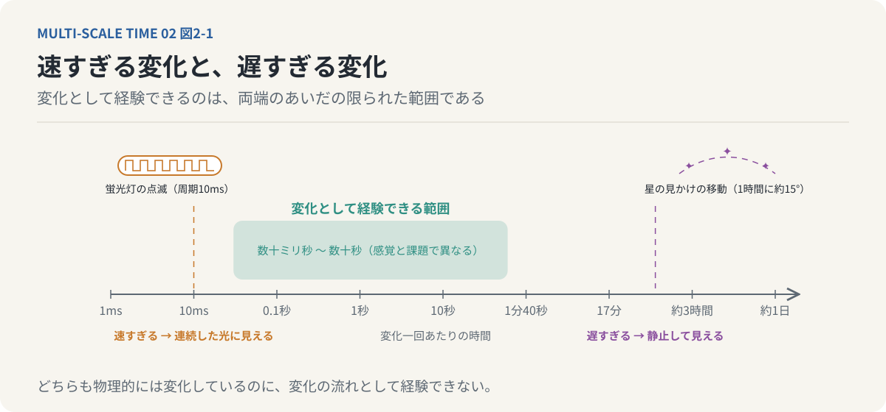
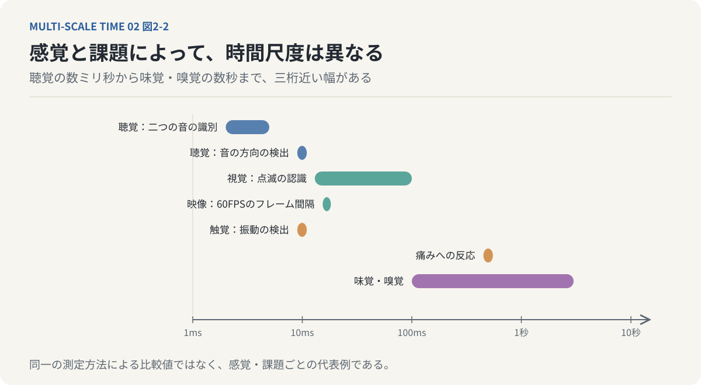
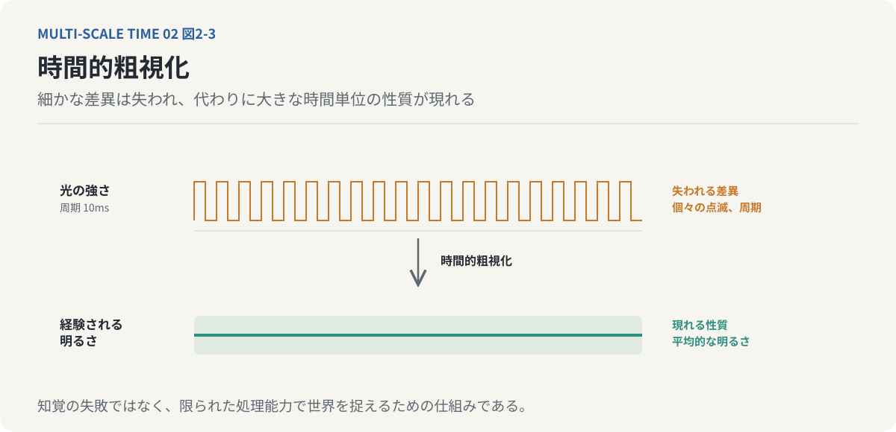
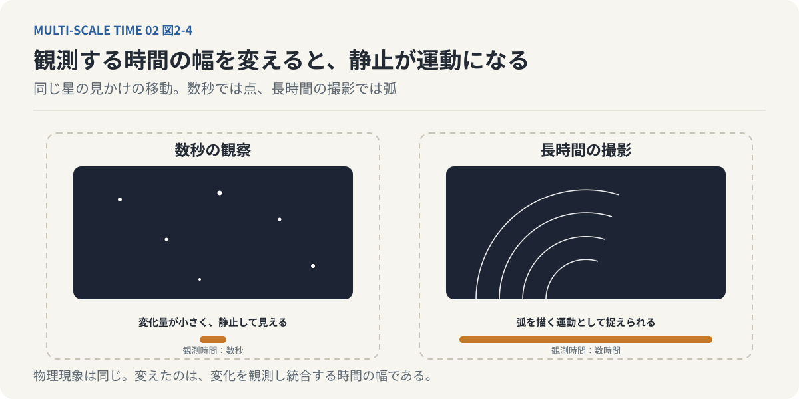
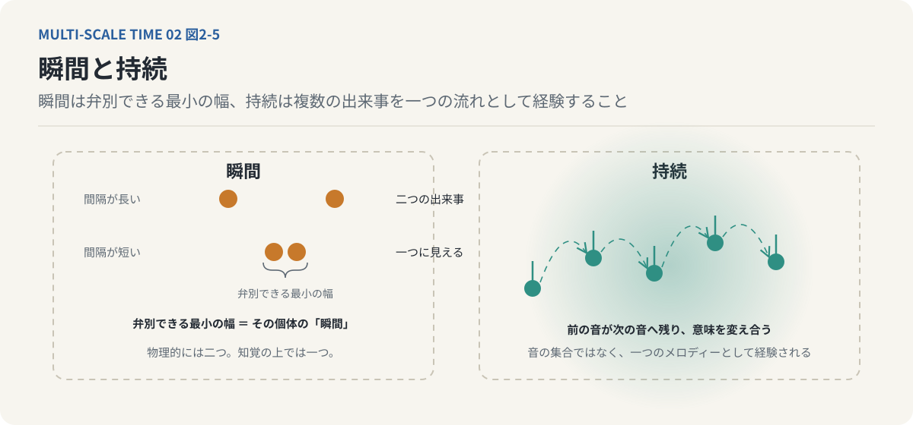
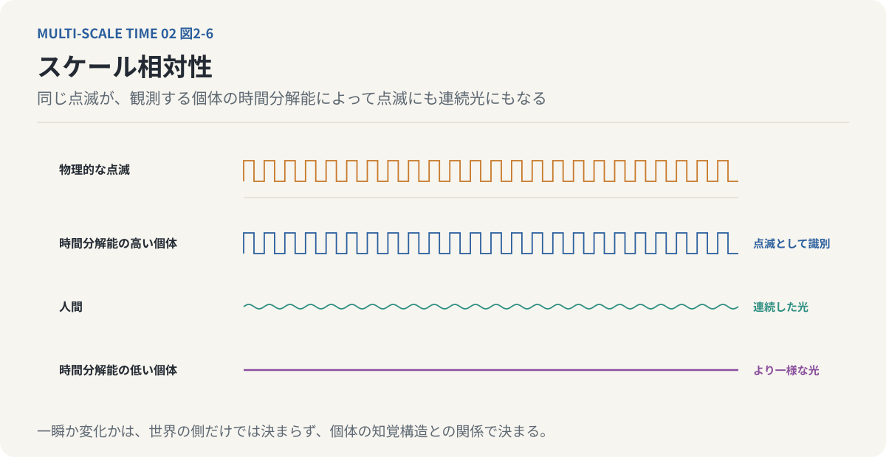

# 第2回　私たちには見えない時間がある

## 瞬間と持続、そして時間知覚の限界

<!-- NAV:TOP -->
[← 第1回](01-does-time-flow.md) | [連載目次](../README.md) | [第3回 →](03-brain-reconstructs-reality.md)
<!-- /NAV -->

### 1. 私たちは、世界の変化をすべて見ているわけではない

蛍光灯の光は、私たちには連続して点灯しているように見える。

しかし、電源の方式によっては、実際には1秒間に100回、あるいは120回の明るさの変動が起きている。

一方、夜空を見上げても、星が動いているようには感じられない。

地球は自転しており、星の見かけの位置は刻々と変化している。それでも、数秒間眺めているだけでは、その動きをほとんど認識できない。

一方は速すぎて見えず、もう一方は遅すぎて見えない。

この二つの現象は、正反対のように思える。

しかし、私たちの時間知覚という観点から考えると、共通した特徴を持っている。

**どちらも、物理的には変化しているのに、その変化を時間的な流れとして経験できないのである。**

私たちは外界の変化をそのまま知覚しているわけではない。

ある範囲の速さで進行する変化だけを、連続した出来事として経験している。

では、その範囲は何によって決まるのだろうか。

今回は、この問題を「瞬間」と「持続」という二つの概念から考えてみたい。

*図2-1：変化の速さを対数の横軸に並べた。左の蛍光灯の点滅は速すぎて一定の光として、右の星の見かけの移動は遅すぎて静止として経験される。中央の帯だけが、私たちに「変化」として見える範囲である。*

### 2. 「瞬間」は、長さのない点なのか

日常会話では、「一瞬」という言葉をよく使う。

一瞬だけ光が見えた。一瞬で判断した。一瞬の出来事だった。

しかし、この「一瞬」とは、どのくらいの時間なのだろうか。

数学的には、瞬間を長さのない時間上の一点として扱うことができる。

時刻を実数で表せば、ある時刻とその次の時刻の間に、いくらでも細かな時刻を設定できる。

ところが、私たちの知覚は数学的な時間軸とは異なる。

どれほど短い時間間隔でも区別できるわけではないからである。

たとえば、二つの光が非常に短い間隔で点滅したとする。

間隔が十分に長ければ、私たちは二度の点滅を別々の出来事として認識できる。

しかし、間隔が短くなるにつれて、二つの点滅は区別しにくくなる。

最終的には、一度の発光、あるいは連続した光として知覚される。

物理的には二つの出来事が存在している。それにもかかわらず、知覚の上では一つの出来事になる。

この違いを考えるために、ここでは「瞬間」を次のように定義する。

**瞬間とは、一個体が内在的に弁別できる最小の時間幅である。**

これは物理学における時間の一点とは異なる、知覚を考えるための操作的な定義である。

また、すべての感覚に共通する絶対的な最小単位を意味するものでもない。

何を識別するのか、どの感覚器官を使うのか、どのような条件で観察するのかによって、その幅は異なる。

重要なのは、私たちにとっての「瞬間」が、外界の物理的な時間だけでは決まらないということである。

瞬間は、それを経験する個体の知覚能力によっても規定される。

### 3. 時間分解能という制約

この能力を考える上で重要なのが、「時間分解能」である。

時間分解能とは、時間的に近接した出来事や変化を、どれだけ細かく識別できるかという能力である。

たとえば、映像について考えてみよう。

映画やゲームの映像は、静止画を一定の間隔で切り替えることによって動きを表現している。

60FPSの映像では、1秒間に60枚の画像が表示される。

画像1枚あたりの時間間隔は約16.7ミリ秒である。

それでも、私たちは60枚の独立した静止画を順番に見ているというより、連続した動きを経験する。

ただし、16.7ミリ秒が人間の視覚の分解能そのものであるわけではない。

光の点滅を識別する能力、出来事の順序を識別する能力、運動を滑らかに感じる能力は、それぞれ異なる。

感覚器官ごとの代表的な時間尺度を整理すると、次のようになる。[^poppel-1997]

| 感覚・課題 | 時間尺度の例 |
|---|---|
| 聴覚：二つの音の識別 | 約2～5ms |
| 聴覚：音の方向の検出 | 約10ms |
| 視覚：点滅の認識 | 約13～100ms |
| 映像：60FPSのフレーム間隔 | 約16.7ms |
| 触覚：振動の検出 | 約10ms |
| 痛みへの反応 | 約500ms |
| 味覚・嗅覚 | 約100ms～数秒 |

これらは同一の測定方法による比較値ではない。感覚の種類や課題によって時間尺度が異なることを示すための例である。

*図2-2：表の値を対数の時間軸に並べたもの。聴覚の数ミリ秒から味覚・嗅覚の数秒まで、感覚と課題によって時間尺度は三桁近く異なる。帯は代表値の範囲であり、同一の測定方法による比較値ではない。*

ここからわかることがある。

私たちには、すべての感覚を統一的に処理する単一の時間分解能があるわけではない。

耳は耳の時間尺度で音を処理し、目は目の時間尺度で光を処理している。

触覚も、味覚も、嗅覚も同様である。

つまり、私たちが一つの「現在」として経験しているものは、異なる時間尺度で処理された情報の組み合わせなのである。

このことは、後に意識の仕組みを考える上で重要になる。

### 4. 速すぎる変化は、連続したものになる

もう一度、蛍光灯の例に戻ろう。

電源に由来する明るさの変動が1秒間に100回起こる場合、その周期は10ミリ秒である。

もし知覚系がこの変動を十分に識別できなければ、点滅は連続した光として経験される。

ここには、興味深い変換が起こっている。

物理的な世界では、光の強さが周期的に変化している。

しかし、知覚される世界では、その変化が失われ、一定の明るさを持つ光として認識される。

私たちは、変化しているものを、変化していないものとして経験するのである。

このように、細かな時間的差異を区別せず、大きな単位にまとめて扱うことを「時間的粗視化」と呼ぶ。

粗視化は、単なる知覚の失敗と考える必要はない。

もし外界のあらゆる微小な変化を、その都度独立した情報として処理しなければならないとしたら、神経系には膨大な処理負荷がかかる。

生物にとって必要なのは、世界のすべての変化を完全に記録することではない。

生存や行動に必要な違いを識別することである。

その意味で、時間的粗視化は、限られた処理能力の中で世界を捉えるための重要な仕組みと考えられる。

ただし、ここで一つ疑問が生まれる。

細かな変化が失われるなら、私たちの経験は単に情報量が減ったものになるのだろうか。

必ずしもそうではない。

個々の変化が区別できなくても、それらがまとまることで、連続した明るさや滑らかな運動といった別の特徴が経験される。

識別できなくなった微細な差異の代わりに、より大きな時間単位での性質が現れるのである。

*図2-3：時間的粗視化。上は周期10ミリ秒で変動する光の強さ。知覚がこれを識別できないと、下のように一定の明るさとして経験される。細かな差異は失われるが、代わりに「平均的な明るさ」という大きな時間単位の性質が現れる。*

この問題は、次回取り上げる主観的な感覚の質、すなわちクオリアの議論にもつながっていく。

### 5. 遅すぎる変化も、私たちには見えない

時間知覚の制約は、高速な変化だけに存在するわけではない。

遅い変化についても、同じことが起こる。

夜空の星を考えてみよう。

地球の自転によって、星の見かけの位置は時間とともに変化する。

しかし、ほんの数秒間、夜空を眺めたとしても、星が動いているとは感じにくい。

変化が小さすぎるからである。

ところが、カメラを使って長時間撮影すると、星の軌跡を記録できる。

一定間隔で撮影した画像をつなげれば、星が空を移動する様子を映像として確認することもできる。

物理現象そのものが変わったわけではない。

変えたのは、変化を観測し、統合する時間の幅である。

短時間の観測では静止して見えたものが、観測時間を延ばすことで運動として捉えられるようになる。

*図2-4：同じ星の見かけの移動。数秒の観察（左）では変化量が小さく静止して見えるが、観測し統合する時間の幅を延ばす（右）と、弧を描く運動として捉えられる。物理現象は同じで、変えたのは観測の時間幅である。*

高速な変化と低速な変化では、知覚できない理由が同じとは限らない。

高速な変化では、個別の出来事を時間的に分離できない。

低速な変化では、一定の観察時間内に生じる変化量が小さく、運動として識別できない。

それでも、両者には重要な共通点がある。

**私たちは、外界の変化を無制限に経験できるわけではない。変化を捉えられる時間尺度には範囲がある。**

その範囲を外れた現象は、物理的には進行していても、私たちの直接的な時間経験からは抜け落ちる。

### 6. 瞬間の連続は、なぜ「持続」になるのか

ここまで、時間的な出来事をどれだけ細かく識別できるかについて考えてきた。

しかし、私たちの時間経験は、単に瞬間を区別することだけでは説明できない。

鳥が飛ぶ様子を眺めているとき、私たちは鳥の位置を一枚ずつ記録しているわけではない。

鳥が空間の中を移動していく、その変化全体を経験している。

音楽を聴いているときも同様である。

一つの音が鳴り、次の音が鳴る。

それぞれの音は異なる時刻に発生している。しかし、私たちは音を完全に独立した出来事として経験していない。

前の音が残り、次の音へとつながり、メロディーが生まれる。

このような連続した時間経験を考えるために、「持続」という概念を導入する。

**持続とは、一個体が内在的に連続した変化として経験する時間の幅である。**

瞬間が、識別可能な最小の時間幅を表すのに対して、持続は複数の出来事を一つの流れとして統合する経験である。

ここで重要なのは、持続が単なる瞬間の足し算ではないということである。

たとえば、一曲の音楽を構成するすべての音符を、一つずつ独立したデータとして記録したとする。

音の高さ、長さ、強さをすべて記録すれば、演奏を再現するための情報は得られるだろう。

しかし、それだけでは、その音楽を聴いているときの経験そのものを説明できない。

私たちは、それぞれの音を前後の音との関係の中で聴いている。

前の音が次の音の意味を変え、次の音が前の音の意味を変える。

音楽の流れとは、個々の音が相互に結びついて形成される経験なのである。

*図2-5：左は「瞬間」。二つの点滅が区別できる最小の間隔が、その個体にとっての瞬間の幅になる。右は「持続」。独立した音符の列ではなく、前の音が次の音へ残り、互いの意味を変えながら一つのメロディーとして経験される。*

このような持続の捉え方は、哲学者アンリ・ベルクソンの時間哲学と深く関係している。[^bergson-essai]

ベルクソンは、時計で分割できる均質な時間と、私たちが内面的に経験する持続を区別した。

時計の時間では、1秒と次の1秒は同じ長さの単位として扱われる。

しかし、持続においては、ある瞬間がそれ以前の経験を含み、次の瞬間へと質的に変化していく。

私たちが経験しているのは、切り離された瞬間の集合ではなく、過去が現在に浸透し続ける流れなのである。

### 7. 生物によって、世界の流れる速さは異なるのか

ここで、時間分解能と持続を一緒に考えてみよう。

ある生物は、人間よりも短い時間間隔で起こる変化を識別できるとする。

その生物にとっては、人間が一つの出来事として捉える変化の中にも、複数の出来事が存在することになる。

反対に、時間的な変化を人間ほど細かく識別できない生物にとっては、人間が区別する出来事が一つにまとまる可能性がある。

これは、異なる生物が同じ世界に存在していても、異なる時間的な構造を経験し得ることを意味する。

ただし、時間分解能が高い生物にとって、必ず時間全体が遅く感じられるとは限らない。

出来事を細かく識別できることと、主観的に時間が長く感じられることは、異なる問題だからである。

それでも、一つの重要な結論は導ける。

ある現象が「一瞬」なのか「時間的な変化」なのかは、観測する個体に依存する。

人間には連続した光に見える現象が、別の生物には点滅として識別されることがある。

人間には静止して見える現象が、異なる時間尺度では変化として捉えられることもある。

つまり、時間経験は世界の側だけで決まるのではない。

世界と、それを経験する個体の知覚構造との関係によって成立する。

これを、時間経験の「スケール相対性」と呼ぶことにしよう。

*図2-6：スケール相対性。同じ物理的な点滅（上）が、時間分解能の高い個体には個々の点滅として、人間には連続した光として、分解能の低い個体にはより一様な光として経験される。瞬間か変化かは、観測する個体の時間スケールに依存する。*

### 8. 時間スケールギャップという問題

ここまでの議論から、もう一つ重要な概念を導入できる。

「時間スケールギャップ」である。

時間スケールギャップとは、異なる現象や処理が、著しく異なる時間尺度で進行する状態を指す。

たとえば、光そのものの振動は極めて高速である。

可視光の周波数は数百兆Hzに達する。

それに対して、人間の視覚が識別できる明るさの変化は、課題や条件に応じて数十Hzから、それ以上の範囲にある。

この二つの間には、非常に大きな時間尺度の隔たりが存在する。

ここで考えるべきなのは、これほど異なる速度で進行する物理現象と神経処理が、どのように結びついているのかという問題である。

光の電磁波としての振動を、私たちは一周期ごとに認識しているわけではない。

視覚系は光の波長や強度などを、感覚器官が扱える信号へと変換している。

その結果、私たちは色や明るさを経験する。

ここでは、物理的な世界の時間尺度が、そのまま主観的な経験の時間尺度へ移されているわけではない。

異なる尺度の間で情報の変換が起こっている。

そして、この変換によって、元の物理現象をそのまま再現するのではない、新しい認識の形式が生まれる。

時間スケールギャップとは、単に処理速度の違いを表す言葉ではない。

**異なる時間尺度で成立する現象の間で、どのように情報が変換され、新しい性質が現れるのかという問題なのである。**

この問題は、視覚だけに限られない。

神経細胞の電気的な活動、身体の運動、記憶の形成、意識的な判断は、それぞれ異なる時間尺度で進行している。

それにもかかわらず、私たちはそれらを一つの経験として生きている。

ここに、意識と時間の関係を考えるための重要な手掛かりがある。

### 9. 私たちが経験しているのは、世界のすべてではない

ここまでの議論を振り返ると、私たちが経験している世界について、一つの見方が得られる。

私たちは、外界で起こるあらゆる変化を認識しているわけではない。

感覚器官と神経系には、識別できる時間尺度の限界がある。

そのため、ある変化は細かすぎて失われ、別の変化は遅すぎて捉えられない。

それでも、私たちの経験は断片的なものにはならない。

むしろ、私たちは一つの連続した世界を経験している。

鳥は滑らかに飛び、音楽はメロディーとして流れ、目の前の人は一人の人物として存在し続ける。

ここには、二つの異なる働きがある。

一つは、知覚できない細かな違いをまとめる働きである。

もう一つは、別々の時点で受け取った情報を、一つの連続した経験へ統合する働きである。

前者は時間的粗視化として考えられる。

後者は持続という概念によって考えられる。

どちらも、物理的な変化をそのまま受け取るだけでは、私たちの時間経験を説明できないことを示している。

**私たちが経験する時間は、外界の変化と、個体の情報処理の仕組みとの相互作用によって成立している。**

これは、時間が物理的に存在しないという主張ではない。

客観的な時間の計測と、時間を経験する仕組みを区別する必要があるということである。

### 10. 見えない時間から、経験される世界へ

今回の議論では、時間知覚に下限と上限があることを考えた。

瞬間とは、個体が識別できる最小の時間幅である。

持続とは、複数の変化を一つの流れとして経験することである。

そして、異なる時間尺度の間には、時間スケールギャップが存在する。

これらの概念から見えてくるのは、私たちの経験が、物理的な世界の単純な写しではないという事実である。

世界には、私たちが直接知覚できないほど速い変化がある。

同時に、直接知覚できないほど遅い変化もある。

それでも、私たちはそこに安定した色や形、滑らかな運動、連続した出来事を経験する。

では、知覚できない情報が失われる一方で、なぜ私たちの経験には豊かな質が存在するのだろうか。

赤いバラを見たとき、私たちは単に特定の波長の光を処理しているだけではない。

そこには「赤く見える」という主観的な経験がある。

この感覚の質は、物理的な光の情報とどのように関係しているのだろうか。

次回は、ここから一歩進んで考えてみたい。

脳は現実を受動的に受け取るだけではない。

過去の経験を使って世界を予測し、不足する情報を補いながら、現在の知覚を作り出している。

その仕組みを考えることで、時間的粗視化から主観的な体験の成立へと議論を進める。

---

**次回｜第3回「脳は現実を見ているのではなく、再構成している」**

生成モデル、予測誤差、クオリアを手掛かりに、限られた感覚入力から豊かな主観的経験がどのように生まれるのかを考える。

## 参考文献・注記

[^poppel-1997]: Ernst Pöppel（1997）. [A hierarchical model of temporal perception](https://doi.org/10.1016/S1364-6613(97)01008-5)。Trends in Cognitive Sciences 1(2)。数十ミリ秒の統合単位と約3秒の時間窓という階層的な時間知覚モデル。表の個々の値は感覚ごとの代表例であり、この論文の数値をそのまま引いたものではない。
[^bergson-essai]: アンリ・ベルクソン（1889）. [Essai sur les données immédiates de la conscience（『時間と自由』）](https://plato.stanford.edu/entries/bergson/)。均質な時計の時間と、過去が現在に浸透し質的に変化する持続の区別。リンク先はスタンフォード哲学百科事典の項目。

<!-- NAV:BOTTOM -->
---

[← 第1回](01-does-time-flow.md) | [連載目次](../README.md) | [第3回 →](03-brain-reconstructs-reality.md)
<!-- /NAV -->
