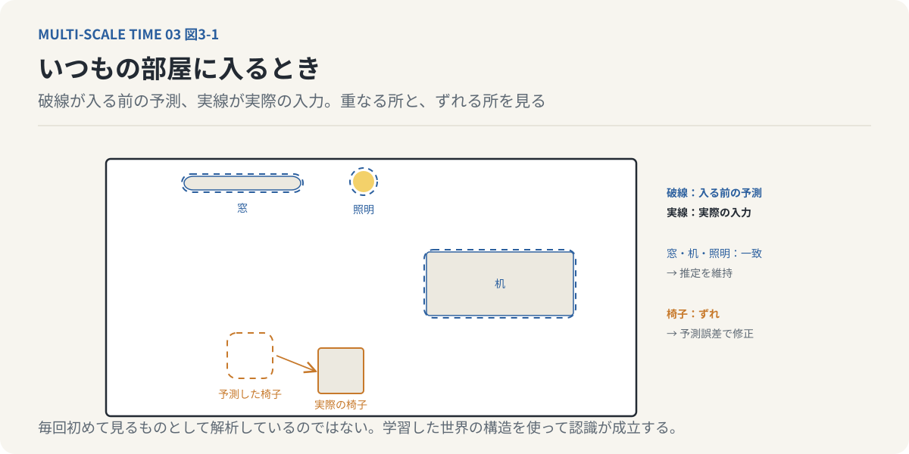
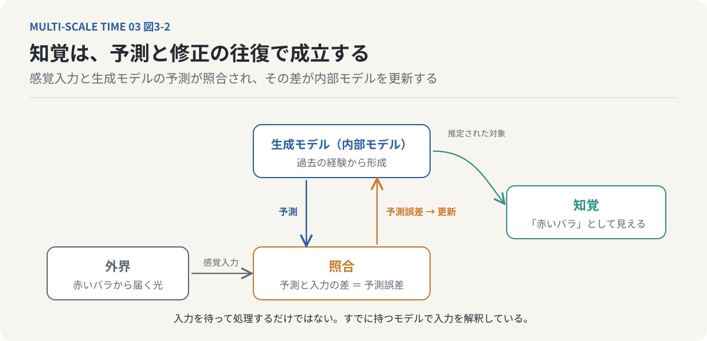
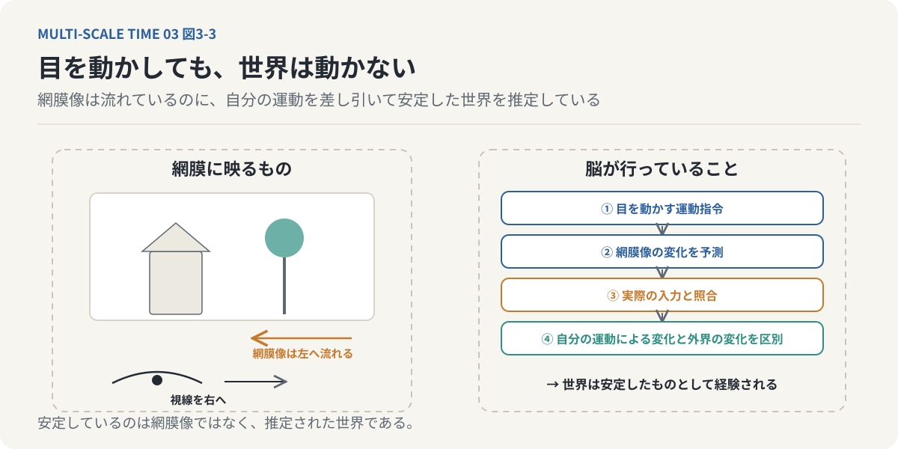
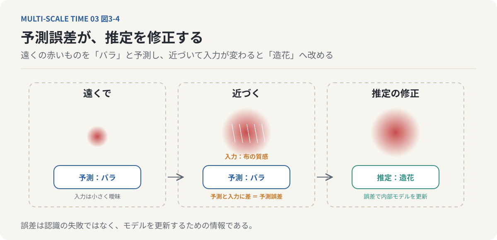
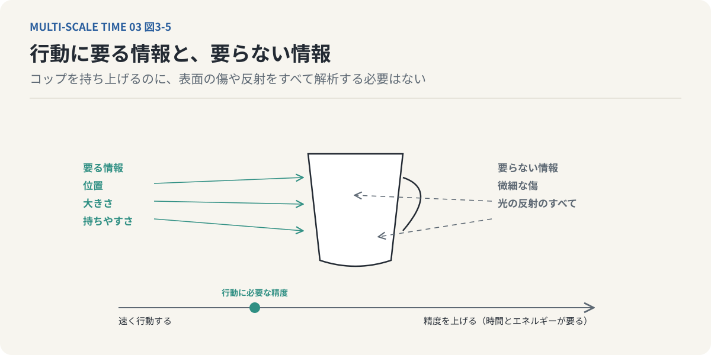
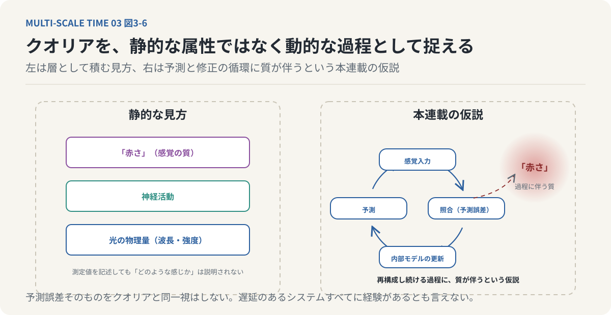
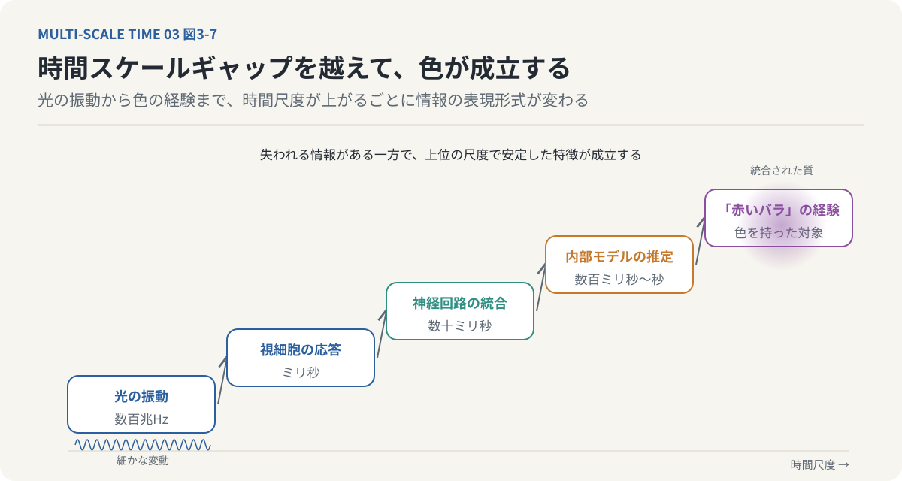

# 第3回　脳は現実を見ているのではなく、再構成している

## 時間的粗視化、生成モデル、そしてクオリアの成立

<!-- NAV:TOP -->
[← 第2回](02-limits-of-time-perception.md) | [連載目次](../README.md) | [第4回 →](04-consciousness-and-delay.md)
<!-- /NAV -->

### 1. 私たちは、現実をそのまま見ているのか

目の前に赤いバラがある。私たちは、その花びらの赤さを見て、形を認識し、近づけば香りを感じる。

そのとき、私たちは何を経験しているのだろうか。

直感的には、目の前に存在するバラを、そのまま見ているように思える。しかし、実際には少し事情が異なる。バラから反射された光は網膜に到達し、視細胞によって神経信号へ変換される。その信号は複数の神経回路を経由して処理され、色や形、位置、運動などの情報として統合される。

私たちが経験する「赤いバラ」は、こうした神経処理を通じて成立している。

ここで興味深いのは、脳がバラそのものに直接触れているわけではないということである。脳が受け取るのは、感覚器官によって変換された信号である。外界の物体そのものと、それを認識する脳との間には、常に情報の変換が介在している。しかも、感覚器官が受け取れる情報は、外界に存在する情報のごく一部にすぎない。

前回は、この制約を時間知覚の観点から考えた。速すぎる変化は一つにまとまり、遅すぎる変化は動きとして認識されない。つまり、私たちの知覚は、物理的な変化をそのまま再現しているわけではない。

では、限られた感覚入力から、なぜ私たちはこれほど豊かで安定した世界を経験できるのだろうか。

その手掛かりとなるのが、脳による「予測」である。

### 2. 脳は、感覚入力を待っているだけではない

私たちは一般に、知覚を次のような過程として考えがちである。外界で何かが起こり、感覚器官がそれを検出し、脳が情報を処理する。外界から脳へ、情報が一方向に流れるという理解である。もちろん、感覚入力は知覚に不可欠である。

しかし、脳の情報処理は、外界からの入力を受動的に受け取るだけではない。脳は、過去の経験や現在の文脈を利用して、次にどのような感覚入力が得られるかを予測している。

たとえば、いつもの部屋に入ったときのことを考えよう。私たちは、部屋にあるすべての物体を、毎回初めて見るものとして解析しているわけではない。

机はどこにあるか。窓はどちらの方向にあるか。照明をつけると何が見えるか。こうした情報は、過去の経験によってある程度予測できる。

そのため、脳は現在の感覚入力だけに頼らず、過去に学習した世界の構造を利用して認識を成立させる。

*図3-1：いつもの部屋に入るとき。脳は入る前から机・窓・照明の配置を予測している（破線）。実際の入力（実線）の多くは予測と一致し、動かされた椅子のように一致しない部分だけが推定の修正を要する。認識は毎回ゼロから解析されるのではない。*

このような仕組みを説明する枠組みの一つが「予測処理」である。[^clark-2013]予測処理では、脳は感覚入力の原因を推定する内部モデルを持ち、そのモデルを利用して入力を予測すると考える。

ここでいう内部モデルを、生成モデルと呼ぶ。生成モデルとは、世界がどのような状態にあるとき、どのような感覚入力が生じるのかを表現するモデルである。

たとえば、目の前に赤いバラがあると推定したとき、脳は、その対象からどのような視覚情報が得られるかを予測できる。実際に入力された情報と予測が一致していれば、その推定を維持できる。一致しなければ、推定を修正する必要が生じる。このように、私たちの知覚は、感覚入力と内部モデルとの相互作用によって成立すると考えられる。

私たちは、外界の情報を受け取ってから世界を理解するだけではない。**すでに持っている世界のモデルを使って、現在の入力を解釈している。**

*図3-2：知覚の循環。外界からの感覚入力（下向きの矢印）と、生成モデルが出す予測（上向きの矢印）が照合され、その差である予測誤差が内部モデルを更新する。知覚は入力の一方向の流れではなく、予測と修正の往復で成立する。*

### 3. 目を動かしても、なぜ世界は動かないのか

脳が予測を使って知覚を成立させていることを考える上で、興味深い例がある。私たちは、日常的に何度も目を動かしている。視線を右へ向ければ、網膜に映る景色は左方向へ移動する。視線を左へ向ければ、網膜像は反対方向へ移動する。

ところが、私たちは目を動かすたびに、部屋全体が反対方向へ動いているとは感じない。

なぜだろうか。

この問題は、19世紀の生理学者ヘルマン・フォン・ヘルムホルツも考察した。[^helmholtz]ヘルムホルツは、感覚が不完全である以上、知覚には無意識的な推論が介在すると考えた。眼球運動についても、脳が自分自身の運動を考慮し、その結果としてどのような感覚変化が生じるかを推定していると説明できる。具体的には、次のような過程である。

1. 目を動かす運動指令が生じる。
2. その運動によって網膜像がどのように変化するかを予測する。
3. 実際に得られた感覚入力と予測を照合する。
4. 自分の眼球運動による変化と、外界の物体そのものの変化を区別する。

その結果、目を動かしても、世界を安定したものとして経験できる。

*図3-3：視線を右へ向けると網膜像は左へ流れる（左）。脳は運動指令から網膜像の変化を予測し、実際の入力と照合して、自分の運動による変化を差し引く（右の四段階）。安定しているのは網膜像ではなく、推定された世界である。*

ここで重要なのは、網膜に映る映像が安定しているわけではないということである。変化している感覚入力から、安定した世界を認識している。つまり、知覚の安定性は、感覚入力そのものの性質だけでは説明できない。脳が自分自身の行動と感覚の関係を推定することで、安定した世界像が成立しているのである。

### 4. 現実と予測の間には、必ず差が生まれる

生成モデルによる知覚を考えると、次の問題が現れる。

内部モデルは、現実を完全に再現できるのだろうか。

答えは否である。現実の世界には、膨大な情報が存在している。物体の表面には微細な凹凸があり、光は複雑に反射し、空気は絶えず動き、周囲ではさまざまな音が発生している。こうした情報のすべてを、脳が完全に表現することはできない。

そもそも、私たちの感覚器官が検出できる情報には限界がある。さらに、神経系の処理能力にも限界がある。したがって、生成モデルは現実の完全な複製にはなり得ない。モデルが予測した感覚入力と、実際に得られた感覚入力との間には差が生じる。

この差を「予測誤差」と呼ぶ。

たとえば、遠くにある赤いものをバラだと思ったとする。近づいてみると、花びらのように見えた部分が布であり、実際には造花だったとわかる。最初の予測と、新しく得られた感覚入力が一致しなかった。そこで脳は、対象についての推定を修正する。

このように、予測誤差は内部モデルを更新するための重要な情報となる。

*図3-4：予測誤差による推定の修正。遠くの赤いものを内部モデルは「バラ」と予測する（左）。近づくと布の質感という入力が届き、予測との差が生じる（中）。その差を受けて、推定は「造花」へ改められる（右）。誤差は失敗ではなく、モデルを更新する情報である。*

ただし、予測誤差とは、単に認識を間違えたことだけを意味するわけではない。内部モデルによる予測と感覚入力との間に存在する差異そのものを指す。そして、この差異をどのように処理するかによって、知覚や学習が変化する。

### 5. 脳は、すべての誤差をなくそうとはしていない

ここで、一つの疑問が生まれる。

予測誤差が生じるなら、脳はその誤差を完全になくすまで処理を続けるのだろうか。

そう考えると、いくつかの問題がある。

たとえば、机の上に置かれたコップを手に取る場面を考えよう。コップを持ち上げるためには、その位置、大きさ、持ちやすさなどを判断する必要がある。しかし、コップの表面に存在する微細な傷や、光の反射のすべてを解析する必要はない。それらの情報を完全に理解しなくても、コップを持ち上げることはできる。

生物の情報処理には目的がある。環境に適応し、生存し、必要な行動を実現することである。そのため、すべての感覚情報を最大限の精度で処理することが、常に有利とは限らない。情報を細かく処理するには時間とエネルギーが必要になる。

処理の精度を高めることと、迅速に行動することの間には、しばしばトレードオフが存在する。したがって、生物の知覚は、無制限に詳細な世界像を作ることよりも、行動に必要な情報を適切に利用することに最適化されていると考えられる。

*図3-5：コップを持ち上げるのに要る情報と要らない情報。位置・大きさ・持ちやすさ（左）は要るが、微細な傷や光の反射（右）はすべて解析しなくてよい。精度を上げるほど時間とエネルギーを要するので、知覚は行動に必要な情報の利用に最適化されている。*

ここで前回の議論と接続できる。時間的粗視化とは、短時間の微細な変化を一つにまとめることであった。生成モデルによる予測も、感覚情報の不足を補い、限られた情報から世界を理解するための仕組みである。両者は異なる処理であるが、共通した特徴を持っている。

外界のすべての情報を保持するのではなく、情報を選択・統合し、生物にとって利用可能な表現へ変換しているということである。

### 6. 情報が失われるのに、なぜ経験は豊かなのか

ここで、もう一度、赤いバラを考えてみたい。バラの表面から反射された光は、網膜で神経信号へ変換される。視覚系は、すべての光の情報をそのまま保持するわけではない。感覚器官の制約によって一部の情報は失われ、神経処理によって特徴が抽出・統合される。

それにもかかわらず、私たちは「赤いバラを見る」という豊かな経験を持つ。これは興味深いことである。外界の情報を減らし、粗くまとめているのに、私たちの経験には色や形、質感といった多様な性質が存在する。ただし、ここで注意すべきことがある。

情報を粗視化すれば、それだけで新しい主観的経験が生まれると証明されたわけではない。粗視化によって知覚表現が変化することと、その表現に主観的な質が伴うことは、区別すべき問題である。それでも、情報の統合によって、元の物理刺激とは異なる記述水準の性質が成立することは重要である。

たとえば、個々の光の変動が統合されることで、一定の明るさという知覚的な性質が成立する。連続した画像が適切な条件で提示されると、滑らかな運動として経験される。個々の刺激を独立して考えるだけでは、こうした統合された経験を十分に説明できない。この問題は、哲学や認知科学における「クオリア」の議論へつながっていく。

### 7. クオリアとは何か

クオリアとは、主観的な経験に伴う感覚の質を表す概念である。赤いものを見たときの「赤さ」。リンゴを食べたときの味わい。痛みを感じたときの、あの痛みそのもの。

こうした経験が、本人にとってどのような感じであるかという側面を指す。

ここで区別したいのは、外界の物理的な特徴と、それを経験することの違いである。赤い光については、波長や強度などの物理量を測定できる。視覚系がどのような神経活動を起こしているかも、一定の範囲で測定できる。しかし、そうした測定値を記述することと、「赤を見るとはどのような感じなのか」を説明することは同じではない。

この主観的な質を、どのように客観的な物理過程と結びつけて説明するのか。

それがクオリアをめぐる中心的な問題の一つである。

予測処理の考え方を利用しよう。私たちが赤いバラを見るとき、脳は感覚入力を受け取るだけでなく、過去の経験から得た内部モデルによって対象を再構成している。その再構成は、現実を完全に複製するものではない。感覚入力と予測の間には差異があり、内部モデルはその差異に応じて更新される。

この動的な処理が、主観的な経験の成立と関係しているのではないか。

ここから先は、確立した説明ではなく、一つの理論的な仮説となる。

### 8. クオリアは、現実を再構成し続ける過程なのか

今回の連載で検討したいのは、クオリアを静的な情報の属性としてではなく、動的な過程として捉える可能性である。赤いバラを見る経験を、もう少し細かく考えてみよう。

まず、感覚器官から外界の情報が入力される。脳は、過去の経験に基づく生成モデルを使って、その入力の原因を推定する。実際の入力と予測が一致しなければ、予測誤差が生じる。その誤差は内部モデルの更新に利用される。

しかし、現実の情報量は膨大であり、内部モデルは現実を完全には再構成できない。したがって、脳は限られた情報の中で、世界についての推定を継続的に更新している。

次のような仮説を考えることができる。

**クオリアとは、現実を完全には再構成できない生物が、現実を再構成し続ける動的な過程に伴う主観的な質なのではないか。**

この考え方では、主観的経験を完成済みの内部表現としてだけでなく、現実と内部モデルの間で続く相互作用として捉える。

*図3-6：クオリアの捉え方の二つ。左は静的な見方で、光の物理量、神経活動、「赤さ」を層として積む。右は本連載の仮説で、現実を完全には再構成できない生物が予測と修正を続ける動的な過程に、「赤さ」という質が伴うと考える。予測誤差そのものをクオリアと同一視はしない。*

重要なのは、予測誤差そのものをクオリアと同一視しないことである。予測誤差が存在するシステムすべてに主観的な経験があるとは限らない。また、予測誤差の計算だけでは、なぜ特定の感覚が特定の質を持つのかという問題も解決しない。

この仮説が示しているのは、次のことである。主観的経験の成立を理解するには、静的な情報表現だけでなく、予測と修正が進行する時間的な構造に注目する必要がある。時間の問題が再び現れる。

私たちが経験している「赤さ」は、単にある瞬間の神経状態なのだろうか。それとも、感覚入力と予測が継続的に相互作用する過程の中で成立しているのだろうか。

もし後者であるなら、主観的経験を理解するには、その経験がどのような時間幅の中で形成されるのかを考えなければならない。

### 9. 異なる時間スケールから、新しい質が現れる

ここで、第2回の時間スケールギャップに戻ろう。光の電磁波としての振動は、極めて短い時間スケールで進行している。視細胞の応答、神経回路による処理、意識的な知覚は、それぞれ異なる時間スケールを持っている。にもかかわらず、私たちは一つの安定した色を経験する。

このとき、異なる時間スケールの間で情報が変換されている。物理的な刺激のすべてが、そのまま意識に現れるわけではない。感覚器官が情報を選択し、神経系が特徴を統合し、内部モデルが対象を推定する。その結果、私たちが直接経験するのは、個々の電磁波の振動ではなく、色や明るさを持った対象である。

*図3-7：時間スケールギャップを越える変換。左下の光の振動（数百兆Hz）から、視細胞の応答、神経回路の統合、内部モデルの推定へと時間スケールが上がるにつれ、情報の表現形式が変わり、右上で「赤いバラ」という色を持った対象の経験が成立する。*

ここで考えられるのは、時間スケールの異なる階層間で、情報の表現形式が変化するということである。[^hirai-2022]細かな時間的変化が統合され、より大きな時間スケールで安定した特徴として扱われる。このような階層間の変換は、感覚の処理だけでなく、記憶や行動にも見られる。数ミリ秒の神経活動が積み重なり、数百ミリ秒の知覚や運動が成立する。

さらに、数秒間の経験が記憶に統合され、数年にわたる知識や人格の形成に関わる。異なる時間スケールの過程が、相互に影響しながら、より大きなまとまりを形成している。ただし、情報表現の階層的な変換と、主観的意識の発生を完全に説明できたことは同義ではない。そこで次に問うべきなのは、こうした時間的な統合を可能にする仕組みである。

なぜ生物は、刺激を受けて即座に反応するだけでなく、情報を内部に保持し、予測と照合を行うようになったのだろうか。

### 10. 予測するためには、時間的な余白が必要である

ここまで、知覚を予測と修正の過程として考えてきた。しかし、予測には重要な前提がある。それは、現在の感覚入力を、過去の情報や内部モデルと比較できることである。刺激に対して、常に決まった反応を即座に返すだけのシステムを考えよう。

そのシステムでは、入力に対する反応が固定されている。一方、過去の経験を利用して異なる行動を選択するシステムでは、入力と出力の間に別の処理が介在する。情報を保持し、過去の経験を参照し、複数の可能性を評価する。こうした働きには、刺激と反応の間の時間的な構造が関係する。

ここで重要になるのが「遅延」である。[^hirai-2019]遅延とは、単に処理が遅いということではない。刺激が入力されてから行動が成立するまでの間に、内部の情報処理が介在するということである。もちろん、反応が遅いだけで意識が生まれるわけではない。

しかし、刺激と反応の間に時間的な余白が存在することで、過去の記憶を利用した判断や、未来を予測した行動が可能になる。この考え方は、哲学者アンリ・ベルクソンの意識論へとつながっていく。[^bergson-ec]ベルクソンは、生命が物理的な作用と反作用の連鎖から相対的な自由を獲得することと、意識の成立を結びつけて考えた。

今回の議論を一つにまとめることができる。私たちの知覚は、現実をそのまま受け取るものではない。感覚器官の制約の中で情報を選択し、時間的に統合し、過去の経験から作られた生成モデルを利用して世界を再構成している。そして、この再構成は、ある時間的な広がりの中で進行する。

知覚が動的な再構成であるなら、その再構成を可能にする「時間的な内部」は、どのようにして生物に生まれたのか。

これが次回の問いである。

---

**次回｜第4回「意識は、反応の『遅延』から生まれたのか？」**

単純な生物の刺激反応から、人間の記憶と意思決定に至るまでを比較し、反応を保留する「時間的余白」が、意識の成立にどのような役割を持つのかを考える。
## 参考文献・注記

[^clark-2013]: Andy Clark（2013）. [Whatever next? Predictive brains, situated agents, and the future of cognitive science](https://doi.org/10.1017/S0140525X12000477)。Behavioral and Brain Sciences 36(3)。予測処理の枠組みの概観。本連載の「生成モデル」「予測誤差」の用語はこの枠組みに従う。
[^helmholtz]: ヘルマン・フォン・ヘルムホルツ（1867）. [Handbuch der physiologischen Optik](https://en.wikipedia.org/wiki/Hermann_von_Helmholtz)。知覚における無意識的推論の考え方。眼球運動と網膜像の安定に関する議論の出発点。リンク先は百科事典の項目。
[^bergson-ec]: アンリ・ベルクソン（1907）. [L'Évolution créatrice（『創造的進化』）](https://plato.stanford.edu/entries/bergson/)。生命が作用と反作用の連鎖から相対的に離れていく過程として意識を考えた。リンク先はスタンフォード哲学百科事典の項目。
[^hirai-2022]: 平井靖史（2022）. [世界は時間でできている ── ベルクソン時間哲学入門](https://www.seidosha.co.jp/book/index.php?id=3708)。青土社。ベルクソンの時間哲学を「マルチ時間スケール（MTS）解釈」として再構成した入門書。本連載の骨格 ── 複数の時間スケールの積層、階層0〜3、時間的粗視化（凝縮）、幅のある現在、未完了相、意識の遅延テーゼ ── はこの本に由来する。
[^hirai-2019]: 平井靖史（2019）. [「スケールに固有」なものとしての時間経験と心の諸問題 ── ベルクソン〈意識の遅延テーゼ〉から](https://www.kinokuniya.co.jp/f/dsg-01-9784326102778)。森田邦久編『〈現在〉という謎 ── 時間の空間化批判』勁草書房、205–224頁。「意識の遅延テーゼ」という名称の出所。リンク先は書店の書籍ページ。

<!-- NAV:BOTTOM -->
---

[← 第2回](02-limits-of-time-perception.md) | [連載目次](../README.md) | [第4回 →](04-consciousness-and-delay.md)
<!-- /NAV -->
