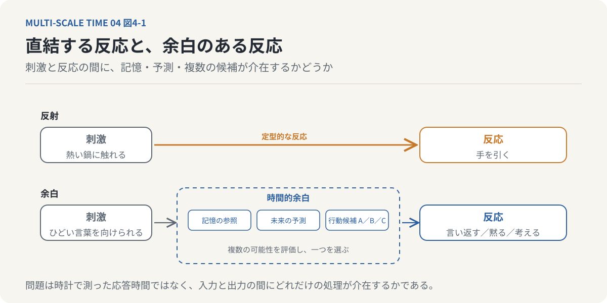
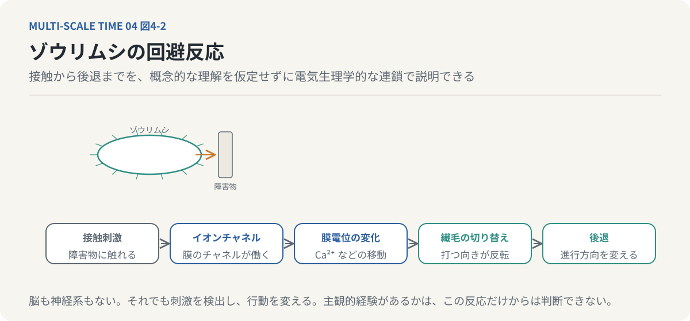
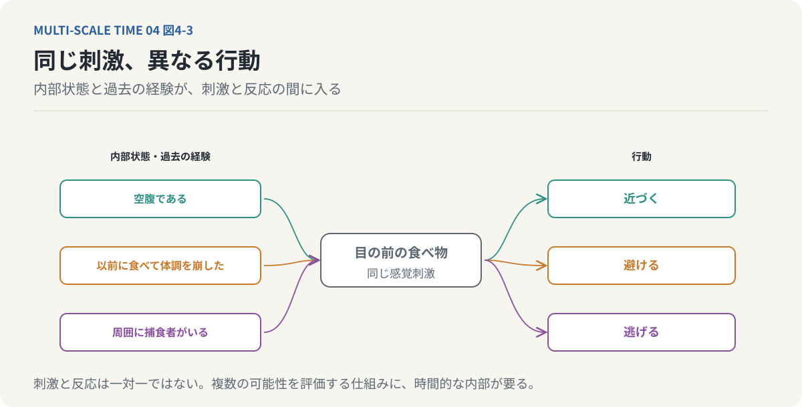
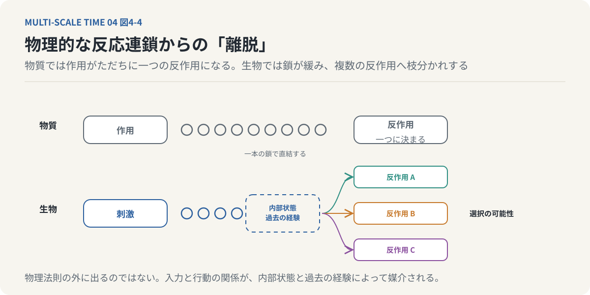
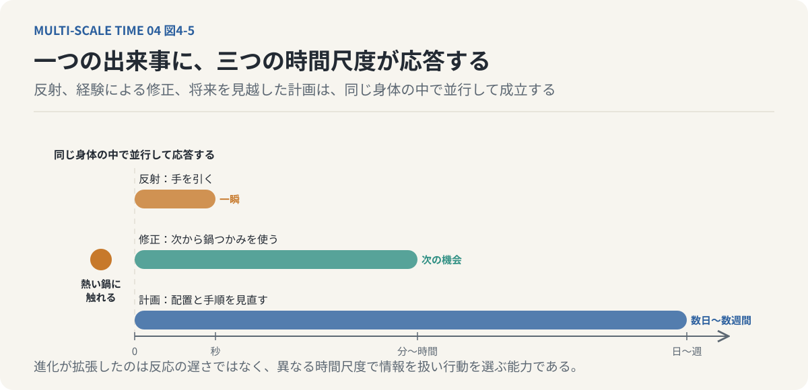
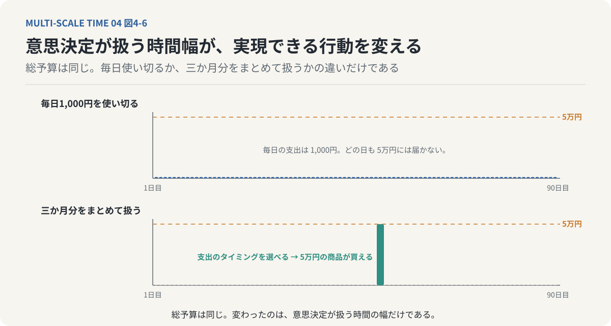
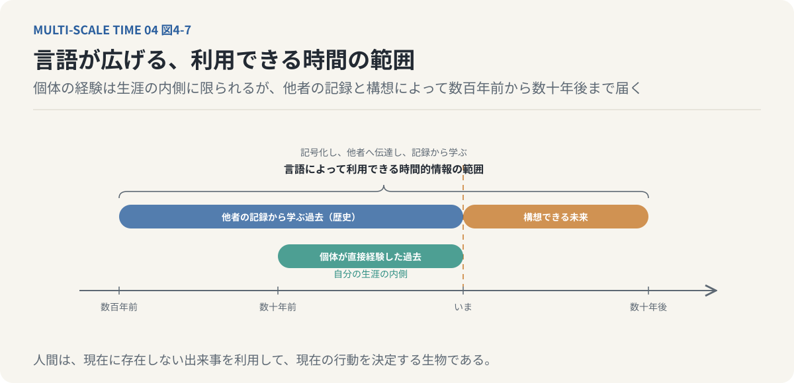
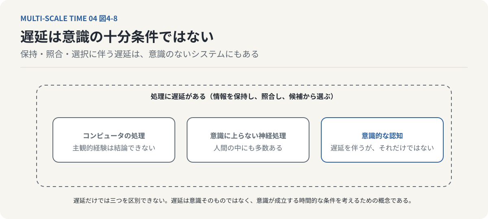
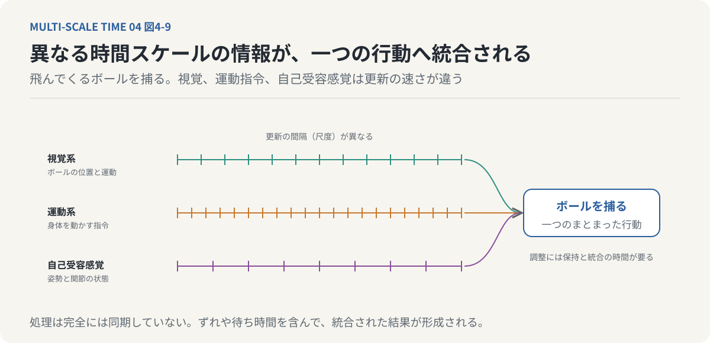

# 第4回　意識は、反応の「遅延」から生まれたのか？

## 生命が獲得した時間的余白と、心の誕生

<!-- NAV:TOP -->
[← 第3回](03-brain-reconstructs-reality.md) | [連載目次](../README.md) | [第5回 →](05-mind-is-made-of-memory.md)
<!-- /NAV -->

### 1. 刺激を受けて、すぐに反応する世界

熱いものに触れると、私たちは反射的に手を引っ込める。その一方で、誰かに突然ひどいことを言われても、必ずしも即座に言い返すわけではない。

相手がなぜそのようなことを言ったのかを考える。過去の関係を思い出す。言い返した場合に何が起こるかを想像する。そして、ときには何も言わないことを選ぶ。

どちらも外界の刺激に対する反応である。しかし、その間に起きていることは大きく異なる。前者では、刺激に対して比較的定型的な反応が生じる。後者では、刺激を受けた後、過去の記憶や未来の予測が介在し、複数の行動から一つが選択される。

ここには、「刺激」と「反応」の間に生じる時間的な余白がある。

この余白は、単に反応が遅くなることを意味するのだろうか。それとも、生物が世界を認識し、行動を選択する仕組みそのものを変えるものなのだろうか。

前回は、私たちの知覚が現実を受動的に受け取るだけではなく、過去の経験を使って世界を再構成する過程であることを考えた。そこで新しい疑問が生まれた。

外界の刺激を内部で保持し、過去の記憶と照合し、未来を予測するという働きは、どのようにして可能になったのか。

今回は、この問題を生物の進化と時間的な構造から考えたい。中心となるのは、哲学者アンリ・ベルクソンの思想から読み取れる「意識の遅延テーゼ」である。この名称は、ベルクソン研究者の平井靖史による。[^hirai-2019]

**意識の成立には、刺激をただちに反応へ変換せず、その間に時間的な余白を生み出すことが重要だったのではないか。**

これが今回の問いである。

*図4-1：上は熱いものに触れて手を引く経路で、刺激が定型的な反応へ直結する。下は言葉を向けられたときの経路で、刺激と反応の間に記憶の参照、未来の予測、複数の行動候補の評価が入り、一つが選ばれる。この「間」が今回扱う時間的余白である。*

### 2. ゾウリムシは、何を知覚しているのか

まず、非常に単純な生物について考えてみよう。ゾウリムシである。ゾウリムシは単細胞生物であり、脳も神経系も持たない。しかし、外界の刺激に反応し、環境に応じて行動を変えることができる。

たとえば、遊泳中のゾウリムシが障害物に接触すると、進行方向を変えることがある。[^jennings-1906]その仕組みは、電気生理学的な過程として説明できる。接触刺激によって細胞膜のイオンチャネルが働き、カルシウムイオンなどの移動を伴う膜電位の変化が生じる。その変化によって繊毛の運動が切り替わり、ゾウリムシは後退する。

一連の過程は、細胞の膜電位とイオンの移動、運動器官の制御によって成立している。

*図4-2：ゾウリムシの回避反応。障害物への接触がイオンチャネルを働かせ、カルシウムイオンの移動を伴う膜電位の変化が起き、繊毛の運動が切り替わって後退する。概念的な理解を仮定しなくても、この連鎖で観察された行動は説明できる。*

私たち人間のような複雑な認知過程を想定する必要はない。ゾウリムシが障害物について概念的に理解し、「この先には障害物があるので、進行方向を変えよう」と熟考しているわけではない。少なくとも、そのような高度な内部表象を仮定しなくても、観察された行動は説明できる。それでも、ゾウリムシは外界の刺激を検出し、その刺激に応じて行動を変えている。

これを、広い意味での知覚と捉えることはできる。ただし、刺激を検出して反応することと、その刺激を主観的に経験していることは同じではない。ゾウリムシに意識経験があるかどうかは、この反応だけから判断できない。

ここで重要なのは、単純な生物にも環境との情報的な相互作用が存在するということである。そして、生物が複雑化するにつれて、その相互作用の内部に、より多様な処理が介在するようになる。

### 3. 刺激と反応の間に、何が生まれたのか

ゾウリムシの反応を、次のように単純化してみよう。刺激が入力される。細胞内の生理的な状態が変化する。その結果として運動が生じる。

もちろん、実際の反応が時間ゼロで起こるわけではない。イオンチャネルの開閉にも、膜電位の変化にも、運動の成立にも時間がかかる。しかし、ここで問題にしたいのは、単なる物理的な応答時間ではない。

**入力から出力までの間に、過去の経験や複数の行動可能性を利用する処理が、どれだけ介在しているかということである。**

神経系を持つ動物では、感覚入力が複数の神経回路を経由して処理される。刺激の種類によっては、反射的な反応が起こる。一方で、複数の情報を統合し、過去の経験を参照して、行動を選択することもできる。

たとえば、目の前に食べ物があるとする。空腹であれば、その食べ物へ近づこうとするかもしれない。しかし、以前に同じ食べ物を食べて体調を崩した経験があれば、避けることもある。周囲に捕食者が存在すれば、食べることよりも逃げることを優先するかもしれない。

同じ感覚刺激であっても、内部状態や過去の経験によって行動が変わる。刺激と反応が、一対一で固定的に対応しているわけではない。

*図4-3：同じ感覚刺激、異なる行動。目の前の食べ物という同じ入力でも、空腹なら近づき、以前に体調を崩した経験があれば避け、捕食者がいれば逃げる。刺激と反応は一対一ではなく、内部状態と過去の経験が間に入る。*

このような行動の柔軟性を実現するためには、感覚入力を内部状態と組み合わせ、複数の可能性を評価する仕組みが必要になる。そこには、外界の刺激を受け取ってから行動を決定するまでの「時間的な内部」が存在する。これが、今回考える遅延の本質である。

### 4. 生命は、物理的な反応の連鎖から相対的に離れる

ここで、ベルクソンの哲学に目を向けよう。[^bergson-ec]ベルクソンは、生命と意識を、物質的な作用と反作用の関係から考えた。物質的な世界では、ある出来事が別の出来事を引き起こす。力が加われば物体は運動し、熱が伝われば温度が変わる。

こうした現象は、物理法則によって記述される。生命も物質からできている以上、物理法則の外側に存在するわけではない。しかし、生物は外界から受けた刺激を、そのまま一つの反応へ変換するだけではない。刺激を選択し、内部状態に応じて処理し、行動の方向を変える。

ベルクソンの思想を時間的な観点から読み直すと、ここに重要な意味を見いだすことができる。生物は、外界の作用に対して、ただちに一つの反作用を返すことから相対的に離れていく。刺激を受け取ってから行動するまでの間に、選択の可能性が生まれる。

*図4-4：物理的な反応連鎖からの「離脱」。上の物質では、作用がただちに一つの反作用を引き起こす。下の生物では、刺激と行動の間の鎖が緩み、内部状態や過去の経験を介して複数の反作用へ枝分かれする。物理法則の外に出るのではなく、入力と行動の関係が内部で媒介される。*

このことを、物理的な反応連鎖からの「離脱」と表現できる。もちろん、生物が物理法則から自由になるという意味ではない。そうではなく、外界からの入力と行動の関係が、内部状態や過去の経験によって媒介されるということである。そして、この媒介が複雑になるほど、生物は同じ刺激に対して異なる行動を選択できるようになる。

**生命が獲得した自由とは、物理法則から逃れることではなく、刺激と反応の間に複数の可能性を持つことである。**

ベルクソンの意識論は、この選択可能性を考えるための重要な視点を提供している。[^bergson-mm]

### 5. 遅延は、なぜ生物にとって有利だったのか

反応を保留することには、利点と欠点がある。利点は、より多くの情報を利用して行動を選択できることである。欠点は、判断までに時間を要することである。捕食者に襲われた瞬間、逃げるべきかどうかを長時間考えていては、生き残れない。

一方で、食べ物の選択や複雑な環境への対応では、過去の経験を利用した方が有利になる場合がある。つまり、速く反応することと、時間をかけて選択することの間には、トレードオフが存在する。生物の進化は、この二つのどちらか一方を選ぶ過程ではなかったと考えられる。むしろ、異なる時間スケールで働く複数の処理機構を発達させてきた。

危険に対しては、反射的に身体を動かす。一方で、より長い時間を使って状況を評価し、行動を計画することもできる。人間の場合、この違いは日常生活でも明確に現れる。熱い鍋に触れたとき、手を引っ込める反応は、熟考するより先に起こる。

しかし、なぜ熱い鍋に触れてしまったのかを振り返り、次回から鍋つかみを使うようにすることもできる。さらに、キッチンの配置を変えたり、調理手順を見直したりすることもできる。ここには、少なくとも三つの異なる時間スケールがある。

- 瞬間的な身体の反応
- 過去の経験を利用した行動の修正
- 将来を見越した長期的な計画

これらは、同じ身体の中で並行して成立している。

*図4-5：熱い鍋に触れた一つの出来事に、三つの時間スケールの処理が並行して応答する。手を引く反射は一瞬で、鍋つかみを使うという修正は次の機会に、配置や手順の見直しは数日から数週間の計画として働く。進化が拡張したのは反応の遅さではなく、この幅である。*

このように考えると、生物の進化によって拡張されたのは、単なる反応の遅さではない。

**異なる時間スケールで情報を扱い、行動を選択する能力そのものである。**

### 6. 人間は、まだ起きていない出来事に反応できる

人間の時間的な能力を考える上で、特に重要なのは未来を扱う能力である。

たとえば、三か月後に高額な商品を購入したいとする。毎日1,000円を必ず使い切るという条件では、5万円の商品を購入することはできない。しかし、三か月分の予算をまとめて管理し、支出のタイミングを自由に選択できるなら、5万円の商品を購入できる。総予算が同じでも、意思決定で扱う時間の幅が異なれば、実現可能な行動は変わる。

*図4-6：上は毎日1,000円を使い切る場合で、どの日も5万円には届かない。下は三か月分をまとめて扱う場合で、支出のタイミングを選べるため5万円の商品が買える。総予算は同じであり、変わったのは意思決定が扱う時間の幅だけである。*

これは単なる金銭管理の話ではない。私たちは、目の前の刺激だけに反応しているわけではない。まだ起きていない未来の出来事を想像し、その未来に向けて現在の行動を変更できる。一日後、一か月後、一年後、十年後。

未来の時間幅を拡張するほど、現在の行動選択も変化する。この能力には、記憶、予測、抽象的思考、計画などの認知機能が関係している。特に前頭前皮質を含む神経ネットワークは、行動の制御や計画、意思決定に重要な役割を担っている。さらに、人間には言語がある。

言語によって、過去の経験を記号化し、他者へ伝達し、将来の行動を計画できる。自分自身が経験していない出来事についても、他者の記録から学ぶことができる。その結果、人間が利用できる時間的な情報の範囲は、個体が直接経験した過去を大きく超えていく。数年前の経験を思い出すだけでなく、数百年前の歴史から学び、数十年後の社会を構想することもできる。

*図4-7：言語が広げる時間の範囲。個体が直接経験できるのは自分の生涯（数十年）の内側だが、言語で記号化された他者の記録によって数百年前の歴史から学び、数十年後の社会を構想できる。利用できる時間的情報の範囲は、個体の経験を大きく超える。*

人間は、現在に存在しない出来事を利用して、現在の行動を決定する生物なのである。

### 7. 反応の遅延は、意識の発生を説明できるのか

ここまで、刺激と反応の間に生じる時間的余白が、行動の柔軟性を支えることを考えた。しかし、ここで注意すべきことがある。行動選択に時間がかかることと、主観的な意識が存在することは、同じではない。

たとえば、コンピュータも入力された情報を保持し、過去のデータと照合し、複数の候補から出力を選択できる。その処理には時間がかかる。しかし、処理に遅延があるという理由だけで、コンピュータが主観的な経験を持つとは結論できない。また、人間の神経系にも、意識に上らない複雑な情報処理が数多く存在する。

したがって、反応の遅延を意識の十分条件と考えることはできない。

*図4-8：遅延は意識の十分条件ではない。情報を保持して照合し、候補から選ぶ処理には遅延が伴うが、それはコンピュータにも、意識に上らない神経処理にもある。遅延は意識そのものではなく、意識が成立する時間的な条件を考えるための概念である。*

それでも、遅延には重要な意味がある。刺激への反応が固定されているだけの仕組みと、過去の情報を利用して複数の行動を選択できる仕組みとでは、情報処理の構造が異なる。後者では、外界からの入力を内部状態と照合することができる。さらに、現在の状態を過去の状態と比較し、次に何をすべきかを予測できる。

このような時間的構造は、少なくとも人間の意識的な認知に深く関係している。ベルクソンの議論から導かれる意識の遅延テーゼは、次のように整理できる。意識は、単に刺激を受け取ることによって成立するのではない。刺激と反応の間に、複数の行動可能性を保持し、それらを選択できる時間的な構造が成立することと関係している。

ここでの遅延とは、時計で測った処理時間の長さそのものではない。外界の刺激に対して、行動が一意に決まらず、内部の情報処理によって選択が可能になることを指している。

遅延は意識そのものではない。**しかし、意識が成立する時間的な条件を理解するための重要な概念である。**

### 8. 意識は、異なる時間スケールの間に生まれる

ここで、前回までの時間スケールの議論と接続してみよう。第2回では、人間の感覚器官がそれぞれ異なる時間分解能を持つことを考えた。聴覚、視覚、触覚は、同じ時間スケールで情報を処理しているわけではない。第3回では、感覚入力と内部モデルの予測が相互作用し、知覚が構成されることを考えた。

そのためには、現在の入力を過去の情報と照合し、内部モデルを更新する必要がある。

では、異なる時間スケールで処理された情報は、どのように一つの行動へ統合されるのだろうか。

たとえば、飛んでくるボールを捕まえる場面を考えよう。視覚系はボールの位置や運動を処理する。運動系は身体を動かすための指令を生成する。身体の姿勢や関節の状態は、自己受容感覚によって検出される。

これらの情報は、それぞれ異なる時間スケールで更新される。それにもかかわらず、私たちは一つのまとまった行動としてボールを捕まえることができる。ここには、複数の時間スケールで進行する処理を調整する仕組みが存在する。

*図4-9：飛んでくるボールを捕る。視覚系はボールの位置と運動を、運動系は身体への指令を、自己受容感覚は姿勢と関節の状態を、それぞれ異なる時間スケールで更新する。それらを調整して一つの行動にまとめる仕組みがあり、そこには保持と統合のための時間が要る。*

時間スケールの異なる処理は、必ずしも完全に同期しているわけではない。ある処理の結果を別の処理が利用するためには、情報の保持や統合が必要になる。その結果、システム内には時間的なずれや待ち時間が生じる。このような階層間の相互作用に注目すると、遅延を別の角度から理解できる。

遅延とは、単に刺激を受け取ってから行動するまでの待機時間ではない。異なる時間スケールの処理が相互に影響し合い、統合された結果を形成するための時間でもある。

ここから、さらに踏み込んだ仮説を立てることができる。意識は、単一の神経活動から生まれるというより、異なる時間スケールで進行する複数の処理が相互作用する中で成立するのではないか。[^hirai-2022]この仮説が正しいかどうかを判断するには、神経活動と主観的経験の関係について、さらに検討する必要がある。しかし、少なくとも意識を一つの瞬間に閉じ込めて説明することには限界がある。

私たちの経験は、複数の時間的な処理を統合した連続的な流れだからである。

### 9. 意識は、行動の可能性を保持する働きである

ここまで考えてきたことを、少し別の言葉で整理してみたい。ある刺激が入力されたとき、常に同じ反応が生じるとする。この場合、刺激が入力された時点で、行動の方向はほぼ決まっている。一方、複数の行動から選択できる生物では、刺激を受け取った時点で、まだ行動が一つに確定していない。

逃げることもできる。近づくこともできる。何もしないこともできる。その複数の可能性を、内部の情報処理によって評価し、選択する。

この状態を、まだ行動が決定されていない時間的な領域として捉えることができる。

ここで重要になるのは、過去の記憶である。生物が過去の経験を利用できなければ、現在の刺激を過去と比較することはできない。また、未来の結果を予測できなければ、複数の行動を将来の結果によって評価することも難しい。つまり、現在の行動選択には、過去と未来が入り込んでいる。

現在の刺激を受け取りながら、過去の経験を利用し、未来の可能性を評価する。この過程こそ、私たちが日常的に経験する意識の重要な特徴の一つである。そして、このような行動の未確定性は、後に取り上げる「未完了相としての現在」という考え方にもつながっていく。現在とは、単に時計が示す一つの時刻ではない。

過去の情報と未来の可能性が、まだ確定していない行動へ向けて相互作用する場でもある。意識をこのような構造として捉えるなら、それは完成した情報を保存する容器ではなく、常に変化し続ける過程として理解できる。

### 10. 心は、時間的な内部を持つことで生まれた

今回の議論を振り返ってみよう。単純な生物にも、外界の刺激を検出し、それに応じて反応する仕組みが存在する。しかし、生物の複雑化とともに、感覚入力と行動の間に多様な情報処理が介在するようになった。過去の経験を参照する。

現在の状況を評価する。未来の結果を予測する。複数の行動可能性を比較する。こうした過程によって、生物は外界の刺激に対して、より柔軟に行動できるようになる。

ベルクソンの意識論は、この変化を、刺激と反応の間に生じる時間的な余白という観点から理解する手掛かりを与えている。

ここでいう遅延は、単なる処理速度の低下ではない。生物が、外界からの入力を内部で保持し、複数の可能性を形成し、行動を選択するための構造である。そして、この時間的な内部が、意識の成立に重要な役割を担ったのではないかという仮説が生まれる。ただし、遅延が存在すれば意識が生まれると証明されたわけではない。

反応の柔軟性と主観的経験の成立を、どのように結びつけるかという問題は残る。それでも、私たちは一つの重要な視点を得た。

**心を理解するには、神経系がどのような情報を処理するかだけでなく、その情報をどのような時間的構造の中で処理するかを考える必要がある。**

次の問いが生まれる。

刺激と反応の間に時間的な余白が生まれたとして、その余白の中で利用されている情報は、どこから来るのだろうか。

現在の感覚入力だけではない。私たちは、過去の経験を利用している。過去に見たもの、聞いたもの、経験したことが、現在の知覚や判断を構成している。

では、過去の経験は単に保存されているだけなのだろうか。それとも、過去の蓄積そのものが、現在の心を形成しているのだろうか。

次回は、この問題を考えていきたい。

---

**次回｜第5回「心は過去でできている」**

記憶を過去の情報を保存する倉庫としてではなく、現在の世界を構成する動的な仕組みとして捉える。記憶の多次元的ネットワーク、再編成、自己回帰を通じて、なぜ過去が現在の経験に入り込み、心そのものを形作るのかを考える。
## 参考文献・注記

[^jennings-1906]: Herbert Spencer Jennings（1906）. [Behavior of the Lower Organisms](https://archive.org/details/behavioroflowero00jenn)。ゾウリムシの障害物への接触に対する回避反応を記述した古典。膜電位と繊毛運動による説明は後の電気生理学に基づく一般的な説明であり、この書籍の記述ではない。リンク先はInternet Archiveの全文。
[^bergson-ec]: アンリ・ベルクソン（1907）. [L'Évolution créatrice（『創造的進化』）](https://plato.stanford.edu/entries/bergson/)。生命が物質的な作用と反作用の連鎖から相対的に離れていく過程と、意識・選択可能性の関係。リンク先はスタンフォード哲学百科事典の項目。
[^bergson-mm]: アンリ・ベルクソン（1896）. [Matière et mémoire（『物質と記憶』）](https://plato.stanford.edu/entries/bergson/)。身体が受け取った刺激と返す運動の間に不確定の余地を持つという議論。「意識の遅延テーゼ」という名称は平井靖史（2019）の用語であり、ベルクソンの原文の用語ではない。リンク先はスタンフォード哲学百科事典の項目。
[^hirai-2019]: 平井靖史（2019）. [「スケールに固有」なものとしての時間経験と心の諸問題 ── ベルクソン〈意識の遅延テーゼ〉から](https://www.kinokuniya.co.jp/f/dsg-01-9784326102778)。森田邦久編『〈現在〉という謎 ── 時間の空間化批判』勁草書房、205–224頁。「意識の遅延テーゼ」という名称の出所。リンク先は書店の書籍ページ。
[^hirai-2022]: 平井靖史（2022）. [世界は時間でできている ── ベルクソン時間哲学入門](https://www.seidosha.co.jp/book/index.php?id=3708)。青土社。ベルクソンの時間哲学を「マルチ時間スケール（MTS）解釈」として再構成した入門書。本連載の骨格 ── 複数の時間スケールの積層、階層0〜3、時間的粗視化（凝縮）、幅のある現在、未完了相、意識の遅延テーゼ ── はこの本に由来する。

<!-- NAV:BOTTOM -->
---

[← 第3回](03-brain-reconstructs-reality.md) | [連載目次](../README.md) | [第5回 →](05-mind-is-made-of-memory.md)
<!-- /NAV -->
