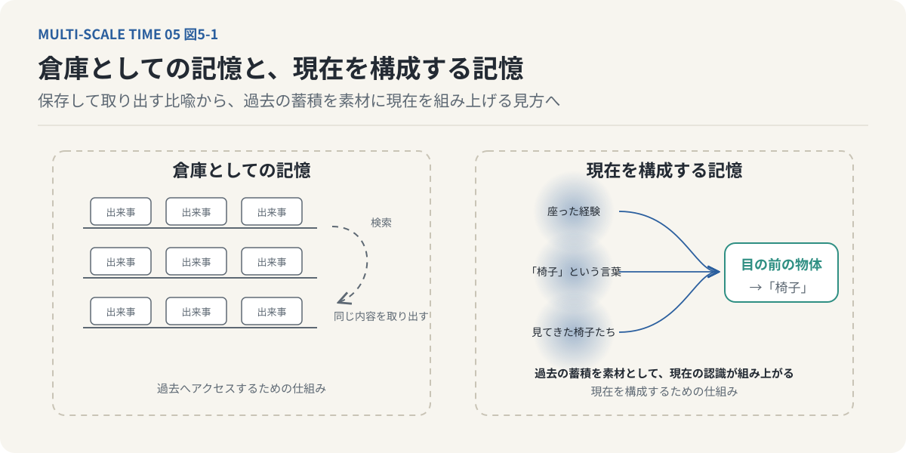
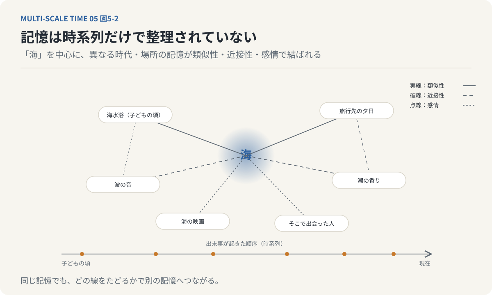
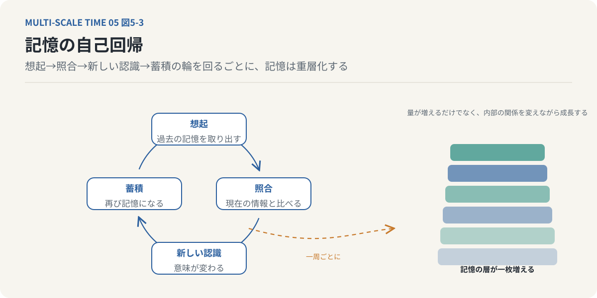

# 第5回　心は過去でできている

## 記憶は保存庫ではなく、現在の世界を構築する仕組みである

<!-- NAV:TOP -->
[← 第4回](04-consciousness-and-delay.md) | [連載目次](../README.md) | [第6回 →](06-the-thickness-of-now.md)
<!-- /NAV -->

### 1. 私たちは、過去を使って現在を見ている

目の前に、一脚の椅子がある。

私たちは、それを見た瞬間に「椅子だ」と認識する。

座るためのものだと理解し、座面の高さや背もたれの形から、どのように座ればよいかを判断できる。

しかし、少し考えてみると不思議なことである。

目に入ってくるのは、光の反射によって得られた色や形の情報にすぎない。

その物体が「座るためのもの」であるという情報は、光そのものに含まれているわけではない。

椅子に座った経験、椅子という言葉を学習した経験、さまざまな椅子を見てきた経験。

そうした過去の蓄積があるからこそ、私たちは目の前の物体を椅子として認識できる。

同じことは、日常のあらゆる場面で起こっている。

知人の顔を見れば、名前を呼ばれる前に誰なのかわかる。

いつもの道を歩けば、次の角を曲がった先に何があるかを予測できる。

聞き慣れた音楽の冒頭が流れれば、続きのメロディーが思い浮かぶ。

私たちは、現在の感覚入力だけで世界を理解しているわけではない。

過去の経験を利用して、現在の世界を認識している。

前回は、刺激と反応の間に生じる「時間的余白」について考えた。

生物は、外界の刺激に即座に反応するだけでなく、内部の情報を利用して行動を選択する。

では、その内部の情報とは何だろうか。

その中心にあるのが記憶である。

ここから、今回の中心命題が導かれる。

**心は、現在の感覚入力によってその都度作られるのではない。過去の経験の蓄積を素材として、現在の世界を構成している。**

今回は、この考え方を掘り下げていきたい。

### 2. 記憶は、過去の出来事を保存する倉庫なのか

記憶という言葉を聞くと、私たちは過去の出来事を保存する仕組みを想像する。

昨日の夕食を思い出す。

子どもの頃の風景を思い出す。

以前に学習した知識を取り出す。

このように、記憶を過去の情報が格納された倉庫として考えることは自然である。

コンピュータにたとえるなら、経験した出来事を保存し、必要になったときに検索して取り出すデータベースのようなものだろう。

しかし、この比喩には重要な限界がある。

私たちの記憶は、過去の出来事をそのまま保存し、同じ内容を繰り返し再生するだけの仕組みではない。[^bartlett-1932]

同じ出来事を思い出しても、そのときの感情や状況によって、思い出される内容や意味が変わることがある。

以前は楽しかった出来事が、後から振り返ると寂しい記憶になることもある。

逆に、当時は苦しかった経験が、後になって重要な学びとして理解されることもある。

過去に起きた出来事そのものが変化したわけではない。

変化しているのは、その出来事を現在の私たちがどのように再構成するかである。

これは、記憶が単なる保存庫ではないことを示している。

記憶は保存されるだけでなく、現在の状況に応じて取り出され、組み合わされ、意味づけられる。

そして、その過程を通じて現在の認知に影響する。

ここで重要なのは、記憶を「過去へアクセスするための仕組み」としてだけでなく、「現在を構成するための仕組み」として捉えることである。

*図5-1：左は「倉庫」の比喩で、出来事が保存され、必要なときに同じ内容が取り出される。右は本連載の見方で、過去の経験（座った、言葉を学んだ、いろいろな椅子を見た）が素材となり、目の前の物体を「椅子」として認識する現在が組み上がる。記憶は過去へ戻るだけの通路ではなく、現在を作る材料である。*

### 3. 現在の知覚は、記憶によって補われている

前回は、脳が生成モデルを利用して感覚入力を解釈していることを考えた。

生成モデルは、過去の経験によって形成される。

ある対象を見たとき、そこからどのような感覚入力が得られるかを予測する。

現在の入力が不完全でも、過去に学習した情報によって不足部分を補うことができる。

たとえば、木目模様を見たときのことを考えてみよう。

木目の中に、人の顔のような形が見えることがある。

しかし、その模様に実際の顔が存在しているわけではない。

私たちは、これまで見てきた顔の特徴を利用し、曖昧な模様に顔のような構造を見いだしている。

これと同様に、ペイズリー柄や雲の形、壁の染みなどにも、見慣れた物体の姿を見つけることがある。

外界から入力される情報だけでは、認識される対象を一意に決定できない。

そこで、過去の経験が利用される。

ベルクソンの認知論を構成論的に読むと、こうした仕組みを「記憶イメージの投射」として理解できる。[^bergson-mm]

私たちは感覚入力を受け取るだけではなく、過去の記憶イメージを利用して対象を積極的に描き出している。

言い換えれば、現在の知覚は、外界からの入力と、内部に蓄積された経験との組み合わせによって成立する。

ここで注意したいのは、記憶が感覚入力を完全に置き換えるという意味ではないことである。

外界からの情報は、認知を制約し、予測を修正する重要な役割を持つ。

しかし、その感覚入力がどのような対象として認識されるかは、過去の経験に大きく依存する。

**私たちは現在の世界を見ながら、同時に過去の世界を利用しているのである。**

### 4. 記憶は、時系列だけで整理されていない

では、記憶は内部でどのように組織化されているのだろうか。

過去の出来事が発生した順番に保存されているだけだと考えると、説明できないことがある。

たとえば、「海」という言葉を聞いたとき、何を思い浮かべるだろうか。

子どもの頃の海水浴を思い出すかもしれない。

旅行先で見た夕日を思い出すかもしれない。

波の音や潮の香りが浮かぶこともある。

あるいは、海に関係する映画や音楽、そこで出会った人を思い出すこともある。

これらの経験は、必ずしも近い時期に起きたものではない。

異なる時代、異なる場所で経験した記憶が、「海」という共通の意味によって結びついている。

つまり、記憶は単純な時系列の並びではない。

複数の関係によって組織化されている。

記憶を結びつける関係には、さまざまなものがある。

まず、類似性による結合である。

形が似ているもの、意味が似ているもの、同じような動作を伴うものは、相互に関連づけられる。

次に、近接性による結合がある。

同じ時間に経験した出来事、同じ場所で起きた出来事、同じ状況で経験した出来事は、互いに関連づけられる。

さらに、感情による結合もある。

まったく異なる出来事であっても、似た感情を伴っていたために関連づけられることがある。

こうした関係によって、記憶は多次元的なネットワークを形成する。

*図5-2：下の軸は出来事が起きた順序。上のネットワークは「海」という意味を中心に、異なる時代・場所の記憶が類似性（実線）、近接性（破線）、感情（点線）で結ばれている。同じ記憶でも、どの線をたどるかで別の記憶へつながる。*

同じ記憶であっても、どの関係をたどるかによって、異なる記憶へつながっていく。

ここで、記憶の重要な性質が見えてくる。

記憶は一つの固定された順序で保存されているだけではない。

現在の状況に応じて、異なる関係を利用して取り出せるのである。

### 5. 同じ記憶から、異なる意味が生まれる

記憶のネットワークは、固定された構造ではない。

新しい経験によって関係が変わり、現在の状況によって利用される経路が変わる。

たとえば、学生時代に失敗した出来事を思い出すとしよう。

当時は、恥ずかしい経験として記憶されていたかもしれない。

しかし、社会人になって同じような状況に直面すると、その経験が判断の手掛かりになることがある。

さらに、誰かに失敗談を語る場面では、他者へ教訓を伝えるための材料になるかもしれない。

同じ過去の出来事であっても、現在の状況によって異なる意味を持つ。

これは、記憶の内容が毎回自由に書き換えられるということではない。

過去の経験に由来する情報が、異なる文脈や他の記憶との関係の中で再構成されるということである。

この性質を、記憶の可塑性と呼ぶ。

可塑性とは、新しい経験や状況に応じて、記憶の構造や利用の仕方が変化し得ることである。

そして、この可塑性は、認知の柔軟性を支えている。

同じものを見ても、異なる見方ができる。

以前とは異なる解釈ができる。

それまで関係がなかった二つの経験を結びつけ、新しいアイデアを生み出すことができる。

ここには、記憶のもう一つの重要な性質がある。

それが創発性である。

創発とは、複数の要素が相互作用することによって、個々の要素だけからは説明しきれない新しい性質が現れることである。

記憶においては、異なる経験を組み合わせることで、新しい意味や洞察が生まれる。

一つひとつの記憶は過去の経験に由来していても、その組み合わせによって、過去には存在しなかった理解が成立する。

**心は過去の情報を再生するだけではない。過去の経験を再編成することで、新しい認識を生み出している。**

### 6. 記憶は、思い出すたびに変化する

記憶をさらに考える上で、重要なのが「想起」という行為である。

私たちは、何かを思い出すとき、過去の出来事をそのまま取り出しているように感じる。

しかし、記憶の想起は、単なる読み出しとは異なる。

過去の情報を現在の文脈で再構成する過程である。

さらに、想起した経験そのものが、新しい記憶の形成に影響する場合がある。

たとえば、子どもの頃の旅行について家族と話したとする。

自分が覚えていた風景を語る。

家族から、忘れていた出来事を聞く。

写真を見て、当時の記憶を補う。

その結果、旅行についての理解が以前とは変わる。

次にその旅行を思い出すときには、今回の会話や写真から得た情報も想起に影響する。

ここでは、過去の記憶を利用することによって、新しい記憶が形成されている。

このような循環を、自己回帰的な過程として捉えることができる。

過去の記憶を取り出す。

現在の情報と照合する。

その結果、新しい認識が形成される。

新しい認識が、再び記憶として蓄積される。

次に思い出すときには、それまでの記憶と新しい情報が利用される。

*図5-3：記憶の自己回帰。過去の記憶を取り出し（想起）、現在の情報と照合し、新しい認識を形成し、それが再び記憶として蓄積される。輪を一周するごとに右の層が一枚増え、記憶は量が増えるだけでなく内部の関係を変えながら重層化する。*

こうして記憶は、単に量が増えるだけではなく、内部の関係を変えながら成長していく。

これを、記憶の自己回帰と呼ぶことにしよう。

自己回帰によって、記憶は堆積し、重層化し、複雑化する。

過去の経験は、現在の認知を構成する。

そして、現在の認知が、新しい過去として蓄積される。

この循環によって、心は時間とともに変化していくのである。

### 7. 記憶には、保存する能力だけでなく、忘れる能力がある

ここで、記憶の別の側面にも触れておきたい。

私たちは一般に、記憶力が高いことを、より多くの情報を正確に保持できることだと考える。

しかし、記憶が機能するためには、保存する能力だけでは不十分である。

情報を選択し、更新し、必要に応じて忘れることも重要になる。

たとえば、以前は正しかった情報が、新しい状況では役に立たなくなることがある。

過去の行動パターンに固執すれば、環境の変化に適応できない。

新しい経験によって、古い情報の意味や重要性を変更する必要がある。

生物の記憶には、生得的な情報と獲得的な情報という異なる側面がある。

生得的な情報は、進化によって形成された神経系の構造や行動傾向として現れる。

外界からの経験によって獲得した情報とは異なり、個体が生まれた時点ですでに備えている。

一方、獲得的な記憶は、経験によって形成される。

新しい情報を学び、以前の情報を修正し、状況に応じて行動を変えることができる。

この獲得的記憶にとって重要なのが、可塑性である。

可塑性があるからこそ、情報の保持と更新の両方が可能になる。

忘却も、この柔軟性と関係している。

もちろん、忘却が常に有益というわけではない。

必要な情報を失えば、認知や行動に支障が生じる。

しかし、すべての情報を永久に同じ強度で保持することも、効率的とは限らない。

重要なのは、経験に応じて記憶の利用可能性や関係性を調整できることである。

この意味で、記憶は固定された過去を守る仕組みではなく、現在の環境へ適応するための仕組みでもある。

### 8. 記憶がなければ、時間は流れるのか

ここで、今回の議論を時間そのものの問題へ戻してみよう。

もし、まったく記憶を持たない生物が存在したとしたら、何が起こるだろうか。

その生物は、現在の刺激に反応できるかもしれない。

しかし、直前に何が起きたのかを保持できなければ、二つの出来事を時間的につなげることは難しい。

ある音が鳴る。

次の音が鳴る。

最初の音がまったく保持されていなければ、二つの音を一つのメロディーとして経験することはできないだろう。

鳥がある位置に見える。

次の瞬間には別の位置に見える。

直前の位置についての情報を保持できなければ、位置の変化を運動として捉えることも難しい。

ここで重要なのは、記憶という言葉を、意識的に過去を思い出す能力だけに限定しないことである。

直前の感覚情報を短時間保持する働きも、広い意味では過去の情報を現在へ持ち越す仕組みである。

そのような保持がなければ、時間的に離れた出来事を統合することはできない。

つまり、持続を経験するためには、何らかの形で過去が現在に保持されている必要がある。

ここから、ベルクソンの時間哲学と結びつく重要な考え方が生まれる。

**記憶は、過去の出来事を保存するだけでなく、時間の流れを経験するための条件でもある。**

記憶が成立することで、現在は孤立した瞬間ではなくなる。

過去の情報が現在に残り、現在の経験が次の瞬間へ引き継がれる。

そうして、私たちは連続した時間を経験する。

これは、記憶が物理的な時間そのものを生み出すという意味ではない。

記憶の成立によって、生物にとっての時間経験が可能になるという意味である。

### 9. 「心は過去でできている」とは、どういうことか

ここまでの議論を整理しよう。

私たちは現在の感覚入力だけで世界を認識しているわけではない。

過去の経験から形成された記憶や内部モデルを利用して、現在の対象を理解している。

その記憶は、単純な時系列の記録ではない。

類似性、近接性、文脈、感情などによって結びついた、多次元的なネットワークを形成している。

さらに、その構造は固定されていない。

現在の状況によって異なる記憶が取り出され、再構成され、新しい意味が生まれる。

記憶を利用した結果は、新しい経験として蓄積される。

この循環によって、記憶は量的にも質的にも変化していく。

そして、こうした過去の蓄積が、現在の知覚や行動を構成している。

ここで「心は過去でできている」という表現の意味が明らかになる。

心とは、過去の出来事を保存している容器ではない。

過去の経験に由来する情報を利用し、現在の世界を再構成し、未来の行動を選択する働きである。

したがって、心は完成した状態で存在するわけではない。

経験を重ねるたびに変化し、その変化した状態から次の経験を構成する。

心は、時間の中で形成され続けている。

そして、その形成の材料となっているのが、過去の蓄積なのである。

### 10. 現在は、過去を含んでいる

最後に、一つの問題を考えてみたい。

私たちは普通、時間を過去・現在・未来に分けて考える。

過去はすでに終わったもの。

現在はいま起きているもの。

未来はまだ起きていないもの。

しかし、今回見てきた記憶の仕組みを考えると、この区別はそれほど単純ではない。

現在の知覚には、過去の記憶が利用されている。

現在の行動には、未来の予測が影響している。

いま目の前にあるものを認識するという行為そのものが、過去と未来の情報を必要としている。

それならば、私たちが経験する「現在」は、時計の針が示す一瞬の点ではないのではないか。

現在には、直前の経験が保持されている。

同時に、次に起こる出来事への期待も含まれている。

つまり、現在は過去と未来から切り離された独立の点ではなく、過去の保持と未来の予測が重なり合う時間的な広がりとして成立している。

ここから、次回の問いが生まれる。

**現在とは、どこからどこまでなのだろうか。**

一瞬という言葉で表される現在には、本当に幅がないのだろうか。

それとも、私たちが経験する現在には、過去を保持し、未来を予期するための時間的な厚みがあるのだろうか。

次回は、この問題をベルクソンの「持続」と、フッサールの「時間意識」を手掛かりに考えていきたい。

---

**次回｜第6回「『現在』は、なぜ一瞬ではないのか？」**

私たちは、メロディーを独立した音の集合としてではなく、連続した流れとして経験する。

そこには、過去の保持、現在の知覚、未来の予感が同時に存在している。

「現在には幅がある」という考え方から、時間の流れが意識の中でどのように成立するのかを考える。

## 参考文献・注記

[^bartlett-1932]: Frederic C. Bartlett（1932）. [Remembering: A Study in Experimental and Social Psychology](https://doi.org/10.1017/CBO9780511759185)。Cambridge University Press。記憶を再生ではなく再構成として捉え、想起が現在の文脈や既存の枠組みに依存することを示した。リンク先は1995年再刊の出版社ページ。
[^bergson-mm]: アンリ・ベルクソン（1896）. [Matière et mémoire（『物質と記憶』）](https://plato.stanford.edu/entries/bergson/)。知覚が記憶イメージによって補われるという議論。「記憶イメージの投射」は本連載による構成論的な読み替えである。リンク先はスタンフォード哲学百科事典の項目。

<!-- NAV:BOTTOM -->
---

[← 第4回](04-consciousness-and-delay.md) | [連載目次](../README.md) | [第6回 →](06-the-thickness-of-now.md)
<!-- /NAV -->
