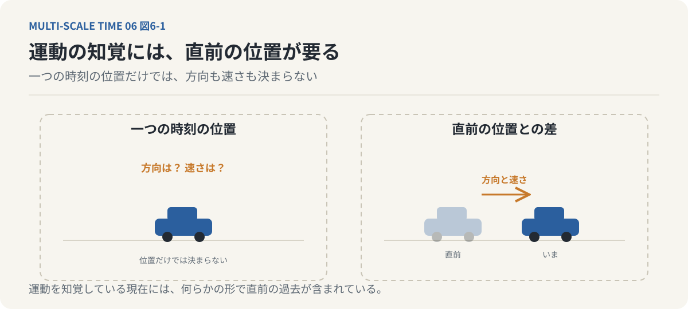
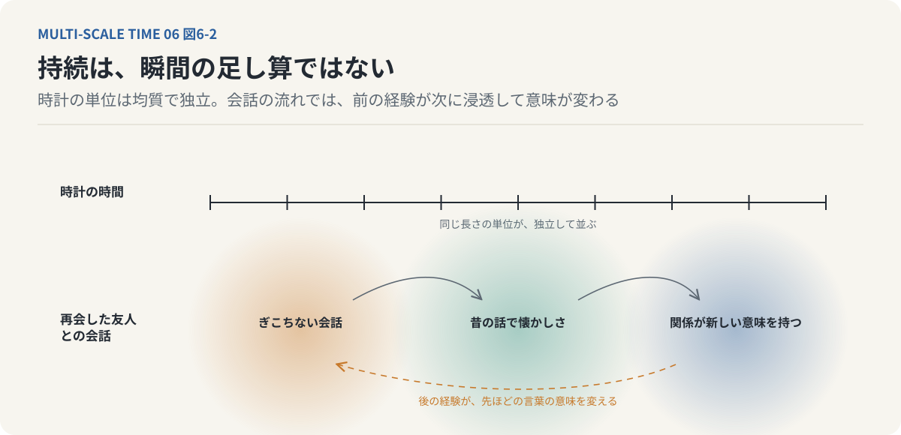
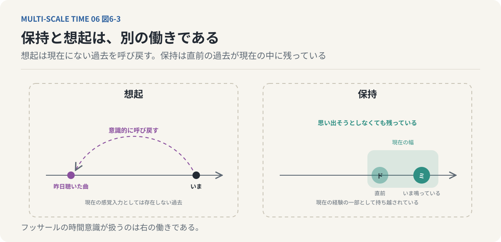
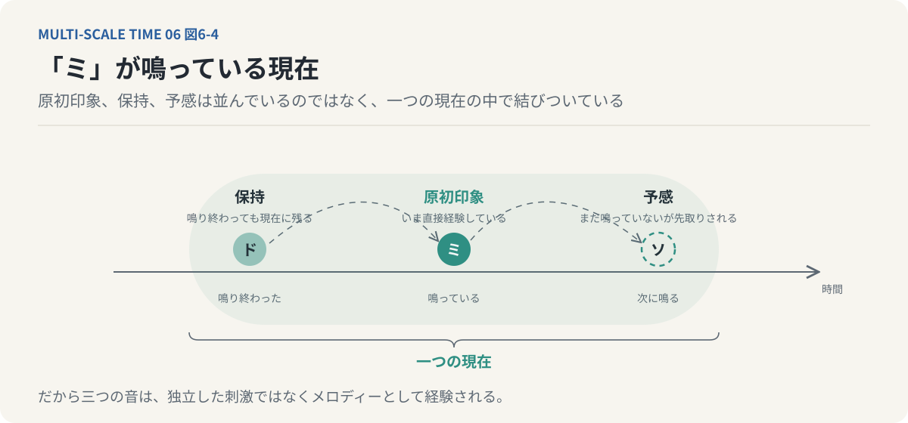
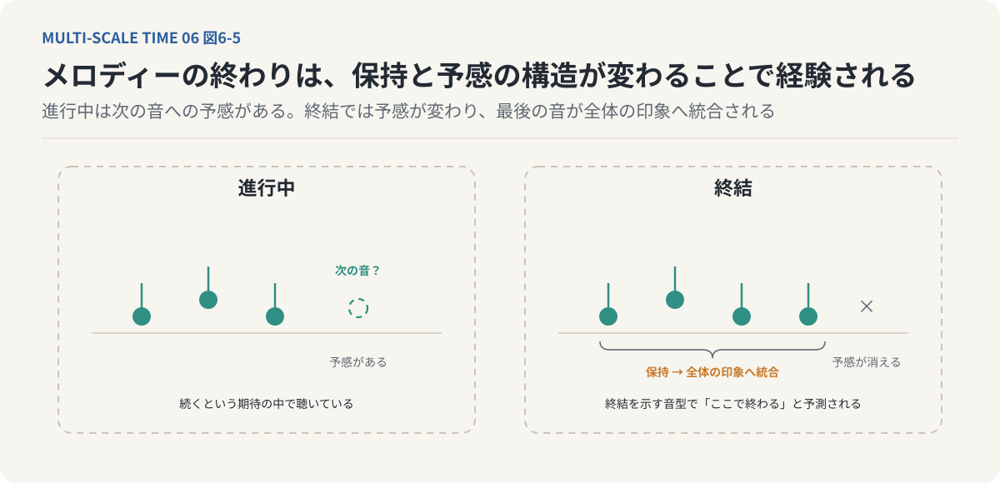
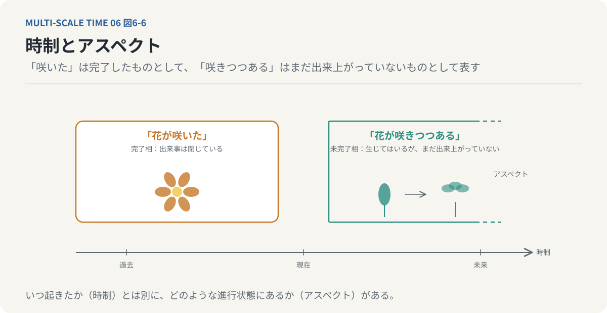
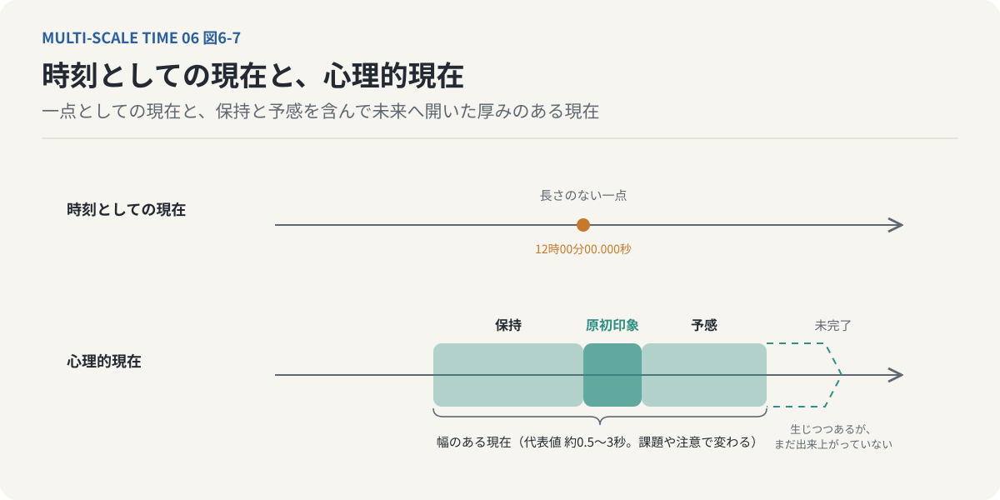
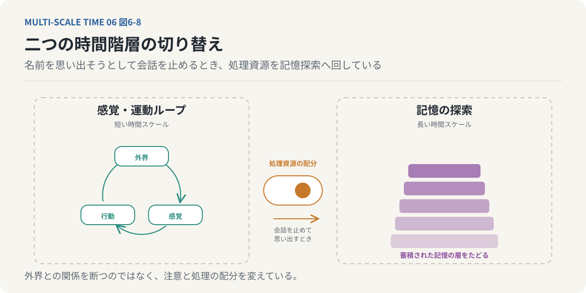

# 第6回　「現在」は、なぜ一瞬ではないのか？

## ベルクソンの持続、フッサールの時間意識、そして未完了の現在

<!-- NAV:TOP -->
[← 第5回](05-mind-is-made-of-memory.md) | [連載目次](../README.md) | [第7回 →](07-embodied-time.md)
<!-- /NAV -->

### 1. 私たちは、どれくらいの長さの「現在」を生きているのか

音楽を聴いているときのことを考えてみよう。

「ド」「ミ」「ソ」という三つの音が、順番に鳴る。

私たちは、この三つの音を独立した出来事として経験するだけではない。

「ド」の次に「ミ」が鳴り、さらに「ソ」が続くことで、一つのメロディーとして聴いている。

しかし、ここには不思議なことがある。

「ソ」が鳴っているとき、「ド」はすでに鳴り終わっている。

物理的には、過去の音である。

それにもかかわらず、私たちは「ド」を完全に失っているわけではない。

その音が直前に鳴ったことを保持しているからこそ、「ミ」や「ソ」をメロディーの一部として経験できる。

では、「ソ」が鳴っている瞬間に、私たちは何を聴いているのだろうか。

現在の「ソ」だけなのだろうか。

それとも、すでに鳴り終わった「ド」や「ミ」も、何らかの形で現在の経験に含まれているのだろうか。

前回は、記憶が現在の知覚を構成していることを考えた。

過去の経験は、単なる保存情報ではない。現在の認識を成立させるために利用されている。

この考え方をさらに進めると、一つの疑問が生まれる。

現在とは、本当に長さのない一瞬なのだろうか。

今回は、現在という時間の構造そのものについて考えてみたい。

### 2. 時計の現在と、経験される現在

時計が示す時刻は、時間軸上の一点として表現できる。

たとえば、12時00分00秒。

さらに細かくすれば、12時00分00.001秒という時刻も指定できる。

数学的には、時間を連続した実数の軸として表現し、その上の任意の一点を現在として扱うことができる。

しかし、私たちが経験する現在は、このような一点とは異なる。

たとえば、目の前を自動車が通過していく場面を考えてみよう。

私たちは、ある時刻に自動車がどこに存在するかを認識するだけではない。

自動車がどちらへ移動しているのか、近づいているのか遠ざかっているのか、どれくらいの速さで走っているのかを感じ取っている。

こうした運動の経験には、時間的に離れた情報の関係が必要である。

ある瞬間の位置だけでは、移動方向や速度は決まらない。

直前の位置との違いがあって初めて、変化を捉えることができる。

つまり、運動を知覚している現在には、何らかの形で過去の情報が含まれている。

*図6-1：運動の知覚には過去の情報が要る。ある時刻の位置だけ（左）では、自動車がどちらへどれくらいの速さで動いているかは決まらない。直前の位置との差（右）があって初めて、方向と速さが捉えられる。運動を知覚する現在には、直前の過去が含まれている。*

このことは、私たちの時間経験が、単一時刻の情報だけでは成立しないことを示している。

ここで、二つの現在を区別しておきたい。

一つは、時計によって指定される「時刻としての現在」である。

もう一つは、私たちが直接経験している「心理的現在」である。

時刻としての現在は、時間軸上の一点として扱える。

一方、心理的現在は、一定の時間幅にわたる情報の統合によって成立する。[^hirai-2022]

この違いを考えることが、時間意識を理解するための出発点となる。

### 3. ベルクソンの「持続」は、瞬間の足し算ではない

第2回では、時間知覚を考えるために「瞬間」と「持続」を区別した。

瞬間とは、個体が内在的に弁別できる最小の時間幅である。

持続とは、個体が連続した変化として経験する時間の流れである。

ここで、ベルクソンの持続という概念を、もう少し丁寧に考えてみよう。[^bergson-essai]

ベルクソンが重視したのは、私たちが内面的に経験する時間が、均質な単位の集まりではないということである。

時計の時間では、ある1秒と次の1秒は、同じ長さの単位として扱われる。

しかし、経験される時間では、各瞬間は完全に独立しているわけではない。

前の経験が次の経験に影響し、次の経験によって前の経験の意味が変わる。

たとえば、久しぶりに友人と再会したときのことを考えてみよう。

最初は少しぎこちない会話だったとしても、昔の出来事を話しているうちに、懐かしさが生まれる。

互いの近況を知ることで、以前の関係が新しい意味を持ち始める。

会話の終わりには、再会した直後とは異なる感情を抱いているかもしれない。

この経験は、個々の発言を時系列に並べただけでは説明しきれない。

会話が進むにつれて、先ほどの言葉の意味が変わり、過去の記憶が呼び起こされ、未来への期待も変化していく。

それらが互いに影響し合い、一つの経験の流れを形成する。

ベルクソンのいう持続は、こうした質的な変化を含む時間である。

*図6-2：持続は瞬間の足し算ではない。時計の時間（上）では各単位は同じ長さで独立している。再会した友人との会話（下）では、ぎこちない会話が昔の話で懐かしさに変わり、近況を知って以前の関係が新しい意味を持つ。前の経験が次に浸透し、質的に変化し続ける。*

重要なのは、持続が単に長い時間を意味するわけではないということである。

1分間であっても、1時間であっても、あるいはもっと短い時間であっても、その経験が互いに浸透し合う連続した流れとして成立しているなら、そこに持続がある。

**持続とは、瞬間を並べたものではなく、過去を含みながら質的に変化し続ける経験なのである。**

### 4. 過去は、現在から完全に消えているのか

ここで、もう一度メロディーの例に戻ろう。

「ド」が鳴り、次に「ミ」が鳴る。

「ミ」を聴いているとき、「ド」はすでに物理的な音としては消えている。

しかし、私たちは「ド」の後に「ミ」が鳴ったという関係を経験している。

この関係がなければ、二つの音は単なる独立した刺激になる。

ここで重要なのは、過去の音が現在に保持されているということである。

ただし、これは必ずしも、過去の音を意識的に思い出しているという意味ではない。

たとえば、昨日聴いた曲を思い出すには、過去の出来事を想起する働きが必要になる。

しかし、いま聴いているメロディーの直前の音については、わざわざ思い出そうとしなくても、現在の経験の一部として残っている。

この二つは異なる。

過去を意識的に思い出すことと、直前の過去が現在の経験に保持されていることは、同じ働きではない。

*図6-3：保持と想起は別の働きである。左の想起は、昨日聴いた曲のように現在にない過去を意識的に呼び戻す。右の保持は、いま聴いているメロディーの直前の音が、思い出そうとしなくても現在の経験の一部として残っている。フッサールの時間意識が扱うのは右である。*

この違いを明確に考えた哲学者の一人が、エトムント・フッサールである。[^husserl-zeit]

フッサールは、私たちがどのように時間の流れを経験しているのかを分析した。

そして、現在の意識には、単に現在の感覚だけでなく、直前の過去の保持と、次に起こることへの予期が含まれていると考えた。

### 5. フッサールの時間意識――保持・原初印象・予感

フッサールの時間意識を考える上で、重要なのが三つの概念である。

「原初印象」「保持」「予感」である。

まず、原初印象とは、いま直接与えられている経験である。

メロディーの最初の「ド」が鳴ったとき、その音は現在の感覚として直接経験される。

次に「ミ」が鳴る。

このとき、「ミ」が原初印象となる。

では、「ド」はどうなるのだろうか。

「ド」はもはや現在鳴っている音ではない。

しかし、完全に意識から消えているわけでもない。

直前に鳴った音として、現在の経験に保持されている。

これが「保持」である。

保持は、過去の出来事をあらためて思い出すこととは異なる。

直前の経験が、現在の意識の中にそのまま持ち越されている働きである。

さらに、私たちは次に鳴る音を予期する。

「ド」「ミ」と続けば、次に「ソ」が鳴るかもしれないと期待する。

もちろん、予期した音が必ず鳴るとは限らない。

意外な音が続くこともある。

それでも、私たちは音楽を聴きながら、次に何が起こるかについて何らかの期待を持っている。

これが「予感」である。

この三つを整理すると、次のようになる。

* 原初印象
    * いま直接経験しているもの
* 保持
    * 直前の過去が現在の経験に残っていること
* 予感
    * 次に生じる出来事をあらかじめ見込むこと

*図6-4：「ミ」が鳴っている現在。中央の「ミ」が原初印象、左の「ド」は鳴り終わっても保持として現在に残り、右の「ソ」は予感として先取りされている。三つは並んでいるのではなく、一つの現在の中で結びついている。*

フッサールの時間意識では、これらは独立して並んでいるのではない。

現在の経験の中で、互いに結びついている。

「ミ」を聴いている現在には、「ド」の保持があり、「ソ」への予感がある。

そのため、私たちは個々の音を一つのメロディーとして経験できる。

**現在とは、原初印象だけで成立するものではなく、過去の保持と未来の予感を含んだ経験なのである。**

### 6. 未来は、まだ存在しないのに現在に影響している

ここで、過去の保持だけでなく、未来の予感にも注目してみたい。

私たちは、まだ起きていない出来事を、どのように経験しているのだろうか。

たとえば、誰かが「今日は大切な話がある」と言ったとする。

その言葉を聞いた瞬間から、私たちは次に何が話されるのかを予測し始める。

良い知らせなのかもしれない。

悪い知らせなのかもしれない。

何かの相談なのかもしれない。

実際に次の言葉が発せられる前から、期待や不安が生じることがある。

まだ起きていない出来事が、現在の経験に影響しているのである。

音楽の場合も同じである。

次にどの音が鳴るかという予感があるからこそ、予想どおりの音が鳴れば安定感を覚え、予想外の音が鳴れば驚きを感じる。

ここで、前々回に扱った生成モデルと予測誤差の議論がつながってくる。

脳は、過去の経験を利用して次の感覚入力を予測する。

現在の入力が予測と異なれば、その差異に応じて内部モデルを更新する。

フッサールの予感と、認知科学における予測処理は、同一の理論ではない。

前者は時間経験の現れ方を記述する哲学的な概念であり、後者は神経情報処理を説明する理論的枠組みである。

しかし、両者は共通した問題を扱っている。

それは、未来がまだ実現していないにもかかわらず、現在の経験が未来への期待によって構成されているという問題である。

現在は、過去の情報を含むだけではない。

まだ実現していない未来の可能性も含んでいるのである。

### 7. 私たちは、メロディーの終わりをどう認識するのか

ここで、少し視点を変えてみよう。

メロディーが連続した経験として成立することは理解できた。

では、私たちはメロディーの「終わり」をどのように認識しているのだろうか。

最後の音が鳴った瞬間に、必ず終わりを確信できるわけではない。

その後に別の音が続く可能性があるからである。

にもかかわらず、私たちは曲の終わりを感じ取ることができる。

そこには、いくつかの働きが関係している。

一つは、予感の変化である。

メロディーの進行中、私たちは次に音が続くことを期待している。

しかし、終結を示す音型やリズムが現れると、次の音への期待が変化する。

音楽的な経験や慣習によって、「ここで終わるだろう」という予測が形成される。

もう一つは、保持の変化である。

最後の音が鳴り終わった後、その音は現在の感覚入力ではなくなる。

しかし、直前の音として保持され、さらにメロディー全体の印象へと統合されていく。

そして、曲が終わったことを振り返ることで、最後の音が全体の結末として位置づけられる。

ここでは、単に音が途切れたという物理的な事実だけでなく、過去の保持と未来の期待の変化が関係している。

さらに、感情的な反応も加わる。

予想どおりに曲が終われば、完結したという感覚が生まれることがある。

予想外の場所で終われば、まだ続きがあるような未完結感が残ることもある。

同じように音が停止しても、その前にどのような流れがあったかによって、終わりの経験は変わる。

ここから、一つの重要なことがわかる。

出来事の終わりは、単に刺激が消失した時点としてではなく、保持と予感の構造が変化することによっても経験される。

*図6-5：メロディーの終わりの経験。進行中（左）は次の音が続くという予感がある。終結を示す音型が現れる（右）と予感が変わり、最後の音は保持されて全体の印象へ統合される。終わりは刺激の消失ではなく、保持と予感の構造の変化として経験される。*

時間の区切りは、時計の上だけに存在するものではない。

私たちの経験の内部にも、始まり、継続、完了という構造が存在しているのである。

### 8. 「生じつつある」という時間

ここで、時間を考えるためのもう一つの概念を導入したい。

「アスペクト」である。[^comrie-1976]

言語では、出来事がいつ起きるかということと、その出来事がどのような進行状態にあるかということを区別できる。

前者を時制、後者をアスペクトと呼ぶ。

時制は、過去・現在・未来といった時間的位置を表す。

一方、アスペクトは、出来事が進行中なのか、完了しているのか、反復しているのかといった性質を表す。

たとえば、次の二つの表現を考えてみよう。

「花が咲いた」

「花が咲きつつある」

前者では、花が咲くという出来事が、完了したものとして表現されている。

後者では、その出来事がまだ進行しているものとして表現されている。

花が咲くという変化は生じている。

しかし、まだ完了していない。

このような状態を「未完了相」と呼ぶ。[^hirai-2024]

未完了相とは、単純に現在進行形と同じ意味ではない。言語によって表現方法も異なる。

ここで重要なのは、「生じてはいるが、まだ出来上がっていない」という出来事の捉え方である。

*図6-6：時制とアスペクト。「花が咲いた」（左）は出来事を完了したものとして、「花が咲きつつある」（右）はまだ完了していないものとして表す。いつ起きたか（時制）とは別に、どのような進行状態にあるか（アスペクト）がある。右の「生じてはいるが、まだ出来上がっていない」捉え方が未完了相である。*

この考え方を、私たちの現在の経験に当てはめてみよう。

いま、私たちは何かを経験している。

しかし、その経験がどのような意味を持つかは、まだ完全には確定していない。

会話の途中では、相手が何を伝えようとしているのかわからないことがある。

話の続きを聞いて、初めて先ほどの言葉の意味が明らかになる。

音楽も同様である。

途中までのメロディーは、次にどの音が続くかによって、異なる意味を持つ。

現在進行中の経験は、まだ完成していないのである。

このような現在の性質を、未完了相という概念から考えることができる。

### 9. 現在は、決定されきっていない領域なのか

ここまでの議論を、前回の「意識の遅延テーゼ」と接続してみよう。

前回は、刺激と反応の間に時間的な余白があることを考えた。

その余白の中で、生物は過去の経験を参照し、複数の行動可能性を評価する。

つまり、ある刺激を受け取った時点では、最終的な行動がまだ確定していない場合がある。

この状態を、決定が完了していない領域として捉えることができる。

今回考えた現在の構造にも、これと似た特徴がある。

現在の経験は、過去の保持によって支えられている。

しかし、次に何が起こるかは、まだ確定していない。

未来への予感は存在するが、その予感が必ず実現するわけではない。

新しい出来事が起きれば、現在の経験の意味も変化する。

ここで、現在を単なる時間軸上の一点としてではなく、過去と未来が相互作用する未完了の過程として捉えることができる。

ただし、経験の意味が未確定であることと、物理的な世界が非決定論的であることは別の問題である。

現在が未完了の経験であるということから、物理的な決定論が否定されるわけではない。

ここでいう「決定されきっていない」とは、私たちの認識や行動選択において、結果がまだ確定したものとして経験されていないという意味である。

この区別は重要である。

現在とは、すでに成立した過去を保持しながら、まだ成立していない未来へ向かって変化し続ける、未完了の経験として捉えられる。

これは、時計の時刻としての現在とは異なる。

時刻としての現在は一点として表現できる。

しかし、経験される現在は、過去の保持と未来の予感を含み、常に変化し続けている。

ここに、心理的現在の時間的な厚みがある。

*図6-7：上の軸では、現在は時刻としての一点である。下の軸では、現在は直前の保持と次への予感を含む幅を持ち、右端は「生じつつあるが、まだ出来上がっていない」未完了相として開いている。厚みは数秒程度を代表値とするが、課題や注意によって変わる。*

### 10. 現在の幅は、何によって決まるのか

ここまで、「現在には幅がある」という考え方を見てきた。

では、その幅はどのくらいなのだろうか。

一つの答えとして、心理的現在には数秒程度の統合時間があるという研究や理論が存在する。[^poppel-1997]

本連載では、平井靖史の整理に従い、意図的に思い出さなくても保持できる時間幅として、約0.5～3秒という尺度を採用する。[^taniguchi-hirai-2021]

ただし、心理的現在の長さが常に一定であるわけではない。

何を知覚しているか、どのような課題を行っているか、注意をどこへ向けているかによって、統合される時間幅は異なる。

音の順序を識別する場合と、会話の意味を理解する場合とでは、必要な時間的な文脈が異なる。

さらに、長い文章を読んでいるとき、私たちは数秒前に読んだ内容だけでなく、数分前に提示された話題も利用して理解を進める。

このように考えると、現在の経験を単一の固定された時間窓で説明することには限界がある。

私たちの認知は、複数の時間尺度にまたがる情報を利用している。

ごく短い時間幅では、感覚情報が統合される。

より長い時間幅では、出来事のまとまりが形成される。

さらに長い時間幅では、過去の記憶や概念が利用される。

つまり、現在の経験は、異なる時間スケールの情報を重ね合わせることで成立している。

ここで、連載全体の中心にある「マルチ時間スケール」という考え方が、少しずつ姿を現してくる。

### 11. 現在を生きながら、過去を探すことはできるのか

ここで、記憶の働きと時間スケールの関係について、もう一つ考えてみたい。

私たちは、何かを深く思い出そうとするとき、目の前の作業を止めることがある。

誰かの名前を思い出そうとして、会話を中断する。

昔の出来事を思い返そうとして、目を閉じる。

考え事をするとき、身体の動きが止まることもある。

なぜだろうか。

その一つの理由として、現在の感覚処理や行動と、記憶の探索が、共通する認知資源を利用していることが考えられる。

外界の変化に対応しながら、同時に深い記憶探索を行うことには限界がある。

そのため、外界への注意を減らし、内部の情報処理へ資源を配分することがある。

本連載では、これを異なる時間階層の切り替えとして考える。[^hirai-2019-slud]

現在の感覚―運動ループは、外界との連続的な相互作用によって維持される。

一方、記憶の探索は、より長い時間にわたって蓄積された情報を扱う。

両者には、扱う時間スケールの違いがある。

現在の行動を一時的に止めることは、外界との相互作用の比重を下げ、過去の記憶へアクセスするための処理を優先することと考えられる。

*図6-8：二つの時間階層の切り替え。外界との感覚・運動ループ（左）は短い時間スケールで続き、記憶の探索（右）はより長く蓄積された情報を扱う。名前を思い出そうとして会話を止めるとき、外界との相互作用の比重を下げ、処理資源を記憶探索へ回している。*

これは、脳が完全に外界との関係を断つという意味ではない。

現在の感覚入力や身体状態の処理を続けながら、注意や情報処理の配分を変えているということである。

ここで興味深いのは、私たちが一つの時間の流れだけを処理しているわけではないということである。

目の前の出来事へ反応する短い時間スケールと、過去の経験を検索する長い時間スケールが、同じ個体の中に存在している。

そして、状況によってその比重が変化する。

私たちが経験する現在は、こうした複数の時間階層の相互作用によって支えられているのかもしれない。

### 12. 現在は、過去と未来が出会う場所である

ここまでの議論を振り返ろう。

時計の現在は、時間軸上の一点として表現できる。

しかし、私たちが経験する現在は、一点ではない。

ベルクソンの持続は、時間経験を独立した瞬間の集合ではなく、質的に変化する連続した流れとして捉える。

フッサールの時間意識は、現在の経験が原初印象、保持、予感によって構成されていることを示す。

そして、未完了相という考え方は、現在を完成した状態ではなく、なお形成されつつある過程として捉える手掛かりとなる。

これらの議論には、共通する特徴がある。

現在は、過去から独立していない。

同時に、未来とも切り離されていない。

過去の保持があるからこそ、私たちは変化を連続したものとして経験できる。

未来への予感があるからこそ、次に起こる出来事に意味を与えることができる。

そして、新しい出来事が起こるたびに、直前の経験の意味が変化していく。

この意味で、現在とは静止した点ではない。

過去を保持し、未来を予期しながら、絶えず更新される動的な過程なのである。

ここで、今回の中心命題を整理しておきたい。

**私たちが経験する現在には、時間的な厚みがある。その厚みは、過去の保持、現在の知覚、未来の予感が相互に結びつくことによって成立している。**

そして、この時間的な厚みは、記憶や予測を利用する生物の情報処理と深く関係している。

ただし、ここまでの議論は、主に意識の中で時間がどのように経験されるかを扱ってきた。

次に考えたいのは、その経験を成立させる主体そのものについてである。

私たちは、脳によって世界を認識している。

しかし、脳だけが独立して世界を経験しているわけではない。

脳は身体の中に存在し、身体は環境の中で活動している。

心拍、呼吸、空腹、痛み、疲労、感情。

こうした身体の状態も、私たちの経験に影響している。

さらに、身体の中では、神経系だけでなく、内分泌系や免疫系など、異なる時間スケールを持つ仕組みが同時に働いている。

では、時間を経験しているのは、脳だけなのだろうか。

それとも、身体と環境の相互作用全体が、時間経験を成立させているのだろうか。

次回は、この問いを考えていきたい。

---

**次回｜第7回「脳だけでは、心も時間も生まれない」**

神経系、内分泌系、免疫系、腸脳相関を通じて、心を身体と環境の相互作用から捉える。

さらに、自由エネルギー原理や自己参照の考え方を手掛かりに、私たちの時間経験が脳内の処理だけでは完結しないことを考える。

## 参考文献・注記

[^bergson-essai]: アンリ・ベルクソン（1889）. [Essai sur les données immédiates de la conscience（『時間と自由』）](https://plato.stanford.edu/entries/bergson/)。持続を、均質な単位の集まりではなく、過去を含みながら質的に変化する経験として捉えた。リンク先はスタンフォード哲学百科事典の項目。
[^husserl-zeit]: エトムント・フッサール（1928）. [Zur Phänomenologie des inneren Zeitbewusstseins（『内的時間意識の現象学』、Husserliana X）](https://doi.org/10.1007/978-94-015-3945-6)。1928年にハイデガーの編集で発表された時間意識講義。原初印象・保持・予感による現在の構成。訳語は本連載の採用で、過去把持・未来予持などの訳もある。リンク先は Husserliana X の出版社ページ。
[^comrie-1976]: Bernard Comrie（1976）. [Aspect: An Introduction to the Study of Verbal Aspect and Related Problems](https://en.wikipedia.org/wiki/Grammatical_aspect)。時制と区別される文法範疇としてのアスペクトの入門書。未完了相を時間経験へ転用する読み方は本連載の解釈である。リンク先は百科事典の項目。
[^poppel-1997]: Ernst Pöppel（1997）. [A hierarchical model of temporal perception](https://doi.org/10.1016/S1364-6613(97)01008-5)。Trends in Cognitive Sciences 1(2)。約3秒の時間窓を心理的現在の統合単位とする階層モデル。本文の「約0.5〜3秒」という尺度はこの系統の研究に対応する。
[^hirai-2022]: 平井靖史（2022）. [世界は時間でできている ── ベルクソン時間哲学入門](https://www.seidosha.co.jp/book/index.php?id=3708)。青土社。ベルクソンの時間哲学を「マルチ時間スケール（MTS）解釈」として再構成した入門書。本連載の骨格 ── 複数の時間スケールの積層、階層0〜3、時間的粗視化（凝縮）、幅のある現在、未完了相、意識の遅延テーゼ ── はこの本に由来する。
[^hirai-2024]: 平井靖史（2024）. [時間とは何か？ ── スケールとアスペクト時間論](https://ndlsearch.ndl.go.jp/books/R000000004-I033297275)。現代思想 52(1), 172–183。時間をスケールとアスペクトの二つの軸で捉える論考。リンク先は国立国会図書館サーチの記事情報。
[^taniguchi-hirai-2021]: 谷口忠大・平井靖史・清田陽司・三宅陽一郎・大内孝子（2021）. [ベルクソン的「時間スケール」を軸に新たな知能と意識の構成可能性を探る［後編］](https://doi.org/10.11517/jjsai.36.5_627)。人工知能 36(5), 627–641（前編は 36(4), 500–511）。約0.5秒の「現在の窓」と約20ミリ秒の要素、気づき・焦点化の時間的な資源配分などが語られる対談。
[^hirai-2019-slud]: 平井靖史（2019）. [記憶・意識・時間：拡張ベルクソン主義の観点から](https://doi.org/10.11517/jsaislud.85.0_S02)。人工知能学会 言語・音声理解と対話処理研究会資料 SIG-SLUD-B803、招待講演。観念システムの階層シフトと展望の時間スケールシフトを扱う。

<!-- NAV:BOTTOM -->
---

[← 第5回](05-mind-is-made-of-memory.md) | [連載目次](../README.md) | [第7回 →](07-embodied-time.md)
<!-- /NAV -->
