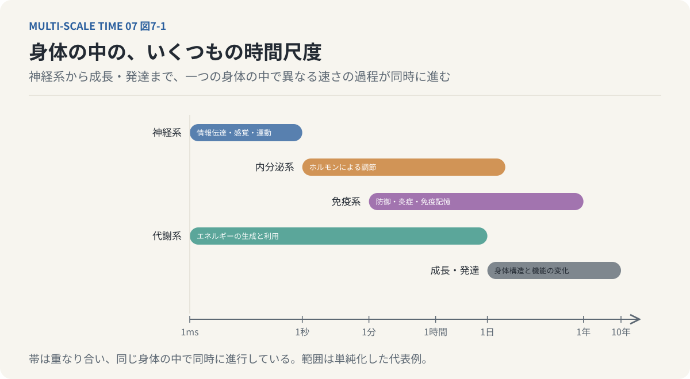
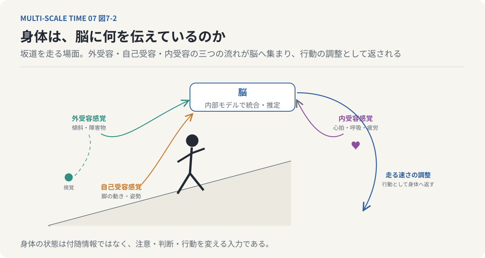
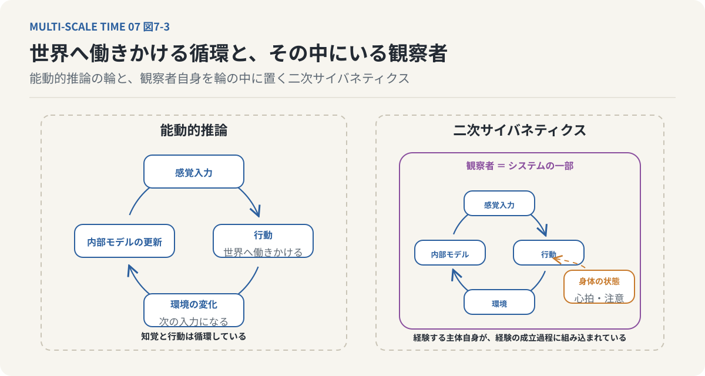

# 第7回　脳だけでは、心も時間も生まれない

## 身体と世界の相互作用が構築する、もう一つの時間

<!-- NAV:TOP -->
[← 第6回](06-the-thickness-of-now.md) | [連載目次](../README.md) | [第8回 →](08-multiple-times-within-us.md)
<!-- /NAV -->

### 1. 時間を経験しているのは、脳だけなのか

緊張しているとき、時間が長く感じられることがある。

大勢の人の前で発表する直前、まだ数分しか経っていないのに、ずいぶん長い時間が過ぎたように感じる。

一方、好きなことに没頭しているときには、数時間が一瞬で過ぎ去ることがある。

こうした時間感覚の変化を、私たちは「脳の働き」として理解しがちである。

もちろん、時間の知覚には脳の活動が深く関わっている。

しかし、緊張しているときに変化しているのは、脳の状態だけではない。

心拍数が増加する。

呼吸が浅くなる。

筋肉が緊張する。

汗をかく。

胃のあたりに不快感を覚えることもある。

こうした身体の変化は、私たちが経験する感情や注意の状態と密接に結びついている。

では、時間感覚を変化させているのは脳なのだろうか。それとも身体なのだろうか。

この問いの立て方自体を見直す必要がある。

脳は身体の外側に存在する装置ではない。

脳は身体の一部であり、身体から絶えず情報を受け取りながら活動している。

さらに身体も、外界から独立した存在ではない。

温度、光、食物、他者の行動など、環境からの影響を受け続けている。

前回は、私たちが経験する現在には時間的な厚みがあり、過去の保持と未来の予感が含まれることを考えた。

今回は、その時間経験を成立させる主体そのものを考えてみたい。

**心や時間経験を理解するには、脳の内部だけでなく、身体と環境の相互作用を考える必要がある。**

### 2. 生物は、世界とつながりながら自分を維持している

生命を考える上で重要なのは、生物が外界から完全に独立しているわけではないということである。

私たちは外界から酸素を取り込み、食物からエネルギーを得て、不要な物質を排出する。

環境からの物質やエネルギーの供給が途絶えれば、生命活動を維持することはできない。

しかし、生物は外界と無制限に混ざり合っているわけでもない。

細胞には膜がある。

その膜によって、細胞の内部と外部が区別される。

細胞膜は、物質の出入りを制御し、内部環境を維持する。

つまり、生物は世界とつながりながら、世界から区別された領域を維持している。

この性質は、生命を理解するための重要な出発点となる。

生物は、外界から完全に切り離されていては生きられない。

一方、外界と区別された内部状態を維持できなければ、生物としての組織を保てない。

**生命とは、世界との相互作用を続けながら、自己の境界と内部状態を維持する過程である。**

この観点から考えると、生物にとっての情報処理には、少なくとも二つの課題がある。

一つは、自分自身の状態を維持することである。

もう一つは、外界の変化を捉え、環境に適応することである。

前者には、免疫系や内分泌系などが重要な役割を持つ。

後者には、神経系が大きく関わっている。

ただし、これらのシステムは明確に分離しているわけではない。

神経系は身体の内部状態を調節し、内分泌系は神経活動に影響を与え、免疫系の活動も脳の状態を変化させる。

生物は、複数の情報処理システムが相互作用することで成立しているのである。

### 3. 神経系・内分泌系・免疫系は、異なる時間で働いている

ここで、時間という観点から三つのシステムを比較してみよう。

神経系は、比較的高速な情報処理を得意とする。

神経細胞は電気的な信号を伝達し、シナプスを介して他の神経細胞へ情報を送る。

その処理には、ミリ秒単位の時間尺度が関係している。

熱いものに触れたときに手を引っ込める反射や、飛んでくる物体に反応する行動は、こうした高速な神経処理によって実現される。

一方、内分泌系は、ホルモンなどの化学物質を利用して身体の状態を調節する。

その作用には、秒から分、時間、場合によっては日単位以上の時間尺度が関係する。

たとえば、ストレスを感じたとき、神経系による速い反応と、ホルモンを介した比較的長い反応が組み合わされる。

免疫系にも、独自の時間尺度がある。

病原体を検出した直後の反応から、数日かけて進行する免疫応答、さらに長期間維持される免疫記憶まで、複数の時間幅で機能している。

これらを整理すると、次のようになる。

| システム | 主な役割 | 時間尺度の例 |
| --- | --- | --- |
| 神経系 | 高速な情報伝達、感覚処理、運動制御 | ミリ秒～秒 |
| 内分泌系 | ホルモンによる身体状態の調節 | 秒～日以上 |
| 免疫系 | 防御、炎症、免疫記憶 | 分～年 |
| 代謝系 | エネルギーの生成と利用 | ミリ秒～日 |
| 成長・発達 | 身体構造や機能の変化 | 日～年 |

これらは各システムの処理範囲を単純化した例であり、厳密に分離された時間区分ではない。

*図7-1：表の五つのシステムを、ミリ秒から年までの対数の時間軸に帯として並べた。神経系は左、成長・発達は右に寄り、免疫系は分から年までの広い幅を持つ。帯は重なり合い、一つの身体の中で同時に進行している。範囲は単純化した代表例である。*

重要なのは、一つの生物の内部で、異なる時間尺度の現象が同時に進行しているということである。

神経系が瞬間的に反応している間にも、ホルモンによる調節は進み、免疫系は身体の状態を監視し、代謝系はエネルギーを供給している。

私たちが一つの身体として存在しているのは、これらの異なる時間尺度の過程が相互に調整されているからである。

ここで、第2回に扱った時間スケールギャップの問題が再び現れる。

異なる時間尺度で動作するシステムは、どのように情報を交換し、互いの状態へ影響を与えているのだろうか。

### 4. 身体は、脳に何を伝えているのか

私たちは、外界を見る、音を聞く、物に触れるといった感覚を、脳への情報入力として考える。

しかし、脳が受け取っている情報は、外界に関するものだけではない。

身体の内部からも、絶えず情報が送られている。

こうした感覚は、大きく三つに区別できる。[^craig-2002]

第一は、外受容感覚である。

視覚、聴覚、触覚など、主に外界の状態を捉える感覚である。

第二は、自己受容感覚である。

身体の姿勢や関節の位置、筋肉の状態などを捉える。

目を閉じていても自分の腕がどこにあるかをある程度把握できるのは、自己受容感覚が働いているためである。

第三は、内受容感覚である。

心拍、呼吸、胃腸の状態、空腹、身体内部の不快感など、身体の生理的な状態を捉える感覚である。

これらの情報は、互いに独立しているわけではない。

たとえば、坂道を走っている場面を考えてみよう。

視覚は地面の傾斜や周囲の障害物を捉える。

自己受容感覚は脚の動きや身体の姿勢を捉える。

内受容感覚は心拍や呼吸、疲労に関する身体状態を伝える。

私たちは、こうした複数の情報を利用しながら、走る速さを調整する。

*図7-2：坂道を走る場面。外受容感覚（傾斜と障害物）、自己受容感覚（脚の動きと姿勢）、内受容感覚（心拍・呼吸・疲労）の三つの流れが脳へ集まり、走る速さの調整として身体へ返される。身体の状態は付随情報ではなく、行動を変える入力である。*

外界の状況だけでなく、身体がどのような状態にあるかによって、行動が変化するのである。

ここで重要なのは、身体の状態が単なる付随情報ではないということである。

身体の内部状態は、何に注意を向け、どのように行動し、何を重要だと判断するかに影響する。

そして、感情の経験にも深く関係している。

### 5. 感情は、身体の状態をどう解釈するかによって変わる

心臓が激しく鼓動しているとする。

そのとき、私たちは何を感じるだろうか。

危険な状況に置かれていれば、恐怖を感じるかもしれない。

好きな人と会う直前なら、期待や緊張を感じるかもしれない。

激しい運動をした直後なら、単に身体が疲れていると理解するだろう。

心拍の増加という身体的な変化が、常に同じ感情として経験されるわけではない。

ここには、身体の状態と、その原因についての解釈が関係している。

感情に関する古典的な理論の一つに、シャクターとシンガーの二要因理論がある。[^schachter-singer-1962]

この理論では、感情の成立に身体的な覚醒と、その状態に対する認知的な解釈が関係すると考える。

関連する有名な研究として、吊り橋実験がある。[^dutton-aron-1974]

揺れる吊り橋の上で生じた緊張や身体的覚醒が、対人場面における感情の解釈へ影響した可能性を示した研究である。

ただし、この実験だけで、すべての感情が二つの要因によって決定されると結論できるわけではない。

感情には、身体状態、過去の経験、環境、社会的な文脈など、多数の要因が関係する。

それでも、ここから重要な視点を得られる。

私たちが経験する感情は、身体からの信号をそのまま受け取ったものとは限らない。

その信号が何を意味するのかについて、脳が推定する過程も関係している。

ここで、第3回の予測処理の議論と接続できる。

私たちは外界について予測するだけでなく、身体内部の状態についても予測している。

心拍が増えた理由は何か。

呼吸が速くなったのはなぜか。

この不快感は何を意味するのか。

身体の信号と内部モデルの相互作用によって、身体状態の認識や感情が形成される。

**心が経験しているのは、外界だけではない。心は、身体そのものを継続的に認識し、解釈しているのである。**

### 6. 私たちの身体には、変化し続ける「基準」がある

身体の状態を考える上で、重要なのがホメオスタシスである。

ホメオスタシスとは、生物が内部環境を一定の範囲に維持する仕組みである。

体温、血糖値、体液の状態など、身体には生命活動を維持するために調節される変数が存在する。

ただし、これらの値が常に一つの固定値に保たれているわけではない。

たとえば、感染症にかかると発熱することがある。

これは単純に体温調節の仕組みが壊れたということではない。

免疫反応に伴い、体温調節の設定値が変化する場合がある。

また、睡眠と覚醒、運動と休息、食事の前後でも、身体の状態は変化する。

つまり、身体は常に同じ状態を維持しているのではない。

変化する環境や内部状態に応じて、調節の目標や方法を変更している。

ここには、過去と未来の情報を利用する仕組みが関係する。

身体は、現在の状態が基準からどれだけ離れているかに応じて反応する。

さらに、今後必要になるエネルギーや、予測される環境の変化に先立って調節を行うこともある。

ここで、ホメオスタシスに加えて、アロスタシスという考え方も重要になる。[^mcewen-1998]

アロスタシスとは、環境や要求の変化に応じて身体の調節を変え、安定を維持するという考え方である。

生物は、現在の状態を修正するだけでなく、将来の必要性を見越して内部状態を調整する。

このように考えると、身体の維持機構にも時間的な構造がある。

現在の身体状態は、過去の変化の結果であり、同時に未来の要求へ向けた調節の途中にある。

身体そのものが、未完了の時間的過程として維持されているのである。

### 7. 腸は、なぜ「第二の脳」と呼ばれるのか

身体と心の相互作用を考える上で、興味深いのが腸である。

腸には、腸管神経系と呼ばれる独自の神経ネットワークが存在する。

腸管神経系は、消化管の運動、分泌、血流などを調節し、脳からの指令がなくても多くの局所的な機能を実行できる。

このため、腸は「第二の脳」と呼ばれることがある。

ただし、これは腸が人間の脳と同じように思考や自己意識を持っているという意味ではない。

消化管の活動を自律的に調節する神経系を備えているという意味である。

さらに腸には、多数の免疫細胞が存在する。

腸管は外界から食物や微生物が入り込む場所でもあり、自己を維持しながら外部の物質と接触し続けなければならない。

腸内には、多様な微生物が生息している。

これらの微生物は、栄養素の代謝や免疫機能、腸管の状態に関係している。

また、腸にはさまざまなホルモンを分泌する細胞が存在する。

消化管の運動、食欲、満腹感などは、神経系と内分泌系の相互作用によって調節される。

セロトニンについても、体内の大部分は消化管で産生される。

ただし、消化管で産生されたセロトニンが、そのまま脳内のセロトニンとして働くわけではない。

血液脳関門などの制約があり、中枢神経系と末梢のセロトニンは区別して考える必要がある。

それでも、腸と脳が双方向に情報を交換していることは重要である。

この関係を、腸脳相関と呼ぶ。[^mayer-2011]

腸と脳は、迷走神経などの神経経路、ホルモン、免疫系を介して相互に影響している。

腸内環境の変化が身体の状態に影響し、その変化が脳の活動や感情、行動に関係する場合がある。

逆に、ストレスなどの脳の状態が腸の運動や分泌を変化させることもある。

ここからわかるのは、心を支える情報処理が脳内で完結していないということである。

身体の内部には、脳とは異なる処理速度や制御機構を持つ複数のシステムが存在し、それらが絶えず相互作用している。

### 8. 身体からの信号は、いつ意識に上るのか

私たちの身体では、膨大な数の信号が絶えず発生している。

しかし、そのすべてが意識されているわけではない。

通常、私たちは胃腸の運動を一つひとつ意識していない。

免疫細胞の活動を直接感じ取ることもない。

心臓が一回拍動するたびに、それを必ず意識しているわけでもない。

ところが、身体の状態が大きく変化すると、突然その存在を強く意識することがある。

激しい空腹を感じる。

胃の痛みに注意が向く。

動悸を感じる。

強い疲労によって、他のことを考えにくくなる。

ここで重要になるのが「サリエンシー」という概念である。[^itti-koch-2001]

サリエンシーとは、ある刺激が他の刺激に比べてどれほど顕著であり、注意を引きつけるかという性質である。

私たちの注意は、すべての情報へ均等に向けられるわけではない。

重要性の高い刺激や予想外の変化が生じると、その情報が優先的に処理されることがある。

身体内部の信号についても同様である。

普段は意識に上らない身体の変化が、状況によっては強い注意の対象となる。

元資料では、このような仕組みを「サリエンス・スレッシュホールド」という概念から説明している。

身体からの信号がある閾値を超えることで、意識的な注意の対象になるという見方である。

ただし、意識化を決定する単一の固定閾値が存在するという意味ではない。

身体信号がどの程度意識されるかは、刺激の強さだけでなく、注意、予測、文脈、過去の経験などにも依存する。

それでも、この考え方は重要である。

身体の内部では常に多くの情報処理が進行している。

その一部が、状況に応じて私たちの意識的な経験に組み込まれる。

つまり、意識は身体内で発生するすべての情報を経験しているわけではない。

身体の状態から、現在の行動や自己維持に関係する情報が選択され、経験されているのである。

### 9. 脳と身体の情報交換は、神経回路だけではない

ここで、情報伝達の仕組みをもう少し広く考えてみよう。

脳の情報処理というと、神経細胞がシナプスを介して電気化学的な信号を伝える仕組みを思い浮かべることが多い。

しかし、神経系の情報伝達は、それだけに限定されない。

脳内では、ノルアドレナリン、セロトニン、ドーパミン、アセチルコリンなどの神経修飾物質が、広い範囲の神経活動を調節している。

これらは、特定の刺激に対する一対一の信号伝達だけでなく、神経回路全体の活動状態に影響を与える。

たとえば、ノルアドレナリンは覚醒や注意の調節に関係する。

ドーパミンは報酬、動機づけ、運動制御などに関係する。

こうした物質の働きによって、同じ感覚入力でも、神経系の応答が異なる場合がある。

さらに、脳内には神経細胞だけでなく、グリア細胞や細胞外スペースが存在する。

アストロサイトは、シナプス周辺の神経伝達物質の濃度や細胞外環境の調整などに関係する。

脳脊髄液や間質液の移動も、脳内環境の維持に関係する。

近年は、脳内の老廃物除去に関わるグリンファティック・システムについても研究が進んでいる。[^iliff-2012]

また、シナプスを直接介さない電気的な相互作用として、エプファティック・コミュニケーションも知られている。[^anastassiou-2011]

こうした仕組みを考えると、脳内の情報処理は、単一の通信方式だけで成立しているわけではないことがわかる。

高速な神経信号が存在する。

比較的広い範囲を調節する神経修飾が存在する。

さらに、細胞外環境や代謝状態の変化が神経活動に影響する。

ここにも、異なる時間スケールを持つ複数の過程が存在する。

そして、それらの相互作用によって、神経系全体の状態が変化している。

脳は、固定された回路が入力を処理するだけの装置ではない。

内部環境の変化によって、自らの情報処理の状態を変え続けるシステムなのである。

### 10. 脳は、世界を予測するだけでなく、世界へ働きかけている

ここまで、身体と脳の相互作用について考えてきた。

しかし、もう一つ重要な関係がある。

それは、身体と外界の関係である。

第3回では、脳が生成モデルを利用して感覚入力を予測することを考えた。

外界から情報を受け取り、予測と照合し、内部モデルを更新する。

しかし、生物は外界を観察しているだけではない。

自ら行動することで、次に得られる感覚入力を変化させることができる。

たとえば、遠くに何かが見えたとする。

それが何なのかわからなければ、近づいて確かめることができる。

角度を変えて見ることもできる。

手で触れて確かめることもできる。

このとき、生物は内部モデルを更新するために、外界との関係そのものを変えている。

このような知覚と行動の関係を考える理論の一つが、自由エネルギー原理である。[^friston-2010]

自由エネルギー原理は、カール・フリストンによって提唱された理論的枠組みであり、生物の知覚、学習、行動を変分自由エネルギーの最小化という観点から説明する。

この理論では、生物は感覚入力に対して内部モデルを更新するだけでなく、自ら行動することで感覚入力を変化させる。

知覚によって世界についての推定を修正する。

学習によって内部モデルを更新する。

行動によって、予測に関係する感覚入力そのものを変える。

こうした考え方は、能動的推論と呼ばれる枠組みにもつながる。

ここで重要なのは、生物の認知を、脳内で完結する受動的な計算として扱わないことである。

生物は身体を通じて世界へ働きかける。

その結果として新しい感覚入力を受け取る。

そして、その情報を利用して内部モデルを更新する。

つまり、知覚と行動は循環している。

**私たちは、世界を認識してから行動するだけではない。行動することによって、認識する世界そのものを変えている。**

### 11. 観察する自分自身も、世界の一部である

ここで、もう一つの理論的な視点を導入したい。

セカンドオーダー・サイバネティクスである。[^von-foerster-2003]

サイバネティクスは、システムの制御や通信、フィードバックを扱う学問として発展した。

初期のサイバネティクスでは、外部から観察するシステムの制御を考えることが多かった。

たとえば、室温を一定に保つ空調システムを考えてみよう。

温度センサーが室温を測定し、設定値との差に応じて冷暖房を調整する。

これはフィードバック制御の一例である。

しかし、生物の認知を考える場合、観察者をシステムの外側に置くだけでは不十分になる。

私たちは、世界を観察する主体であると同時に、その世界の中で行動する存在でもある。

自分自身の行動が環境を変え、その環境の変化が新しい感覚入力となって戻ってくる。

さらに、自分自身の状態についての認識が、その後の行動に影響する。

このような自己参照を含むシステムを考えるための視点が、セカンドオーダー・サイバネティクスである。

この立場では、観察者自身をシステムの一部として扱う。

観察者が世界をどう捉えるかは、その観察者自身の構造や状態に依存する。

そして、その認識に基づく行動が、次の観察条件を変化させる。

*図7-3：左は能動的推論の循環。感覚入力が内部モデルを更新し、行動が環境を変え、変わった環境が次の感覚入力になる。右は観察者をシステムの外に置かず、身体の状態（心拍・注意）ごと輪の中に含めた二次サイバネティクスの見方。時間を経験している主体自身が、その経験の成立過程に組み込まれている。*

これは、私たちの時間経験にも関係している。

たとえば、危険を感じて注意を集中すると、時間が長く感じられることがある。

その注意の状態は、身体の反応や行動を変える。

そして、変化した身体の状態が、再び感情や時間感覚へ影響する。

時間を経験している主体自身が、その経験の成立過程に組み込まれているのである。

### 12. 身体と世界の相互作用には、時間的な内部がある

ここまで考えてきたことを、前回までの議論と接続してみよう。

第4回では、刺激と反応の間に生じる時間的余白が、行動の選択可能性を支えていることを考えた。

第5回では、過去の記憶が現在の知覚を構成していることを考えた。

第6回では、現在が過去の保持と未来の予感を含んだ、未完了の経験であることを考えた。

今回見てきた身体と環境の相互作用も、同じように時間的な構造を持っている。

身体の状態は、過去の生理的な変化によって形成される。

現在の状態は、神経系、内分泌系、免疫系などの相互作用によって維持される。

さらに、身体は未来の環境変化や行動の要求に応じて調節される。

つまり、身体もまた、過去を保持し、現在の状態を維持し、未来へ向けて変化するシステムである。

ただし、身体のあらゆる調節過程が、そのまま意識的な時間経験になるわけではない。

免疫系の活動やホルモンの変化は、多くの場合、直接意識されない。

それでも、これらの過程は、脳の活動状態や感情、注意、行動へ影響する。

そして、それらを通じて主観的な時間経験にも関係する。

ここで重要なのは、脳と身体を別々の装置として扱わないことである。

脳は身体の内部状態を利用して世界を認識する。

身体は脳の活動によって調節される。

さらに、身体と環境の相互作用が、新しい感覚入力を生み出す。

この循環の中で、現在の経験が構成されている。

**時間経験は、脳内で完結した計算の結果としてだけでなく、身体と環境の継続的な相互作用の中で理解する必要がある。**

### 13. 私たちの身体には、いくつもの時間が流れている

最後に、今回の議論を時間スケールという観点から整理してみたい。

私たちの身体では、異なる速さの過程が同時に進行している。

神経細胞の電気的な活動は、ミリ秒単位で変化する。

心拍や呼吸は、秒単位の周期を持つ。

ホルモンの調節は、分や時間の尺度で進行する。

免疫反応は、数日から数週間にわたって変化することがある。

身体の成長や加齢は、年単位の時間を必要とする。

これらは、すべて同じ生物の内部で起きている。

しかも、互いに独立しているわけではない。

短い時間スケールで生じた変化が、長い時間スケールの状態へ影響する。

逆に、長い時間をかけて形成された身体の状態が、瞬間的な反応を変える。

たとえば、長期間の睡眠不足は、翌日の注意や反応速度に影響する。

数日間続く炎症が、現在の疲労感や行動に影響することもある。

長年の運動習慣によって形成された身体の状態が、瞬間的な運動能力を左右することもある。

短い時間と長い時間は、単に並んでいるわけではない。

互いの状態を変化させながら、一つの生命活動を形成している。

ここから、今回の中心的な結論が導かれる。

**私たちの身体には、単一の時間ではなく、複数の時間スケールが同時に存在している。そして、それらの相互作用が、心と時間経験を支えている。**

時間を経験しているのは、脳から切り離された抽象的な主体ではない。

身体を持ち、環境の中で活動し、過去の経験を利用しながら未来へ向かって行動する生物なのである。

### 14. 時間を、一つの流れとして考えることの限界

ここまでの連載では、時間についてさまざまな角度から考えてきた。

第1回では、時計が測る客観的時間と、私たちが経験する主観的時間を区別した。

第2回では、時間知覚には分解能の限界があり、個体ごとに経験できる時間スケールが異なることを考えた。

第3回では、脳が生成モデルを使って世界を再構成し、予測と感覚入力の相互作用によって知覚が成立することを考えた。

第4回では、刺激と反応の間の時間的余白が、行動選択や意識の成立に関係することを考えた。

第5回では、過去の記憶が現在の世界を構成することを考えた。

第6回では、現在には過去の保持と未来の予感が含まれ、時間的な厚みがあることを考えた。

そして今回は、こうした時間経験が脳内の処理だけでは完結せず、身体と環境の相互作用に支えられていることを考えた。

ここまでの議論を並べると、一つの問題が見えてくる。

私たちは普段、時間を一本の線として考えている。

過去から現在へ、現在から未来へと、時間が一方向に流れていく。

しかし、生物の内部で実際に起きていることは、それほど単純ではない。

ミリ秒単位の神経活動がある。

数秒間にわたる知覚の統合がある。

数分から数時間にわたる身体の調節がある。

数日から数年にわたる記憶や学習がある。

さらに、個体の生涯や生物の進化という長い時間尺度も存在する。

これらの時間的な過程は、同じ速度で進行しているわけではない。

そして、互いに影響し合っている。

だとすれば、私たちが経験する一つの連続した時間は、どのように成立しているのだろうか。

異なる時間スケールで進行する複数の過程が、どのように結びつき、一つの「現在」を形成しているのだろうか。

最終回では、この問題を正面から考えたい。

これまで扱ってきた時間知覚、予測、意識、記憶、身体の相互作用を、マルチ時間スケールという一つの枠組みから捉え直す。

そして、連載の最初に提示した問いへ戻る。

時間とは、私たちの外側を一様に流れているものなのだろうか。

それとも、私たちが生きるということ自体が、複数の時間を統合し続ける過程なのだろうか。

---

**次回｜最終回・第8回「私たちの中には、複数の時間が流れている」**

神経活動、知覚、記憶、身体の調節、成長、進化。

異なる時間スケールを持つ現象が、一つの生物の内部で同時に進行している。

それらの階層間で起こる情報の統合、遅延、凝縮、質的な変化を手掛かりに、時間・心・意識を統一的に捉える「マルチ時間スケール」の考え方を提示する。

## 参考文献・注記

[^craig-2002]: A. D. Craig（2002）. [How do you feel? Interoception: the sense of the physiological condition of the body](https://doi.org/10.1038/nrn894)。Nature Reviews Neuroscience 3。内受容感覚を身体の生理状態の感覚として整理し、情動との関係を論じた。
[^schachter-singer-1962]: Stanley Schachter, Jerome E. Singer（1962）. [Cognitive, social, and physiological determinants of emotional state](https://doi.org/10.1037/h0046234)。Psychological Review 69(5)。感情の二要因理論の原著。
[^dutton-aron-1974]: Donald G. Dutton, Arthur P. Aron（1974）. [Some evidence for heightened sexual attraction under conditions of high anxiety](https://doi.org/10.1037/h0037031)。Journal of Personality and Social Psychology 30(4)。いわゆる吊り橋実験。
[^mcewen-1998]: Bruce S. McEwen（1998）. [Stress, adaptation, and disease: Allostasis and allostatic load](https://doi.org/10.1111/j.1749-6632.1998.tb09546.x)。Annals of the New York Academy of Sciences 840。Sterling と Eyer が提案したアロスタシスの概念の整理。
[^mayer-2011]: Emeran A. Mayer（2011）. [Gut feelings: the emerging biology of gut–brain communication](https://doi.org/10.1038/nrn3071)。Nature Reviews Neuroscience 12。腸脳相関の概観。
[^itti-koch-2001]: Laurent Itti, Christof Koch（2001）. [Computational modelling of visual attention](https://doi.org/10.1038/35058500)。Nature Reviews Neuroscience 2。視覚のサリエンシーの計算モデル。身体内部の信号への拡張は本連載の解釈である。
[^iliff-2012]: Jeffrey J. Iliff ほか（2012）. [A paravascular pathway facilitates CSF flow through the brain parenchyma and the clearance of interstitial solutes, including amyloid β](https://doi.org/10.1126/scitranslmed.3003748)。Science Translational Medicine 4(147)。グリンファティック・システムの報告。
[^anastassiou-2011]: Costas A. Anastassiou, Rodrigo Perin, Henry Markram, Christof Koch（2011）. [Ephaptic coupling of cortical neurons](https://doi.org/10.1038/nn.2727)。Nature Neuroscience 14。シナプスを介さない細胞外電場による神経細胞間の相互作用。
[^friston-2010]: Karl Friston（2010）. [The free-energy principle: a unified brain theory?](https://doi.org/10.1038/nrn2787)。Nature Reviews Neuroscience 11。自由エネルギー原理の概説。能動的推論の枠組みにつながる。
[^von-foerster-2003]: Heinz von Foerster（2003）. [Understanding Understanding: Essays on Cybernetics and Cognition](https://doi.org/10.1007/b97451)。Springer。観察者をシステムの一部として扱うセカンドオーダー・サイバネティクスの論集。

<!-- NAV:BOTTOM -->
---

[← 第6回](06-the-thickness-of-now.md) | [連載目次](../README.md) | [第8回 →](08-multiple-times-within-us.md)
<!-- /NAV -->
