# 第8回　私たちの中には、複数の時間が流れている

## マルチ時間スケールから考える、時間・意識・心の成立

<!-- NAV:TOP -->
[← 第7回](07-embodied-time.md) | [連載目次](../README.md)
<!-- /NAV -->

### 1. 私たちは、一つの時間を生きているのだろうか

いま、この文章を読んでいる。目は文字を捉え、脳は言葉の意味を理解し、直前に読んだ内容を保持しながら、次の文章を予測している。その間にも、心臓は拍動し、呼吸は続き、体内では代謝や免疫活動が進行している。数秒前に読んだ文章は、現在の理解に影響している。

数年前に学んだ知識も、文章の解釈に利用されている。そして、この文章を読み終えた後に何を考えるか、何をするかという未来への期待も、現在の経験に入り込んでいる。私たちは、これらを一つの「いま」として経験している。しかし、その内部で進行している過程は、同じ速度で動いているわけではない。

神経細胞の信号伝達はミリ秒単位で進行する。言葉の認識や運動の制御には、数十ミリ秒から数秒程度の時間が関係する。文章の理解には、数秒から数分の文脈が利用される。過去の記憶には、数年から数十年の経験が蓄積されている。

身体の成長や加齢は、さらに長い時間スケールで進行している。つまり、一人の人間の内部には、異なる時間スケールで働く多数の過程が存在している。しかも、それらは独立しているわけではない。短い時間で起きる出来事が、長い時間にわたる変化を生み出す。

反対に、長い時間をかけて形成された構造が、瞬間的な反応を左右する。

では、これほど異なる時間スケールの過程が、なぜ一つの経験として成立するのだろうか。

この問いが、連載を通じて考えてきた問題の中心である。最終回では、これまで扱ってきた時間知覚、意識、記憶、予測、身体の相互作用を、「マルチ時間スケール」という枠組みから統合したい。この枠組みは、平井靖史がベルクソンから再構成した「マルチ時間スケール（MTS）解釈」に由来する。[^hirai-2022]

### 2. 時間は、単一の尺度で記述できるとは限らない

第1回では、客観的時間と主観的時間を区別した。時計が測る時間は、物理現象を共通の尺度で比較するために定義されたもである。一方、主観的時間は、生物が変化を経験することで成立する。同じ1秒であっても、その間に何が起こったと認識できるかは、生物の知覚能力によって異なる。

第2回では、この違いを時間分解能から考えた。速すぎる変化は、個別の出来事として識別できない。遅すぎる変化は、短い観察時間の中では運動として認識できない。つまり、生物には、それぞれ変化を経験できる時間的な範囲がある。

ここから、重要な考え方が導かれた。

**ある現象が瞬間なのか持続なのかは、その現象を経験する個体の時間スケールに依存する。**

これは、客観的な時間の存在を否定するものではない。同じ物理的な時間の中でも、生物によって識別できる変化や、統合できる出来事が異なるということである。さらに、第7回では、一つの生物の内部にも複数の時間スケールが存在することを考えた。神経系、内分泌系、免疫系、代謝系は、それぞれ異なる時間的な特徴を持っている。

一つの個体の内部で、複数の時間的な過程が同時に進行している。

時間スケールを二つの意味で考える必要がある。

一つは、ある現象がどれくらいの速さで進行するかという時間スケールである。

もう一つは、その現象を個体がどのくらいの時間幅で統合し、経験するかという時間スケールである。物理的な時間スケールと、情報処理や経験の時間スケールは、必ずしも一致しない。この違いを踏まえることが、マルチ時間スケールを考えるための出発点となる。

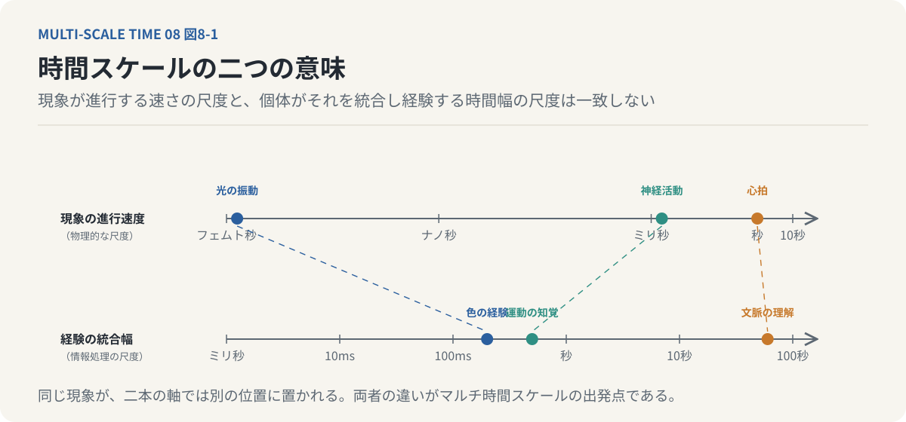

*図8-1：時間スケールの二つの意味。上は現象がどれくらいの速さで進むかという物理的な尺度、下はその現象を個体がどのくらいの時間幅で統合し経験するかという尺度。光の振動や神経活動は、二本の軸で異なる位置に置かれる。*

### 3. 一つの身体の中には、いくつもの時計がある

生物の内部では、異なる時間スケールを持つ過程が並行して動いている。

たとえば、神経細胞の電気的な活動は、ミリ秒単位で変化する。脳波にも複数の周波数帯域が存在する。[^buzsaki-2006]周波数帯域によって、次のように分類されることが多い。

| 帯域 | 周波数 |
| --- | --- |
| デルタ波 | 約0.5〜4Hz |
| シータ波 | 約4〜8Hz |
| アルファ波 | 約8〜13Hz |
| ベータ波 | 約13〜30Hz |
| ガンマ波 | 約30〜100Hz |

これらはそれぞれ異なる神経活動の特徴を表し、睡眠、覚醒、記憶、注意などの状態と関係している。ただし、特定の脳波が単一の認知機能だけを担っているわけではない。複数の神経活動が、異なる時間スケールで相互作用している。また、人間には約24時間周期の概日リズムがある。

睡眠と覚醒、体温、ホルモン分泌などの生理機能は、概日リズムによって調節される。その分子的な仕組みには、CLOCKやBMAL1などの時計遺伝子が関係している。[^takahashi-2017]さらに、身体の成長や発達は数年から数十年の時間をかけて進行する。このような複数の周期や変化の尺度を、一つの個体が同時に持っている。

本連載では、この考え方を「多重時計原理」と呼ぶ。平井靖史のMTS解釈が「複数の時間スケールが縦に積層している」と表現する見方の言い換えである。[^imono-2023]

ここでいう時計とは、必ずしも時刻を計測する装置を意味しない。それぞれのシステムが固有の時間スケールで状態を変化させるということである。

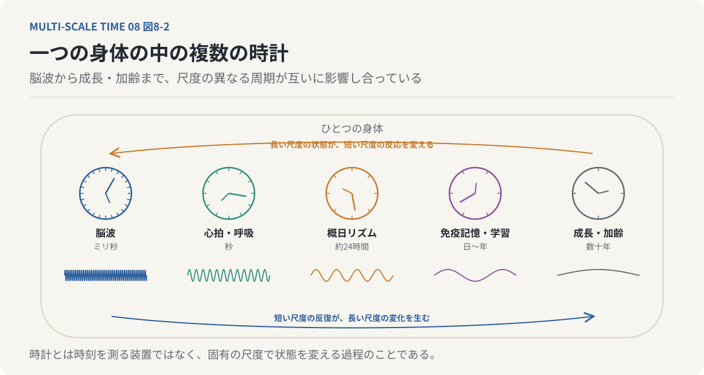

*図8-2：一つの身体の中の複数の時計。左から右へ、脳波（ミリ秒）、心拍と呼吸（秒）、概日リズム（約24時間）、免疫記憶と学習（日〜年）、成長と加齢（数十年）。下向きの矢印は長い尺度の状態が短い尺度の反応を変えること、上向きの矢印は短い尺度の反復が長い尺度の変化を生むことを示す。*

そして重要なのは、これらの時計が互いに無関係ではないことである。睡眠不足によって、翌日の注意や反応速度が変化する。長期間の学習によって、瞬間的な判断が速くなる。身体の成長によって、運動制御の能力が変化する。

長い時間スケールの状態が、短い時間スケールの処理に影響している。逆に、短い時間スケールで繰り返される活動が、長期的な変化を引き起こすこともある。学習による神経回路の変化や、運動習慣による身体機能の変化がその例である。

生物の時間は、単一の時計によって支配されているのではない。**異なる時間スケールで進行する過程の相互作用によって維持されている。**

### 4. 短い時間を積み重ねても、長い時間にはならない

ここで、一つの疑問が生まれる。

短い時間スケールの出来事が多数集まれば、そのまま長い時間スケールの現象になるのだろうか。

たとえば、1ミリ秒の神経活動を1,000回繰り返せば、1秒間の意識経験が成立するのだろうか。

単純にそう考えることはできない。なぜなら、時間的な長さが同じであっても、そこにどのような関係が存在するかによって、成立する現象が異なるからである。音楽を例に考えよう。一つひとつの音符には長さがある。

それらを時間順に並べれば、一定の長さを持つ音の系列になる。しかし、音符を無作為に並べただけでは、必ずしも一つのまとまったメロディーとして経験されるわけではない。音と音の間に、リズム、音程、反復、期待といった関係が形成されることで、メロディーというまとまりが成立する。

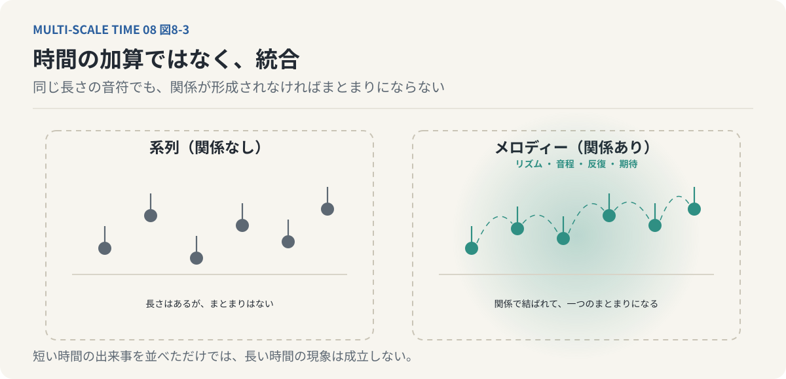

*図8-3：時間の加算ではなく統合。左は音符を無作為に並べた系列で、長さはあってもまとまりはない。右は同じ長さの音符がリズム、音程、反復、期待の関係で結ばれ、メロディーというまとまりになる。短い時間の出来事を並べただけでは、長い時間の現象は成立しない。*

ここで生じているのは、単なる時間の加算ではない。異なる時点の情報が統合され、一つの構造として扱われることである。同じことは、知覚や記憶についても考えられる。短い時間に発生した多数の感覚入力が、統合されることで一つの対象として認識される。

複数の出来事が、一つの経験として記憶される。さらに、複数の経験が結びつくことで、概念や知識が形成される。

ここでは、下位の時間スケールで起きた出来事が、そのまま上位の時間スケールに保存されているわけではない。多数の出来事から特徴や関係が抽出され、より大きなまとまりとして再構成されている。この過程を、時間的な情報の凝縮として考えることができる。

### 5. 時間スケールギャップは、情報を変換する

第2回で扱った蛍光灯の例を思い出してみよう。物理的には、光の強さが高速に変動している。しかし、人間の視覚がその変化を個別に識別できなければ、連続した光として認識される。

ここでは、細かな時間的変動が、より大きな時間スケールでの安定した明るさへと統合されている。このような過程を、時間的粗視化と呼んだ。重要なのは、下位の時間スケールで存在する違いが、そのまま上位の認識に現れるわけではないということである。一部の情報は失われる。

一方で、より大きな時間スケールで安定した特徴が抽出される。

たとえば、個々の点滅は識別できなくなっても、平均的な明るさは認識できる。多数の神経活動の一つひとつを意識しなくても、統合された対象や運動を経験できる。ここには、情報表現の変換がある。

平井靖史は、時間的粗視化によって細かな特徴が失われる一方、新しい質が成立するという考え方を「凝縮説」と呼ぶ。本連載もこの名称に従う。[^hirai-2022]この考え方をマルチ時間スケールへ拡張すると、次のような仮説が生まれる。異なる時間スケールの間では、情報が単純に伝達されるだけではない。

下位の時間スケールで起きた多数の変化が、上位の時間スケールで一つのまとまりとして統合される。その結果、上位の時間スケールでは、下位の個別要素とは異なる性質が成立する。ただし、ここでいう新しい性質は、必ずしも主観的な意識を意味しない。

たとえば、平均的な明るさや滑らかな運動の表現が成立することと、それらを主観的に経験することの間には、なお説明すべき問題が残る。それでも、時間スケール間で情報の表現形式が変化するという点は重要である。

**マルチ時間スケールにおける階層間の関係は、単なる時間の積み重ねではなく、情報の選択・凝縮・再構成として理解できる。**

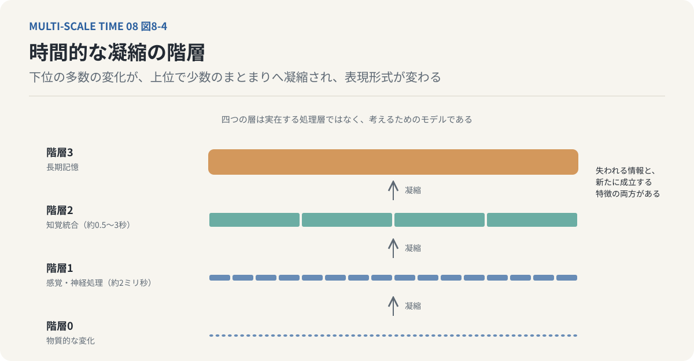

*図8-4：時間的な凝縮の階層。下の階層0（物質的な変化）では多数の細かな変動があり、階層1（約2ミリ秒の感覚・神経処理）、階層2（約0.5〜3秒の知覚統合）、階層3（長期記憶）へ上がるごとに、多数の変化が少数のまとまりへ凝縮される。失われる情報と、新たに成立する特徴の両方がある。四つの層は脳に実在する固定的な処理層ではなく、考えるためのモデルである。*

### 6. 意識は、時間スケールの間に生まれるのか

ここで、第4回の意識の遅延テーゼに戻ろう。[^bergson-mm][^hirai-2019]ベルクソンの思想を時間的な観点から捉えると、意識の成立には、刺激と反応の間に生じる時間的な余白が重要な役割を持つ。外界から刺激を受けたとき、常に一つの反応が固定的に生じるだけではない。刺激を内部で処理し、過去の記憶を参照し、複数の行動可能性を評価する。

この時間的な内部が、柔軟な行動選択を可能にする。処理の時間スケールに注目しよう。感覚器官からの入力は、比較的短い時間スケールで変化する。一方、記憶や行動計画は、それより長い時間スケールの情報を利用する。

現在の刺激を過去の経験と照合するためには、異なる時間スケールの情報を同じ処理の中で扱わなければならない。ここには、時間的な保持が必要になる。直前の情報を保持しなければ、次の情報と比較できない。長期的な記憶を利用できなければ、過去の経験に基づく判断もできない。

異なる時間スケールの情報を統合するための処理が、刺激と反応の間に介在する。この観点から、遅延を単なる応答時間の増加としてではなく、異なる時間スケールを接続するための構造として捉えることができる。

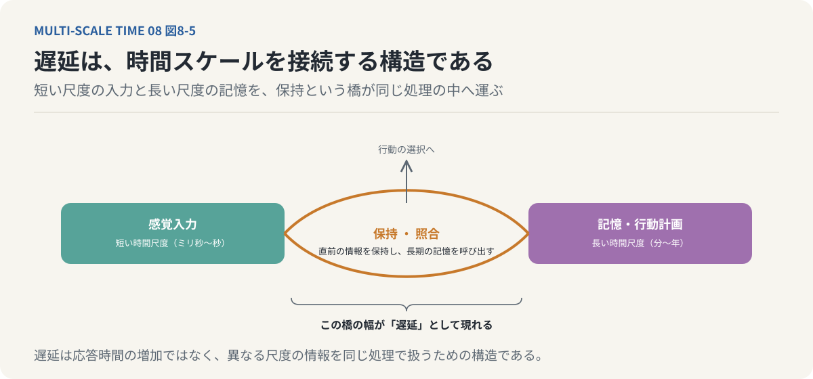

*図8-5：遅延は時間スケールを接続する構造。感覚入力は短い尺度で変化し、記憶や行動計画は長い尺度の情報を使う。現在の入力を過去と照合するには、直前の情報を保持し、長期の記憶を呼び出す「橋」が要る。この橋の幅が、刺激と反応の間の遅延として現れる。*

平井靖史は、こうした時間的な内部が、感覚質、時間経験、注意の焦点化などの成立条件となるという仮説を示している。本連載もこの仮説に立つ。[^taniguchi-hirai-2021]もちろん、時間的な遅延が存在するだけで意識が生まれると証明されているわけではない。複数の時間スケールを統合するシステムが、すべて主観的な経験を持つわけでもない。

それでも、意識を理解するためには、単一の瞬間に起きる神経活動だけでなく、異なる時間スケールの処理がどのように結びつくかを考える必要がある。

ここから、今回の連載全体を貫く仮説を提示できる。

**意識の成立には、異なる時間スケールで進行する情報処理が相互作用する構造が重要なのではないか。**その構造は、過去の情報を現在へ保持しながら、未来の行動可能性を形成する。

意識とは、静止した一点に存在するものではなく、複数の時間的な過程が統合され続ける中で成立する現象として捉えられるのである。

### 7. 記憶は、時間スケールを拡張する

第5回では、「心は過去でできている」という考え方を扱った。現在の知覚は、外界からの感覚入力だけでは成立しない。過去の経験から形成された記憶や内部モデルを利用することで、対象を認識し、意味を理解し、未来の行動を選択できる。

記憶を時間スケールの観点から捉え直そう。ある出来事が一瞬で終わったとしても、その出来事に関する情報は、より長い時間にわたって保持される場合がある。

たとえば、一瞬だけ見た顔を、数分後に思い出せることがある。数分間の会話を、数年後まで覚えていることもある。ある経験が、その後の人生の判断に長く影響する場合もある。

ここでは、短い時間スケールで成立した経験が、長い時間スケールの情報として利用されている。

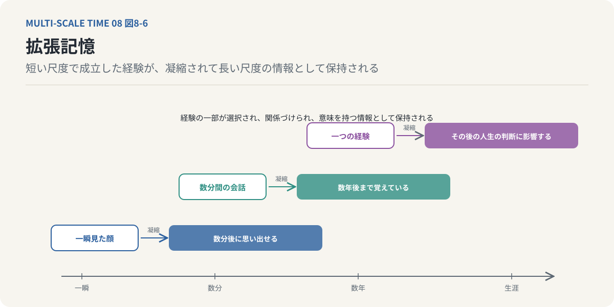

*図8-6：拡張記憶。一瞬見た顔は数分後に思い出せ、数分の会話は数年後まで残り、一つの経験はその後の人生の判断に長く影響する。短い尺度で成立した経験が、選択され、関係づけられ、意味を持つ情報として長い尺度に保持される。*

これを、本連載では「拡張記憶」という概念から捉える。平井靖史の純粋記憶のマルチ時間スケール解釈の言い換えである。[^hirai-2026-ajp]拡張記憶とは、上位の時間階層が下位の時間的な出来事を凝縮し、保持するという考え方である。

たとえば、平井靖史に従って、次のような階層を仮定できる。[^imono-2023]

- 階層0：物質的な変化
- 階層1：ミリ秒単位の感覚・神経処理
- 階層2：数秒程度の知覚統合
- 階層3：より長期にわたる記憶

この階層構造は、脳に実在する四つの固定的な処理層を示すものではない。異なる時間スケールの情報処理を考えるためのモデルである。

ここでは、階層1の代表値として約2ミリ秒、階層2として約0.5〜3秒を取り上げる。これらの間には、およそ数百倍から千倍程度の時間スケールの差がある。さらに、長期記憶まで考えると、その隔たりは何桁にも及ぶ。

ここで重要なのは、情報が時間スケールを超えて利用されるということである。数ミリ秒の感覚入力そのものが、数十年にわたって同じ形式で保存されるわけではない。経験の一部が選択され、関係づけられ、意味を持つ情報として保持される。さらに、新しい経験によって更新される。

こうして短い時間の出来事が、長い時間の認知構造に影響する。そして、長期間かけて形成された記憶が、次の瞬間の知覚や行動を変える。記憶は、異なる時間スケールを結びつける仕組みなのである。

### 8. 私たちは、過去を現在の中に持ち込んでいる

ここで、第6回に扱った「現在には幅がある」という考え方を思い出してみよう。フッサールの時間意識では、現在の経験は原初印象、保持、予感によって構成される。[^husserl-zeit]現在の感覚入力だけでなく、直前の過去が保持され、次に起こることへの期待が含まれる。一方、ベルクソンの持続は、過去が現在に浸透しながら質的に変化し続ける時間の流れを表している。

これらの考え方をマルチ時間スケールから捉え直すと、現在とは、異なる時間スケールの情報が同時に利用される場として理解できる。目の前の音を聴く。直前の音を保持する。過去に学習したメロディーの構造を利用する。

次の音を予測する。こうした働きが重なり合うことで、一つの音楽経験が成立する。このとき、現在の経験を構成している情報は、すべて同じ時点に由来するわけではない。現在の感覚入力がある。

直前の過去がある。さらに遠い過去の記憶がある。そして、まだ実現していない未来への予測がある。これらが、現在の経験の中で相互作用している。

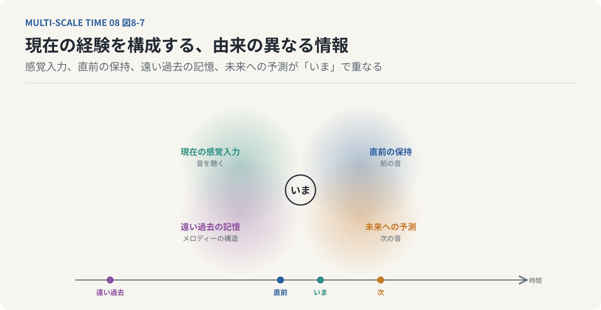

*図8-7：現在の経験を構成する情報は、同じ時点に由来しない。中央の「いま」には、現在の感覚入力（音を聴く）、直前の保持（前の音）、遠い過去の記憶（学習したメロディーの構造）、未来への予測（次の音）が重なっている。時間スケールの異なる情報が、現在の認知と行動のために組み合わされている。*

つまり、私たちが経験する現在とは、単一の時間スケールに閉じた状態ではない。異なる時間スケールで形成された情報が、現在の認知や行動のために組み合わされている状態である。

ここから、もう一つ重要なことがわかる。過去は、単に現在の背後へ消え去るものではない。過去に形成された情報が、現在の内部状態として残り続ける。そして、その内部状態が、次の現在の成立に影響する。

私たちは過去を離れて現在を生きているのではない。**過去によって形成された状態として、現在を生きている。**

### 9. 現在は、常に完成していない

しかし、現在が過去によって構成されているとしても、それだけでは時間経験を十分に説明できない。なぜなら、私たちは過去の情報を再生しているだけではないからである。現在の感覚入力によって、過去の記憶や内部モデルは絶えず更新される。そして、未来の出来事を予測し、その予測に基づいて行動を変える。

第6回の未完了相という考え方が重要になる。未完了相とは、「生じつつあるが、まだ完了していない」という出来事の捉え方である。現在の経験も、同じような性質を持つ。いま進行している会話は、まだ終わっていない。

次にどのような言葉が続くかによって、それまでの発言の意味が変化することがある。いま進行している行動も、まだ結果が確定していない。

次に何が起こるかによって、現在の判断が適切だったかどうかが変わる。私たちは、過去の情報を利用して未来を予測する。しかし、その予測は必ずしも実現しない。予想外の出来事が起これば、内部モデルを更新する。

その更新によって、新しい行動可能性が生まれる。ここに、現在を未完了の過程として捉える理由がある。ただし、経験や判断が未完了であることから、物理的な世界の非決定論が導かれるわけではない。

ここで扱っているのは、私たちが未来をまだ確定した出来事として経験していないということである。現在とは、過去によって制約されながらも、未来へ向けて更新され続ける状態である。この構造は、記憶と予測を持つ生物の時間経験を考える上で重要である。

### 10. なぜ楽しい時間は、あっという間に過ぎるのか

ここで、連載の最初に挙げた疑問へ戻ってみよう。

なぜ楽しい時間は短く感じられ、退屈な時間は長く感じられるのだろうか。

この問題は、単に時計の進み方を誤って推定しているというだけではない。時間の評価には、注意、感情、身体の状態、記憶などが関係している。[^block-zakay-1997]

たとえば、楽しい活動に没頭しているとき、注意は時間そのものではなく、活動の内容へ向けられていることが多い。そのため、活動中には時間の経過をあまり意識しない。一方、待ち時間のように、時間の経過そのものへ注意が向けられる場面では、経過時間が長く感じられることがある。しかし、活動を終えた後に振り返ると、異なる評価が生まれる場合がある。

新しい経験が多く、詳細な記憶が残っている出来事は、後から振り返ると長く感じられることがある。逆に、同じような出来事の繰り返しで記憶の区別が少ない期間は、振り返ると短く感じられる場合がある。つまり、体験中の時間感覚と、記憶から振り返った時間の長さは、同じ仕組みで決まるとは限らない。

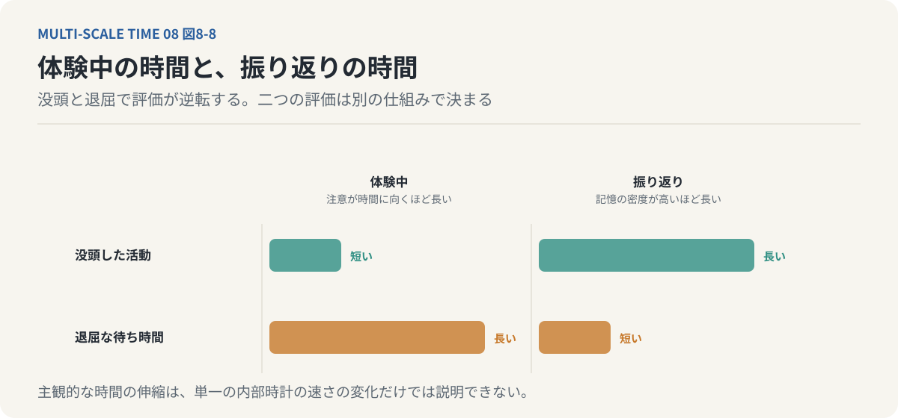

*図8-8：体験中の時間と、振り返りの時間。没頭した活動は体験中は短く感じるが、新しい経験と詳細な記憶が多いので振り返ると長い。退屈な待ち時間は体験中は長いが、記憶の区別が少ないので振り返ると短い。二つの評価は別の仕組みで決まる。*

ここでも、異なる時間スケールの情報処理が関係している。現在の注意によって評価される時間。出来事のまとまりによって構成される時間。長期記憶から再構成される時間。

これらは、互いに関係しながらも、異なる働きを持つ。さらに、情動や身体の覚醒状態も、時間の知覚や記憶に影響する。強い恐怖を感じた出来事が、実際より長く感じられることもある。しかし、そのような変化が必ずしも体験中の時間処理速度の変化を意味するわけではない。

後から思い出すときの情報量や解釈が、時間評価に影響する可能性もある。このように考えると、主観的な時間の伸縮は、単一の内部時計が速くなったり遅くなったりする現象としてだけでは説明できない。

**私たちの時間感覚は、異なる時間スケールで働く注意、感情、記憶、予測の相互作用によって変化する。**

### 11. 時間経験は、どこに存在するのか

ここまで考えてくると、一つの根本的な問いが生まれる。

時間経験は、脳のどこに存在するのだろうか。

脳の中に、現在という時間を直接計測する一つの装置があるのだろうか。

時間の推定には、基底核、小脳、補足運動野、前頭前皮質、海馬など、複数の脳領域が関係している。しかし、それらが一つの中央時計に従ってすべての時間経験を生み出していると考える必要はない。時間の長さを推定すること。出来事の順序を識別すること。

運動のタイミングを調整すること。過去の出来事を思い出すこと。未来を予測すること。これらは、時間に関係する働きでありながら、異なる神経機構や認知過程を利用している。

そして、脳の活動も身体の状態から独立しているわけではない。心拍、呼吸、ホルモン、免疫活動、睡眠などが、神経活動や認知状態に影響している。さらに、生物は環境に働きかけ、その結果として新しい感覚入力を受け取る。つまり、時間経験を考える際には、脳の内部だけを切り出すことに限界がある。

これは、意識の神経基盤が存在しないという主張ではない。時間経験を成立させる神経機構を理解するには、身体や環境との相互作用も含めて考える必要があるということである。

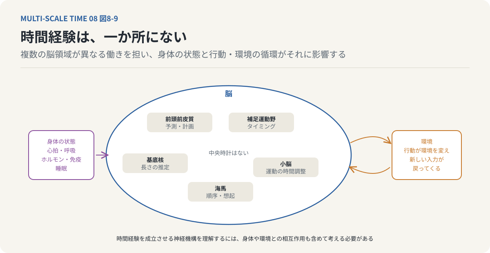

*図8-9：時間経験は一か所にない。時間の推定には基底核、小脳、補足運動野、前頭前皮質、海馬など複数の領域が関わり、それぞれ異なる働き（長さの推定、順序、タイミング、想起、予測）を担う。脳の活動は心拍・呼吸・ホルモンなど身体の状態と、行動と環境の循環からも影響を受ける。*

第7回の自己参照と能動的推論の議論がつながる。生物は世界を観察するだけではない。自ら行動することで、次に経験する世界を変える。そして、その経験によって内部モデルが更新される。

更新された内部モデルが、次の知覚や行動を変える。この循環が続くことで、現在の経験が構成されている。時間経験を、こうした循環する過程として捉えることができるのである。

### 12. マルチ時間スケールという時間哲学

ここまでの議論から、マルチ時間スケールという考え方を、次のように整理できる。

第一に、生物の内部には、複数の時間スケールで進行する過程が存在する。神経活動、感覚知覚、運動、記憶、身体の調節、成長、発達などである。

第二に、それらの時間スケールは相互に影響している。短い時間の出来事が長期的な状態を変え、長期的な状態が瞬間的な反応を左右する。

第三に、異なる時間スケールの間では、情報の凝縮と再構成が起こる。微細な変化の一部が失われる一方、より大きなまとまりとして利用できる特徴が形成される。第四に、生物は過去の情報を保持し、未来を予測することで、現在の行動を選択する。現在の経験には、複数の時間スケールの情報が含まれている。

第五に、主観的な時間は、こうした情報処理の構造に制約されている。人間が経験できる変化の速さや、出来事を統合できる時間幅には限界がある。そして第六に、意識や心を理解するには、この複数の時間スケールの相互作用を考える必要がある。これが、今回の連載を通じて提示したい「マルチ時間スケール」の基本的な考え方である。[^hirai-2026-kodansha][^hirai-2023-bloomsbury]

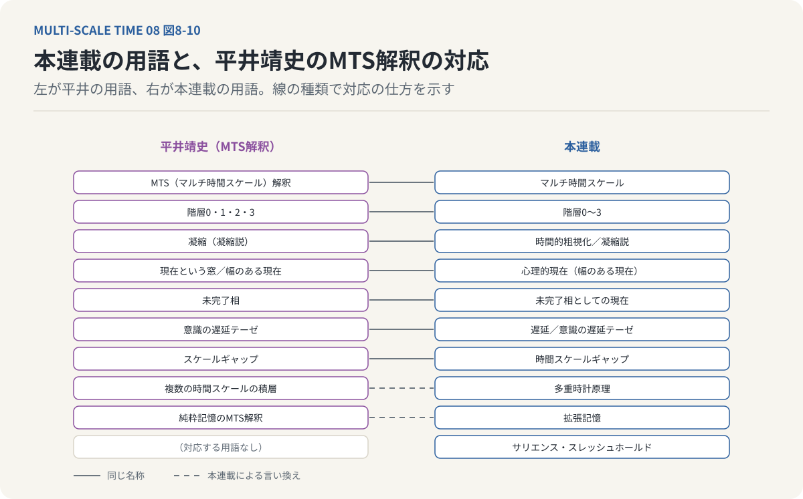

*図8-10：本連載の用語と、平井靖史のマルチ時間スケール（MTS）解釈の用語の対応。実線は同じ名称をそのまま使うもの、破線は本連載による言い換え。多重時計原理はMTS解釈の「複数の時間スケールの積層」、拡張記憶は純粋記憶のMTS解釈、時間スケールギャップは階層間のずれにあたる。*

時間を一つの均質な流れとしてだけ捉える必要はなくなる。物理的な時間は共通の尺度で記述できる。しかし、生物がその時間の中で何を経験し、どのように行動するかは、その個体が持つ情報処理の時間的構造に依存する。その構造は、複数の時間スケールの相互作用によって成立している。

**私たちが経験する一つの時間の流れは、複数の時間的な過程が統合され続けることで成立しているのではないか。**

これが、マルチ時間スケールから見た時間経験の中心仮説である。

### 13. 時間とは、何なのだろうか

最後に、連載の最初の問いへ戻ってみよう。

時間は、本当に流れているのだろうか。

この問いに対して、物理学、哲学、認知科学は、それぞれ異なる問題を扱っている。物理学では、時間は出来事の順序や間隔、物理法則による変化を記述するために用いられる。哲学では、時間の存在や方向性、過去・現在・未来の関係が問われる。認知科学では、生物が時間をどのように知覚し、推定し、記憶するのかが研究される。

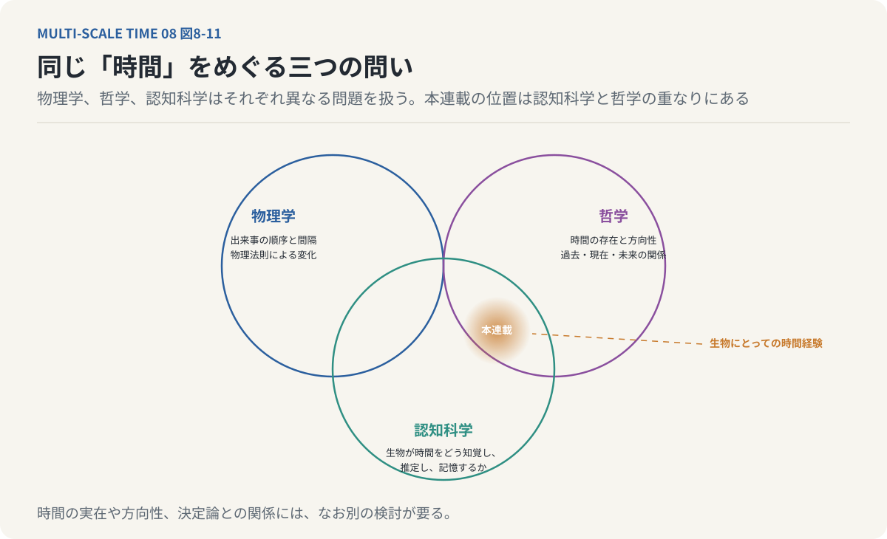

*図8-11：同じ「時間」をめぐる三つの問い。物理学は出来事の順序や間隔、法則による変化を記述し、哲学は時間の存在や方向性、過去・現在・未来の関係を問い、認知科学は生物が時間をどう知覚し、推定し、記憶するかを研究する。本連載が扱ったのは、認知科学と哲学の重なりにある「生物にとっての時間経験」である。*

今回の連載で中心的に扱ったのは、このうち生物にとっての時間経験である。私たちは、客観的に測定される時間を、そのまま内面で経験しているわけではない。限られた時間分解能の中で外界の変化を捉え、過去の記憶を利用し、未来を予測しながら、現在の経験を構成している。その経験は、身体と環境の相互作用に支えられている。

さらに、身体の内部では、異なる時間スケールの過程が同時に進行している。こうした事実と理論を踏まえると、主観的な時間を、世界から独立した一本の時計として考える必要はない。むしろ、時間を経験するとは、生物が過去の情報を保持し、現在の変化を統合し、未来へ向けて行動することと深く関係している。ただし、ここから物理的な時間の本質がすべて明らかになるわけではない。

時間が実在するのか。

時間がなぜ一方向に進むのか。

物理的な決定論と時間の関係はどうなっているのか。

こうした問いには、なお別の検討が必要である。今回得られたのは、それらの問いへの最終的な回答ではない。時間について考えるための、もう一つの視点である。

### 14. 私たちは、時間の中で生きているだけではない

この連載を始めた理由の一つは、私たちが時間的な変化を捉え、設計する能力に乏しいのではないかという疑問だった。私たちは、出来事を整理するとき、時刻や日付を使う。予定表を作り、期限を設定し、進捗を管理する。これらは、客観的時間を利用した有効な方法である。

しかし、そこで扱われているのは、主として出来事がいつ起こるか、どのくらい続くかという情報である。実際の人間の認知や行動は、それほど単純ではない。何かを理解するには、それまでに蓄積された経験が関係する。新しい行動を選択するには、未来の結果を予測する必要がある。

学習には、短い時間の反復と長い時間の蓄積が関係する。身体の状態は、数分前の出来事だけでなく、数日間の睡眠や数年間の生活習慣にも影響される。そして、ある瞬間の判断が、数年後の行動や価値観を変えることもある。短い時間と長い時間は、互いに独立しているわけではない。

それぞれの時間スケールで起きた変化が、別の時間スケールへ影響し続けている。このような構造を考えると、時間的な変化を理解するとは、単に出来事を時系列に並べることではないとわかる。異なる時間スケールの間で、何が保持され、何が失われ、何が新しく形成されるのかを考える必要がある。そして、その変化が次の行動や経験へどのように影響するのかを考える必要がある。

これは、個人の認知だけでなく、学習、組織、社会など、より大きなシステムを考える上でも重要な視点となり得る。短期的には合理的な行動が、長期的には望ましくない結果を生むことがある。逆に、短期的には成果が見えない行動が、長期的には大きな変化を生み出すこともある。異なる時間スケールの相互作用を理解しなければ、こうした現象を十分に捉えることは難しい。

マルチ時間スケールという考え方は、時間を一つの単位で測るだけでなく、異なる速度で進む過程の関係として理解するための手掛かりとなる。そして最後に、連載全体の結論を一つの言葉にまとめたい。

私たちは、単に時間の中で生きているのではない。**過去を保持し、現在を構成し、未来を予測することで、自らの時間経験を生み出し続けている。**

その経験は、単一の時計によって生まれるものではない。瞬間的な神経活動から、長年にわたる記憶や身体の変化まで、異なる時間スケールの過程が相互に作用することで成立している。私たちの中には、複数の時間が流れている。そして、その複数の時間が重なり合うところに、私たちが「いま」と呼ぶ経験がある。

---

### 連載を終えて

時間について考え始めてから、ずいぶん長い時間が経った。それでも、時間が何なのかを完全に説明できたわけではない。しかし、最初に抱いていた疑問は、少し違った形に変わったように思う。時間は本当に流れているのか、と問うことから始めた。

いまは、私たちが時間の流れを経験できるのはなぜなのか、という問いに強く関心が向いている。時計は時間を測る。しかし、時計が時間を経験するわけではない。生物は、外界の変化を捉え、過去を保持し、未来を予測しながら行動する。

その過程で、時間は単なる数値ではなく、経験されるものとなる。そして、その経験の成立には、複数の時間スケールの相互作用が関係している。この考え方が、意識や心を理解するための十分な説明になっているわけではない。まだ多くの仮説と未解決の問題が残っている。

それでも、時間を一つの流れとして捉えるだけでは見えてこなかった問題が、そこにはある。異なる時間スケールの間に生じる遅延。情報の凝縮。記憶による過去の保持。

予測による未来の構成。そして、それらが絶えず相互作用することで成立する現在。時間について考えることは、結局のところ、私たちがどのように世界を経験しているのかを考えることなのかもしれない。

**時間とは何かという問いは、私たちはどのように生きているのかという問いへつながっている。**

（全8回・完）

### 全8回を通じた論理の到達点

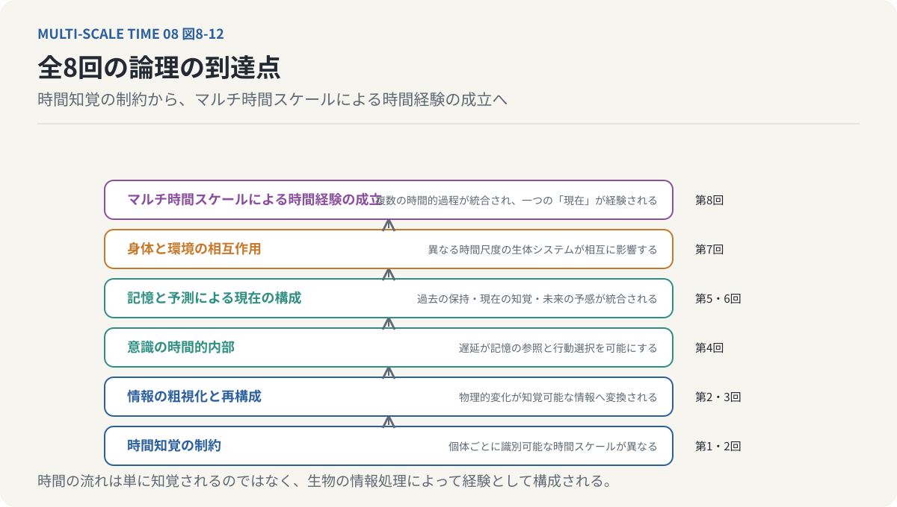

*図8-12：全8回の論理の到達点。下から、時間知覚の制約（第1・2回）、情報の粗視化と再構成（第2・3回）、意識の時間的内部（第4回）、記憶と予測による現在の構成（第5・6回）、身体と環境の相互作用（第7回）、そしてマルチ時間スケールによる時間経験の成立（第8回）へと積み上がる。*

- **時間知覚の制約** ── 個体ごとに識別可能な時間スケールが異なる
- **情報の粗視化と再構成** ── 物理的変化が知覚可能な情報へ変換される
- **意識の時間的内部** ── 遅延が記憶の参照と行動選択を可能にする
- **記憶と予測による現在の構成** ── 過去の保持・現在の知覚・未来の予感が統合される
- **身体と環境の相互作用** ── 異なる時間スケールの生体システムが相互に影響する
- **マルチ時間スケールによる時間経験の成立** ── 複数の時間的過程が統合され、一つの「現在」が経験される

## 参考文献・注記

[^buzsaki-2006]: György Buzsáki（2006）. [Rhythms of the Brain](https://doi.org/10.1093/acprof:oso/9780195301069.001.0001)。Oxford University Press。脳波帯域と、複数の時間スケールで相互作用する神経振動の概観。本文の周波数帯域の数値は一般的な分類に基づく。
[^takahashi-2017]: Joseph S. Takahashi（2017）. [Transcriptional architecture of the mammalian circadian clock](https://doi.org/10.1038/nrg.2016.150)。Nature Reviews Genetics 18。CLOCK、BMAL1 などの時計遺伝子による概日リズムの分子機構。
[^bergson-mm]: アンリ・ベルクソン（1896）. [Matière et mémoire（『物質と記憶』）](https://plato.stanford.edu/entries/bergson/)。刺激と反応の間の不確定の余地、過去が現在に浸透する持続。「意識の遅延テーゼ」は平井靖史（2019）の用語。リンク先はスタンフォード哲学百科事典の項目。
[^husserl-zeit]: エトムント・フッサール（1928）. [Zur Phänomenologie des inneren Zeitbewusstseins（『内的時間意識の現象学』、Husserliana X）](https://doi.org/10.1007/978-94-015-3945-6)。原初印象・保持・予感による現在の構成。リンク先は Husserliana X の出版社ページ。
[^block-zakay-1997]: Richard A. Block, Dan Zakay（1997）. [Prospective and retrospective duration judgments: A meta-analytic review](https://doi.org/10.3758/BF03209393)。Psychonomic Bulletin & Review 4。体験中の時間評価と振り返りの時間評価が異なる要因に左右されることを示したメタ分析。
[^hirai-2022]: 平井靖史（2022）. [世界は時間でできている ── ベルクソン時間哲学入門](https://www.seidosha.co.jp/book/index.php?id=3708)。青土社。ベルクソンの時間哲学を「マルチ時間スケール（MTS）解釈」として再構成した入門書。本連載の骨格 ── 複数の時間スケールの積層、階層0〜3、時間的粗視化（凝縮）、幅のある現在、未完了相、意識の遅延テーゼ ── はこの本に由来する。
[^imono-2023]: 鋳物美佳（2023）. [書評　平井靖史著『世界は時間でできている──ベルクソン時間哲学入門』](https://doi.org/10.51086/sfjp.28.0_360)。フランス哲学・思想研究 28, 360–363。階層0〜3の積層、スケールギャップ、凝縮、幅のある現在、未完了相、階層3による質的な保存を要約した書評。
[^hirai-2019]: 平井靖史（2019）. [「スケールに固有」なものとしての時間経験と心の諸問題 ── ベルクソン〈意識の遅延テーゼ〉から](https://www.kinokuniya.co.jp/f/dsg-01-9784326102778)。森田邦久編『〈現在〉という謎 ── 時間の空間化批判』勁草書房、205–224頁。「意識の遅延テーゼ」という名称の出所。リンク先は書店の書籍ページ。
[^taniguchi-hirai-2021]: 谷口忠大・平井靖史・清田陽司・三宅陽一郎・大内孝子（2021）. [ベルクソン的「時間スケール」を軸に新たな知能と意識の構成可能性を探る［後編］](https://doi.org/10.11517/jjsai.36.5_627)。人工知能 36(5), 627–641（前編は 36(4), 500–511）。約0.5秒の「現在の窓」と約20ミリ秒の要素、気づき・焦点化の時間的な資源配分などが語られる対談。
[^hirai-2026-ajp]: Yasushi Hirai（2026）. [A multi-timescale interpretation of Bergson's theory of pure memory](https://doi.org/10.1007/s44204-026-00446-4)。Asian Journal of Philosophy 5(2)。純粋記憶の保存を、長い時間スケールに保持された経験が短い尺度の経験と同時に存在することとして解釈する。本連載の「拡張記憶」はこの見方の言い換えである。
[^hirai-2026-kodansha]: 平井靖史（2026）. [はじめてのベルクソン ── 時間をひらく哲学](https://www.kodansha.co.jp/book/products/0000430491)。講談社現代新書。『試論』から『二つの源泉』までを順にたどる入門書。
[^hirai-2023-bloomsbury]: Yasushi Hirai, ed.（2023）. [Bergson's Scientific Metaphysics: Matter and Memory Today](https://doi.org/10.5040/9781350342002)。Bloomsbury。『物質と記憶』を現代の諸科学と接続して読み直す英語論集。

<!-- NAV:BOTTOM -->
---

[← 第7回](07-embodied-time.md) | [連載目次](../README.md)
<!-- /NAV -->
